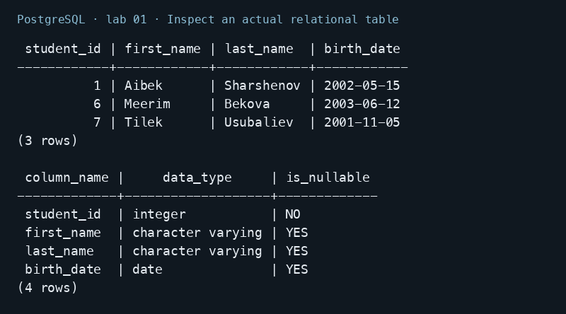

# Lab 01 — Introduction to Relational Databases

AUCA Databases (COM-424.1) · Nikita Nosov

Source: [Introduction to Relational Databases](https://docs.google.com/document/d/1cBOWJijltzRnv3gMqgB5YpzooXFgAG_y/edit)

The first handout introduces database concepts rather than assigning a separate programming exercise. This report summarizes those concepts and relates them to the PostgreSQL tables used in the later labs.

## 1. Database and DBMS

A **database** is an organized collection of data. A **database management system (DBMS)** is the software that stores it, accepts queries, manages permissions, and coordinates changes. PostgreSQL is the DBMS used in these labs; lab11_psql is one database managed by it.

**CRUD** means create, read, update, and delete data. SQL expresses these operations with statements such as INSERT, SELECT, UPDATE, and DELETE. CREATE TABLE defines a table rather than inserting a record.

## 2. Relational terminology

| Term | Meaning in the course examples |
| --- | --- |
| Table | A collection of records about an entity, such as students |
| Row | One student record |
| Column | A typed attribute, such as first_name or birth_date |
| Primary key | One or more columns that uniquely identify a row and cannot be NULL |
| Foreign key | An enforced reference to a candidate key in another or the same table |
| Schema | A database namespace, such as public; the word also describes a model's structure |
| Query | A request to retrieve or manipulate data |
| Index | A lookup structure that can help selected access patterns, with storage and write costs |
| Normalization | Organizing entities and dependencies to reduce duplication and update anomalies |

## 3. Relationships and normalization

- **One to one:** a user and an optional profile. A unique foreign key or shared primary key prevents multiple profiles for one user.
- **One to many:** a department and its employees. Each employee references one department; the department can have several employees.
- **Many to many:** students and courses. An enrollment table stores the student/course pairs and their attributes, such as semester and grade.

Keeping a department name in one department row avoids repeating and independently changing that name in every employee record. Joining through keys reconstructs the related information. Normalization depends on the actual data dependencies; merely splitting tables is not sufficient.

## 4. SQL and NoSQL

Relational systems organize data into relations and commonly expose SQL. NoSQL describes several other models, rather than one universal replacement:

| Model | Main organization | Examples named in the handout |
| --- | --- | --- |
| Document | Documents with nested fields and arrays | MongoDB, CouchDB |
| Key-value | A key addresses a value | Redis, DynamoDB |
| Wide-column | Partitioned rows with column families | Cassandra, HBase |
| Graph | Nodes and relationships | Neo4j, ArangoDB |

Choose a system by relationships, transaction requirements, query patterns, consistency, and distribution needs. SQL systems can scale horizontally, and some NoSQL systems support transactions. Schema flexibility and consistency guarantees depend on the product and configuration. Wide-column databases are not the same as analytical column-oriented storage.

**BASE** describes basically available, soft state, and eventual consistency. It is a distributed-system design approach, not a rule that every NoSQL database must follow.

## 5. ACID and PostgreSQL

| Property | Meaning for a bank transfer |
| --- | --- |
| Atomicity | The debit and credit both commit or both roll back |
| Consistency | The transaction respects the defined constraints and business rules |
| Isolation | Concurrent operations follow the guarantees of the selected isolation level |
| Durability | A successfully committed transaction survives according to the configured durability guarantees |

PostgreSQL grew out of the Berkeley POSTGRES project. It supports relational queries, transactions, foreign keys, indexes, JSON data, and extensibility. It is open source. MySQL is another server-based relational DBMS; SQLite is embedded; Oracle Database is a server-based commercial system with multiple editions and licensing options. None is universally best: deployment constraints and the workload determine the choice.

PostgreSQL features are described in its [official introduction](https://www.postgresql.org/docs/18/intro-whatis.html).

## 6. Inspect an actual relational table

```sql
SELECT student_id, first_name, last_name, birth_date
FROM students ORDER BY student_id;
SELECT column_name, data_type, is_nullable
FROM information_schema.columns WHERE table_name = 'students'
ORDER BY ordinal_position;
```

This read-only illustration uses the existing lab11_psql database from Lab 11. It returns three rows: Aibek, Meerim, and Tilek. student_id is an integer primary key, and birth_date is a date. The image is a readable PNG rendering of the actual psql output; no new rows were added for this illustration.



## Conclusion

A relational design stores entities in typed tables, identifies rows with keys, and enforces relationships with constraints. SQL retrieves and changes those records, while transactions coordinate related changes. The later labs apply these concepts in PostgreSQL.
