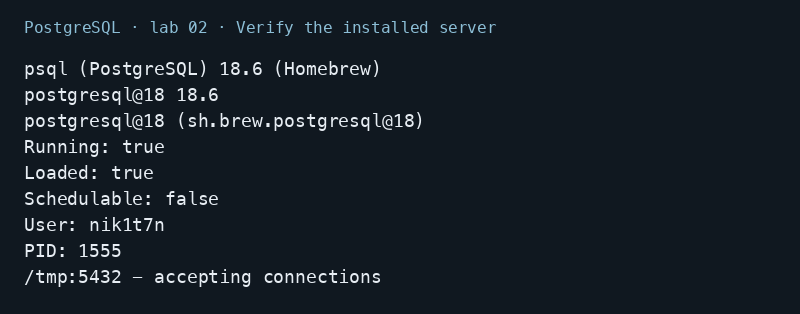
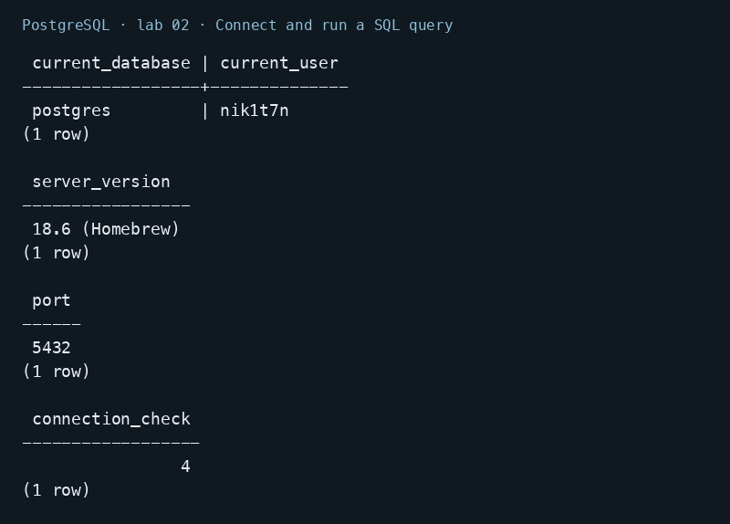
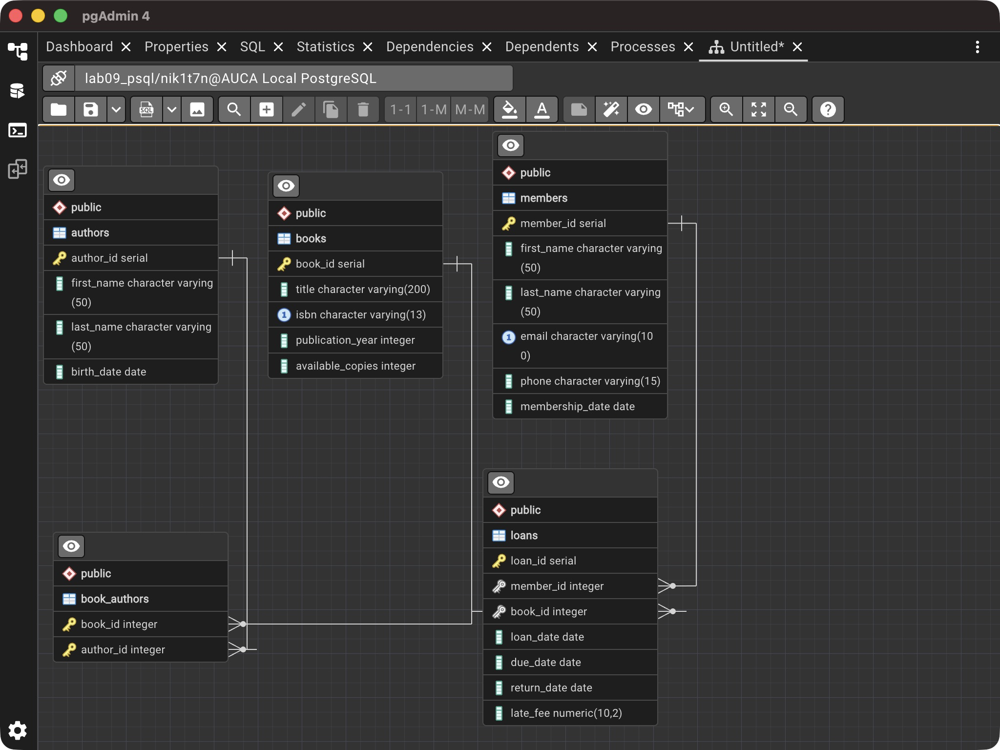

# Lab 02 — Installing PostgreSQL and pgAdmin

AUCA Databases (COM-424.1) · Nikita Nosov

Source: [Installing PostgreSQL and pgAdmin](https://docs.google.com/document/d/1mHYboT9R0GPQhKh9muFf2Tv6AL_HQzws/edit)

This report documents the working macOS setup used by the other labs: Homebrew PostgreSQL 18.6 and pgAdmin 4 9.18. Both applications were already installed, so I verified and used that installation.

## Installation commands for macOS

The handout uses Homebrew. These are the commands for the installed PostgreSQL major version:

```bash
brew install postgresql@18
brew services start postgresql@18
brew install --cask pgadmin4
```

The @18 suffix selects PostgreSQL 18 explicitly. These are setup instructions; the checks below inspect the existing installation. Homebrew is listed among the [official macOS installation options](https://www.postgresql.org/download/macosx/).

## 1. Verify the installed server

```bash
psql --version
brew list --versions postgresql@18
brew services info postgresql@18
pg_isready
```

The client and Homebrew package report PostgreSQL 18.6. The Homebrew service is running under nik1t7n, and pg_isready reports that port 5432 accepts connections.



Open the command-line client:

```text
psql postgres
```

Homebrew uses the macOS account name for the initial role, so this installation connects as nik1t7n. The connection uses the existing local authentication configuration. Passwords are not included in the report. If a password needs to be set for a password-authenticated setup, psql provides the interactive command `\password nik1t7n`.

## 2. Connect and run a SQL query

```sql
SELECT current_database(), current_user;
SHOW server_version;
SHOW port;
SELECT 2 + 2 AS connection_check;
```

The connection selected postgres as the database and nik1t7n as the role. The server reports version 18.6 and port 5432. The calculation returned 4, confirming that SQL executes through the connection.



## 3. Open pgAdmin and connect to the local server

In pgAdmin, a local server is registered through **Register → Server**. The General tab provides a display name, and the Connection tab provides the database connection settings.

| Field | Local setup |
| --- | --- |
| Name | AUCA Local PostgreSQL |
| Host name/address | localhost |
| Port | 5432 |
| Maintenance database | postgres |
| Username | nik1t7n |

The installed pgAdmin opened with the existing AUCA Local PostgreSQL registration and its lab09_psql connection. The screenshot shows the Connected indicator and the database's tables in the ERD tool.



The fields are described in the [pgAdmin Server Dialog documentation](https://www.pgadmin.org/docs/pgadmin4/9.18/server_dialog.html).

## Conclusion

PostgreSQL is running locally, psql executes SQL successfully, and pgAdmin opens the registered course database. The setup is ready for the subsequent database labs.
