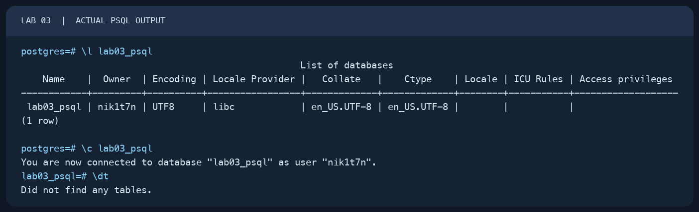
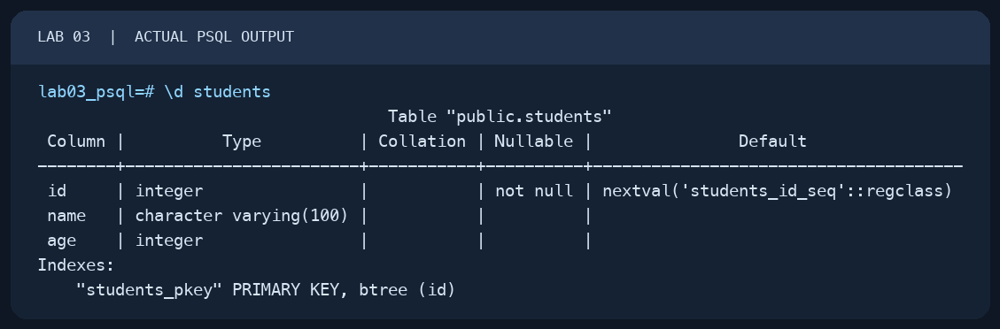
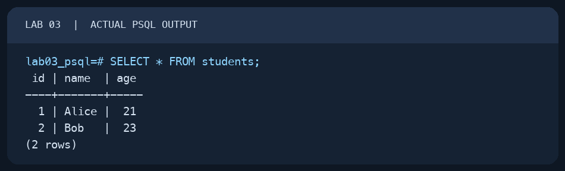
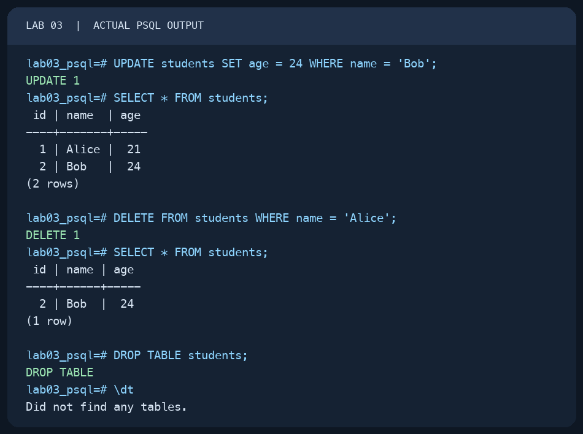

# Lab 03 — Basic psql Commands

AUCA Databases (COM-424.1) · Nikita Nosov

Source: [Basic psql Commands](https://docs.google.com/document/d/1jPfbRCXJYQPcMFPMhifz3LVRFjCeswUB/edit)

This report records commands and results from PostgreSQL 18.6 on macOS. The images below are readable PNG renderings of actual `psql` terminal output.

## 1. Open psql and connect to the lab database

I opened the existing `postgres` database with a simple Terminal command and created a separate database for the lab. I then listed it and connected to it.

```text
psql postgres
```

```sql
CREATE DATABASE lab03_psql;
```

The creation result was `CREATE DATABASE`. These commands confirmed the database and showed that it contained no tables:

```text
\l lab03_psql
\c lab03_psql
\dt
```



## 2. Create and inspect a table

I used the `students` table from the handout. `SERIAL` generates the ID, and `PRIMARY KEY` makes it the row identifier.

```sql
CREATE TABLE students (
    id SERIAL PRIMARY KEY,
    name VARCHAR(100),
    age INT
);
```

PostgreSQL replied `CREATE TABLE`. `\dt` listed `students`, and `\d students` showed its three columns and primary key.

```text
\dt
\d students
```



## 3. Insert and read the handout's rows

```sql
INSERT INTO students (name, age) VALUES ('Alice', 21), ('Bob', 23);
SELECT * FROM students;
```

The insert reported `INSERT 0 2`. The query returned Alice with ID 1 and age 21, and Bob with ID 2 and age 23.



## 4. Practice UPDATE and DELETE

These two operations extend the handout's example. I changed only Bob's age, checked the rows, deleted only Alice, and checked again.

```sql
UPDATE students SET age = 24 WHERE name = 'Bob';
SELECT * FROM students;
DELETE FROM students WHERE name = 'Alice';
SELECT * FROM students;
```

The outputs were `UPDATE 1` and `DELETE 1`. The final query returned only Bob, aged 24.

## 5. Remove the example table

The handout ends by dropping `students`. I then checked that no tables remained.

```sql
DROP TABLE students;
```

```text
\dt
```

PostgreSQL replied `DROP TABLE`, followed by `Did not find any tables.`



## 6. Get help and exit

I also ran `\h SELECT` to see SQL help, `\?` to list psql commands, and `\q` to leave psql.

The database `lab03_psql` remains, while its example table was removed as directed by the handout.
