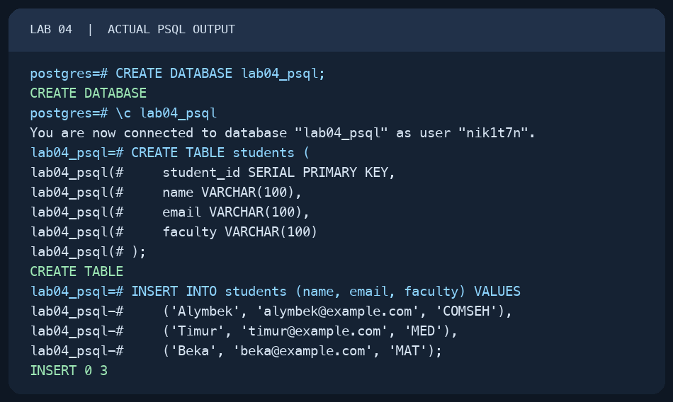
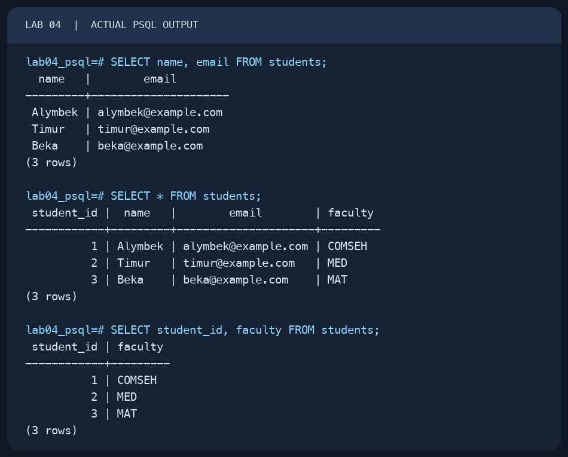
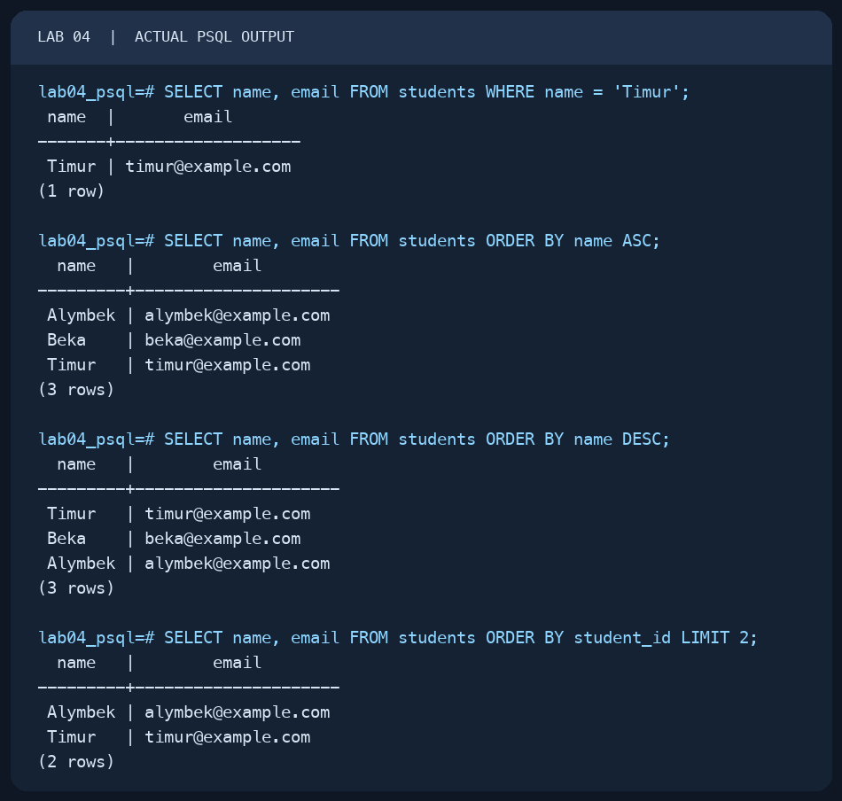
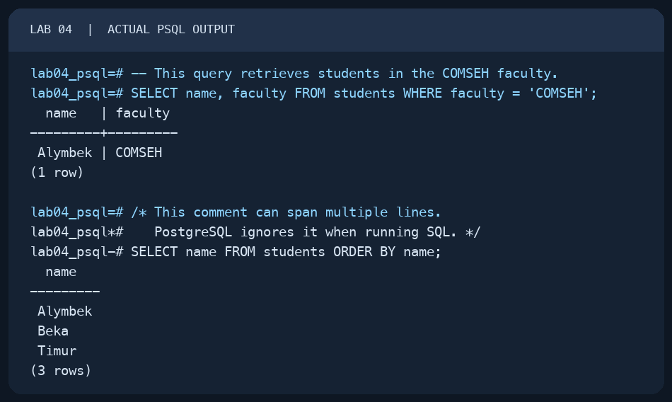

# Lab 04 — First SQL Query

AUCA Databases (COM-424.1) · Nikita Nosov

Source: [First SQL Query](https://docs.google.com/document/d/10qSdz8lve4SAzF0mLsQW1yG2oGQPK1aX/edit)

This report records a local PostgreSQL 18.6 session. The images are readable PNG renderings of actual `psql` terminal output. The handout's Alymbek, Timur, and Beka rows were used so its queries could run against a real table.

## 1. Prepare a table for the queries

Lab 03 removed its `students` table, and that table did not have the `email`, `faculty`, or `student_id` columns used here. I therefore created a separate database and a table with the columns needed by this handout.

```text
psql postgres
```

```sql
CREATE DATABASE lab04_psql;
```

```text
\c lab04_psql
```

```sql
CREATE TABLE students (
    student_id SERIAL PRIMARY KEY,
    name VARCHAR(100),
    email VARCHAR(100),
    faculty VARCHAR(100)
);

INSERT INTO students (name, email, faculty) VALUES
    ('Alymbek', 'alymbek@example.com', 'COMSEH'),
    ('Timur', 'timur@example.com', 'MED'),
    ('Beka', 'beka@example.com', 'MAT');
```

PostgreSQL returned `CREATE DATABASE`, `CREATE TABLE`, and `INSERT 0 3`.



## 2. Run the first SELECT queries

`SELECT` chooses columns and `FROM` names the table. The first query returned names and email addresses; the second returned every column; the third returned IDs and faculties.

```sql
SELECT name, email FROM students;
SELECT * FROM students;
SELECT student_id, faculty FROM students;
```

All three queries returned three rows. The generated IDs were 1 for Alymbek, 2 for Timur, and 3 for Beka.



## 3. Filter, sort, and limit results

`WHERE` selected Timur and returned one row. `ORDER BY name ASC` returned Alymbek, Beka, Timur; `DESC` reversed that order. `LIMIT 2` returned Alymbek and Timur when ordered by `student_id`.

```sql
SELECT name, email FROM students WHERE name = 'Timur';
SELECT name, email FROM students ORDER BY name ASC;
SELECT name, email FROM students ORDER BY name DESC;
SELECT name, email FROM students ORDER BY student_id LIMIT 2;
```

The handout prints `ORDER BY;` without a column. I supplied `name`, because PostgreSQL needs an expression to sort by. I added `ORDER BY student_id` before `LIMIT` so the first two rows are predictable.



## 4. Add SQL comments

PostgreSQL ignored both the single-line comment and the multi-line comment. The queries after them still ran. I used `COMSEH`, a faculty present in the handout's rows, so the first query returned Alymbek.

```sql
-- This query retrieves students in the COMSEH faculty.
SELECT name, faculty FROM students WHERE faculty = 'COMSEH';

/* This comment can span multiple lines.
   PostgreSQL ignores it when running SQL. */
SELECT name FROM students ORDER BY name;
```



The `lab04_psql` database and its three-row `students` table remain available for later practice.
