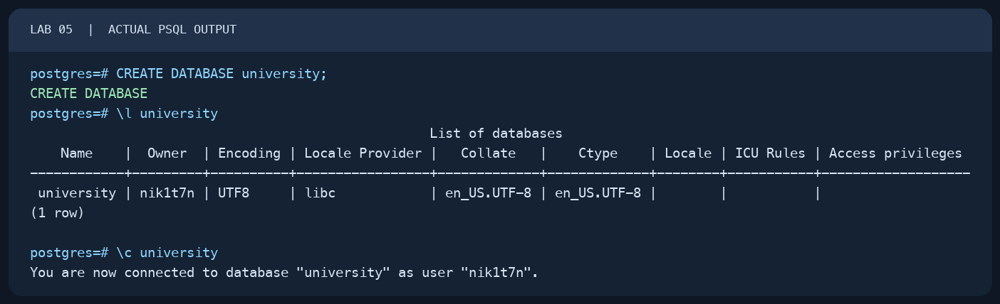
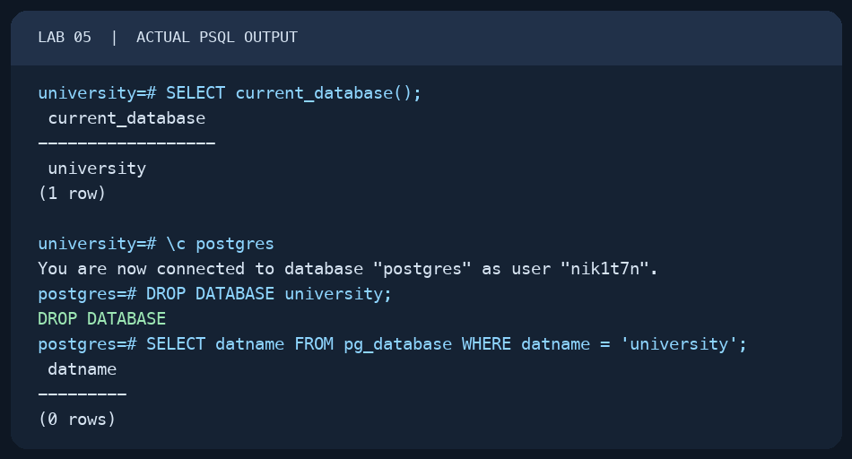

# Lab 05 — Databases

AUCA Databases (COM-424.1) · Nikita Nosov

Source: [Databases](https://docs.google.com/document/d/1tACFw9v3Um6sak1ZjbQzxRur91qSvJKw/edit)

This report records a local PostgreSQL 18.6 session. The images are readable PNG renderings of actual `psql` terminal output. The `university` database was created only for this lab and removed at the end.

## 1. Create a database

I connected to the existing `postgres` database and used the name from the handout.

```text
psql postgres
```

```sql
CREATE DATABASE university;
```

PostgreSQL replied `CREATE DATABASE`. The command `\l university` showed one database named `university`, owned by `nik1t7n` and encoded as UTF8.

```text
\l university
```

## 2. Switch to the new database

The `\c` command changed the active connection. A query confirmed the database name.

```text
\c university
```

```sql
SELECT current_database();
```

The result was `university`.



## 3. Drop the lab database and check the result

PostgreSQL does not let a session drop the database it is currently using. I first switched back to `postgres`, then dropped only the database created in step 1.

```text
\c postgres
```

```sql
DROP DATABASE university;
SELECT datname FROM pg_database WHERE datname = 'university';
```

The drop returned `DROP DATABASE`. The check returned `(0 rows)`, confirming that `university` no longer exists.



## Naming rules from the handout

Use short, descriptive lowercase names, separate words with underscores, and avoid SQL keywords. For example, `student_records` is easier to use than a name with spaces or mixed capitalization.

The temporary `university` database was the only database removed in this lab.
