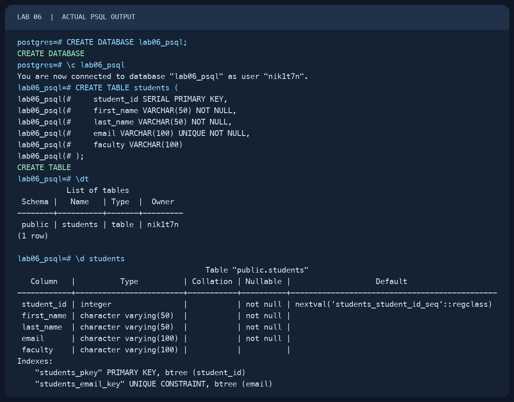
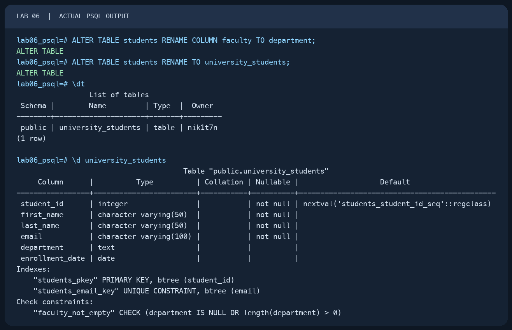
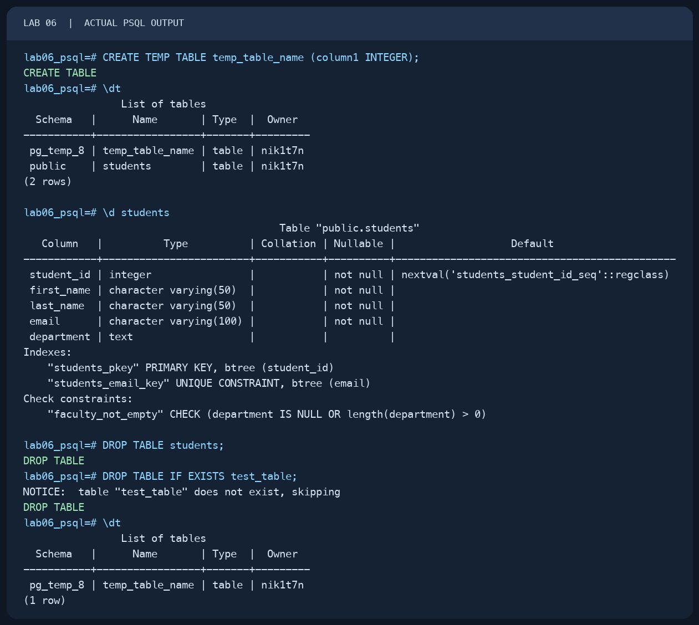
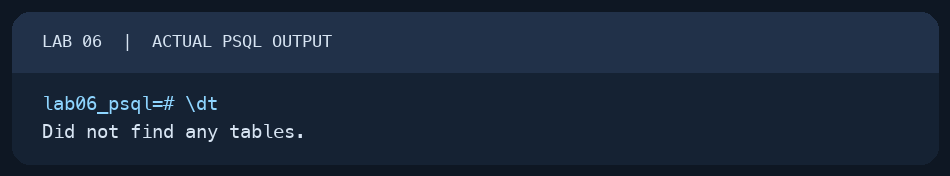

# Lab 06 — Tables, Data Types and Constraints

AUCA Databases (COM-424.1) · Nikita Nosov

Source: [Tables, Data Types and Constraints](https://docs.google.com/document/d/1VbzMZLRlmZaGdtf2FBgx3tjAhQRSBaNU/edit)

This report records a local PostgreSQL 18.6 session. The images are readable PNG renderings of actual `psql` terminal output. The handout focuses on table structure, so no rows were inserted.

## 1. Create and inspect a table

I created a separate database, then used the `students` definition from the handout. `SERIAL` sets up automatic IDs for future rows; `PRIMARY KEY`, `NOT NULL`, and `UNIQUE` define rules for the columns.

```text
psql postgres
```

```sql
CREATE DATABASE lab06_psql;
```

```text
\c lab06_psql
```

```sql
CREATE TABLE students (
    student_id SERIAL PRIMARY KEY,
    first_name VARCHAR(50) NOT NULL,
    last_name VARCHAR(50) NOT NULL,
    email VARCHAR(100) UNIQUE NOT NULL,
    faculty VARCHAR(100)
);
```

PostgreSQL replied `CREATE DATABASE` and `CREATE TABLE`. `\dt` listed `students`; `\d students` showed all five columns, the primary-key index, and the unique email constraint.

```text
\dt
\d students
```



## 2. Change the table structure

I practiced the `ALTER TABLE` operations described in the handout: adding a column, changing a type, adding a `CHECK` rule, and renaming a column and the table.

```sql
ALTER TABLE students ADD COLUMN enrollment_date DATE;
ALTER TABLE students ALTER COLUMN faculty TYPE TEXT;
ALTER TABLE students ADD CONSTRAINT faculty_not_empty
    CHECK (faculty IS NULL OR length(faculty) > 0);
ALTER TABLE students RENAME COLUMN faculty TO department;
ALTER TABLE students RENAME TO university_students;
```

Each statement returned `ALTER TABLE`. The table description then showed `department` as `text`, `enrollment_date` as `date`, and the `faculty_not_empty` check with its reference updated to `department`.

```text
\dt
\d university_students
```



I then renamed the table back and removed the added date column to practice the other structure changes.

```sql
ALTER TABLE university_students RENAME TO students;
ALTER TABLE students DROP COLUMN enrollment_date;
```

## 3. Create a temporary table

The handout says a temporary table belongs to the current session. I created one and listed the tables. `\dt` showed `temp_table_name` in a `pg_temp` schema alongside the permanent `students` table.

```sql
CREATE TEMP TABLE temp_table_name (column1 INTEGER);
```

```text
\dt
```



## 4. Drop the example table and verify session cleanup

I dropped `students`. I also ran the handout's `IF EXISTS` form for a table that was absent; PostgreSQL printed a notice and completed without an error. The temporary table remained visible until I exited psql.

```sql
DROP TABLE students;
DROP TABLE IF EXISTS test_table;
```

After `\q`, I opened a new connection to `lab06_psql` and ran `\dt`. It returned `Did not find any tables.` The temporary table had disappeared with the earlier session.



The handout also introduces `INTEGER`, `BIGINT`, `VARCHAR`, `TEXT`, `BOOLEAN`, `DATE`, `TIMESTAMP`, and `FOREIGN KEY`. This session used the types and constraints needed for its table example; the handout does not provide a second table to reference with a foreign key.
