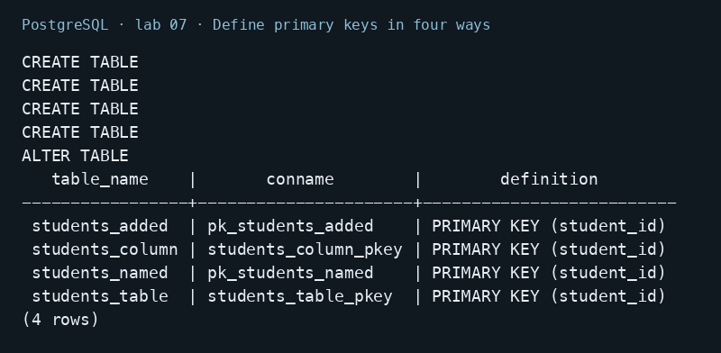
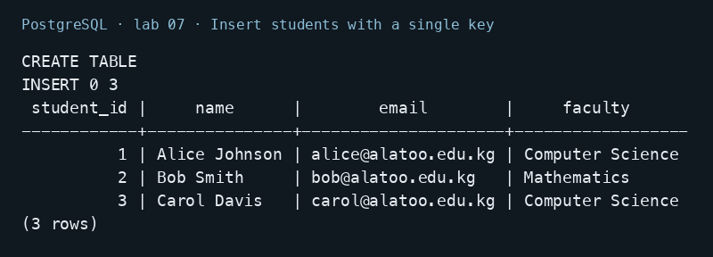
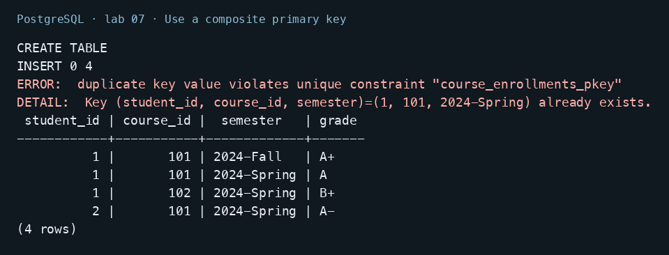
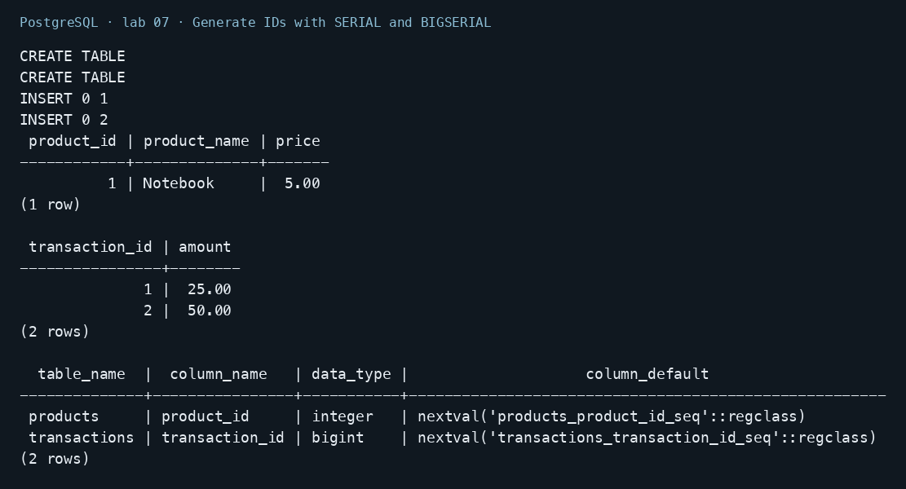
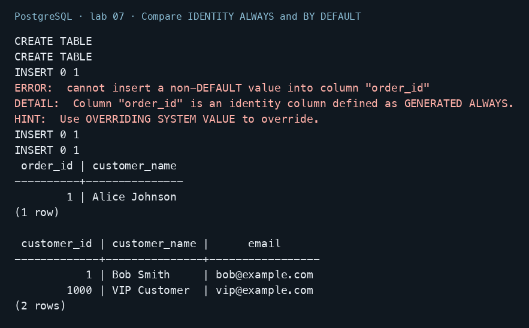
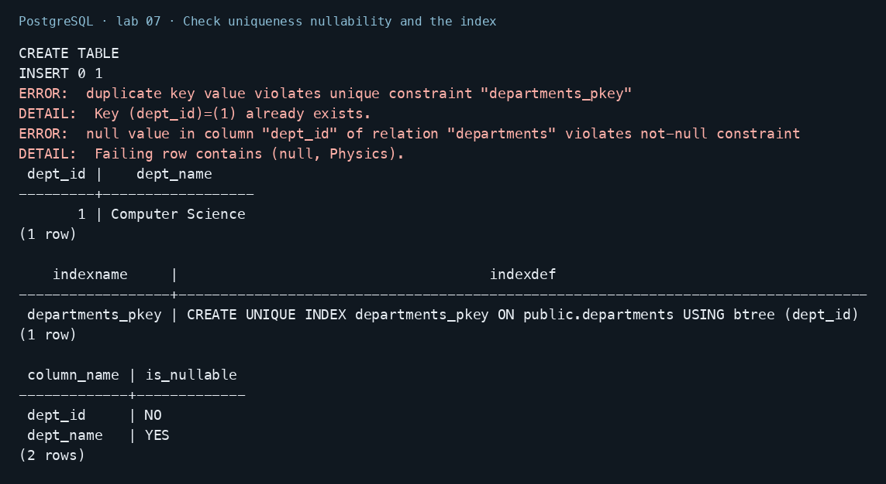

# Lab 07 — Primary Keys

AUCA Databases (COM-424.1) · Nikita Nosov

Source: [Primary Keys](https://docs.google.com/document/d/1dDxnTfpofoXS5KFv2CgsM0r8ZP03imXZ/edit)

I ran the handout examples in PostgreSQL 18.6. Alternative definitions use separate tables. Images are readable PNG renderings of actual psql output.

## Open the database

```text
psql postgres
```

```sql
CREATE DATABASE lab07_psql;
```

```text
\c lab07_psql
```

## 1. Define primary keys in four ways

```sql
CREATE TABLE students_column (
    student_id INTEGER PRIMARY KEY,
    name VARCHAR(100), email VARCHAR(150)
);
CREATE TABLE students_table (
    student_id INTEGER, name VARCHAR(100), email VARCHAR(150),
    PRIMARY KEY (student_id)
);
CREATE TABLE students_named (
    student_id INTEGER, name VARCHAR(100), email VARCHAR(150),
    CONSTRAINT pk_students_named PRIMARY KEY (student_id)
);
CREATE TABLE students_added (
    student_id INTEGER, name VARCHAR(100), email VARCHAR(150)
);
ALTER TABLE students_added ADD CONSTRAINT pk_students_added
    PRIMARY KEY (student_id);
SELECT conrelid::regclass AS table_name, conname,
       pg_get_constraintdef(oid) AS definition
FROM pg_constraint
WHERE contype = 'p' AND connamespace = 'public'::regnamespace
ORDER BY conrelid::regclass::text;
```

All four definitions created a primary key. A table can have one primary-key constraint, which can contain several columns.



## 2. Insert students with a single key

```sql
CREATE TABLE students (
    student_id SERIAL PRIMARY KEY,
    name VARCHAR(100) NOT NULL,
    email VARCHAR(150) UNIQUE,
    faculty VARCHAR(50)
);
INSERT INTO students (name, email, faculty) VALUES
    ('Alice Johnson', 'alice@alatoo.edu.kg', 'Computer Science'),
    ('Bob Smith', 'bob@alatoo.edu.kg', 'Mathematics'),
    ('Carol Davis', 'carol@alatoo.edu.kg', 'Computer Science');
SELECT * FROM students ORDER BY student_id;
```

The three handout rows received IDs 1, 2, and 3. The primary key identifies each student; email has a separate unique constraint.



## 3. Use a composite primary key

```sql
CREATE TABLE course_enrollments (
    student_id INTEGER,
    course_id INTEGER,
    semester VARCHAR(20),
    enrollment_date DATE DEFAULT CURRENT_DATE,
    grade CHAR(2),
    PRIMARY KEY (student_id, course_id, semester)
);
INSERT INTO course_enrollments (student_id, course_id, semester, grade) VALUES
    (1, 101, '2024-Spring', 'A'),
    (1, 102, '2024-Spring', 'B+'),
    (2, 101, '2024-Spring', 'A-'),
    (1, 101, '2024-Fall', 'A+');
INSERT INTO course_enrollments (student_id, course_id, semester)
VALUES (1, 101, '2024-Spring');
SELECT student_id, course_id, semester, grade
FROM course_enrollments ORDER BY student_id, course_id, semester;
```

The same student can take course 101 in two semesters. Repeating all three key values failed; four valid enrollments remained.



## 4. Generate IDs with SERIAL and BIGSERIAL

```sql
CREATE TABLE products (
    product_id SERIAL PRIMARY KEY,
    product_name VARCHAR(100) NOT NULL, price DECIMAL(10,2)
);
CREATE TABLE transactions (
    transaction_id BIGSERIAL PRIMARY KEY,
    amount DECIMAL(15,2),
    transaction_date TIMESTAMP DEFAULT CURRENT_TIMESTAMP
);
INSERT INTO products (product_name, price) VALUES ('Notebook', 5.00);
INSERT INTO transactions (amount) VALUES (25.00), (50.00);
SELECT * FROM products;
SELECT transaction_id, amount FROM transactions ORDER BY transaction_id;
SELECT table_name, column_name, data_type, column_default
FROM information_schema.columns
WHERE (table_name, column_name) IN
    (('products', 'product_id'), ('transactions', 'transaction_id'))
ORDER BY table_name;
```

SERIAL uses an integer sequence; BIGSERIAL uses a bigint sequence. Both generated IDs automatically. They are sequence-backed defaults rather than standalone storage types.



## 5. Compare IDENTITY ALWAYS and BY DEFAULT

```sql
CREATE TABLE orders (
    order_id INTEGER GENERATED ALWAYS AS IDENTITY PRIMARY KEY,
    customer_name VARCHAR(100), order_date DATE DEFAULT CURRENT_DATE
);
CREATE TABLE customers (
    customer_id INTEGER GENERATED BY DEFAULT AS IDENTITY PRIMARY KEY,
    customer_name VARCHAR(100), email VARCHAR(150)
);
INSERT INTO orders (customer_name) VALUES ('Alice Johnson');
INSERT INTO orders (order_id, customer_name) VALUES (1000, 'Manual order');
INSERT INTO customers (customer_id, customer_name, email)
VALUES (1000, 'VIP Customer', 'vip@example.com');
INSERT INTO customers (customer_name, email)
VALUES ('Bob Smith', 'bob@example.com');
SELECT order_id, customer_name FROM orders;
SELECT * FROM customers ORDER BY customer_id;
```

ALWAYS rejected an explicitly supplied ID. BY DEFAULT accepted VIP Customer with ID 1000 and generated ID 1 for Bob. A manual identity value does not advance the underlying sequence.



## 6. Check uniqueness nullability and the index

```sql
CREATE TABLE departments (
    dept_id INTEGER PRIMARY KEY,
    dept_name VARCHAR(100)
);
INSERT INTO departments VALUES (1, 'Computer Science');
INSERT INTO departments VALUES (1, 'Mathematics');
INSERT INTO departments VALUES (NULL, 'Physics');
SELECT * FROM departments;
SELECT indexname, indexdef FROM pg_indexes
WHERE tablename = 'departments';
SELECT column_name, is_nullable FROM information_schema.columns
WHERE table_name = 'departments' ORDER BY ordinal_position;
```

The duplicate and NULL keys both failed. The table retained one department. PostgreSQL created a unique B-tree index and marked dept_id NOT NULL. Keeping keys stable is a design recommendation; a primary key is not automatically immutable.



## Conclusion

Primary keys combine uniqueness and NOT NULL. Composite keys validate the whole combination. PostgreSQL automatically indexes primary keys, and identity columns provide SQL-standard automatic IDs. Foreign keys can reference these identifiers, as shown in Lab 08.
