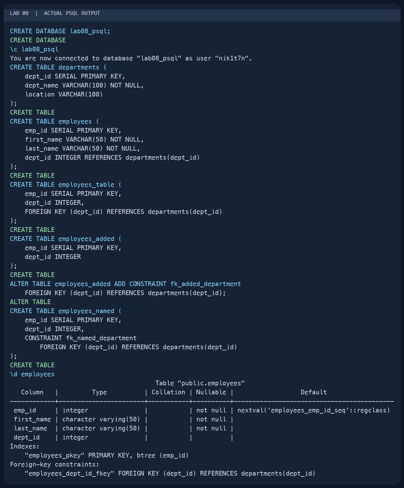
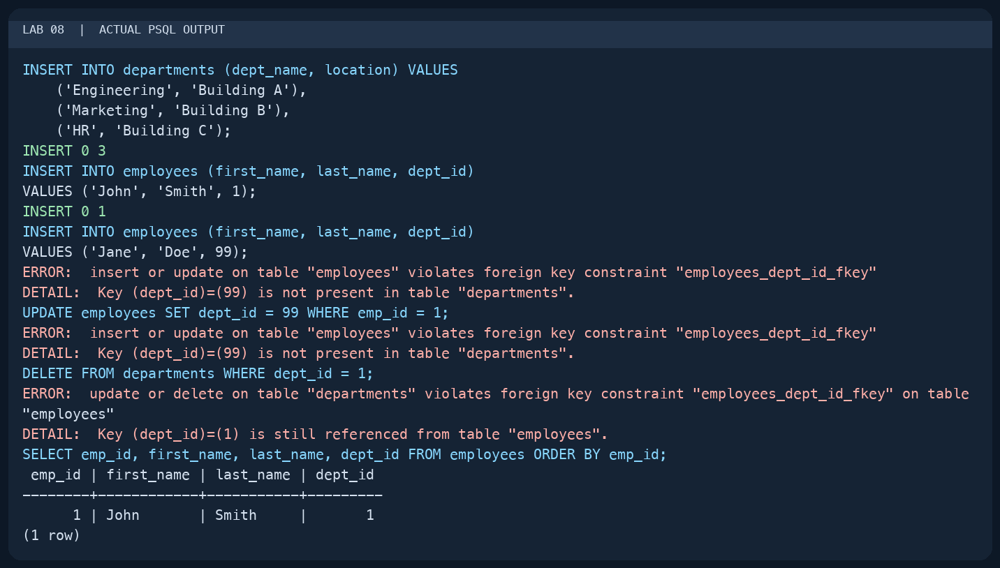
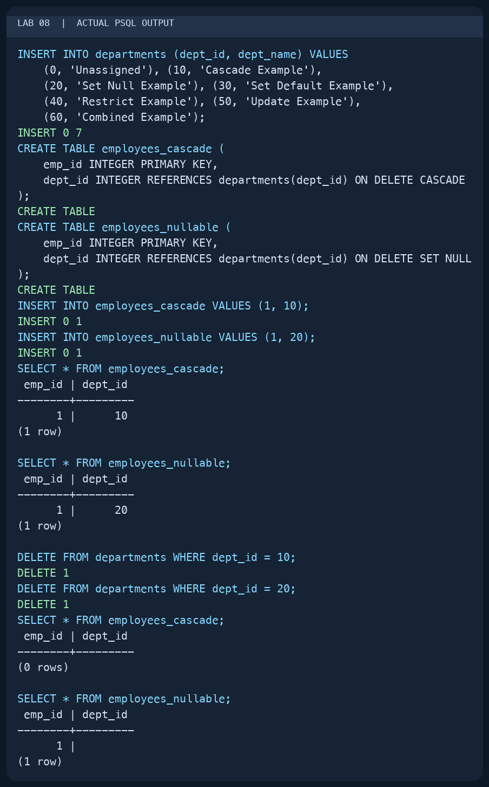
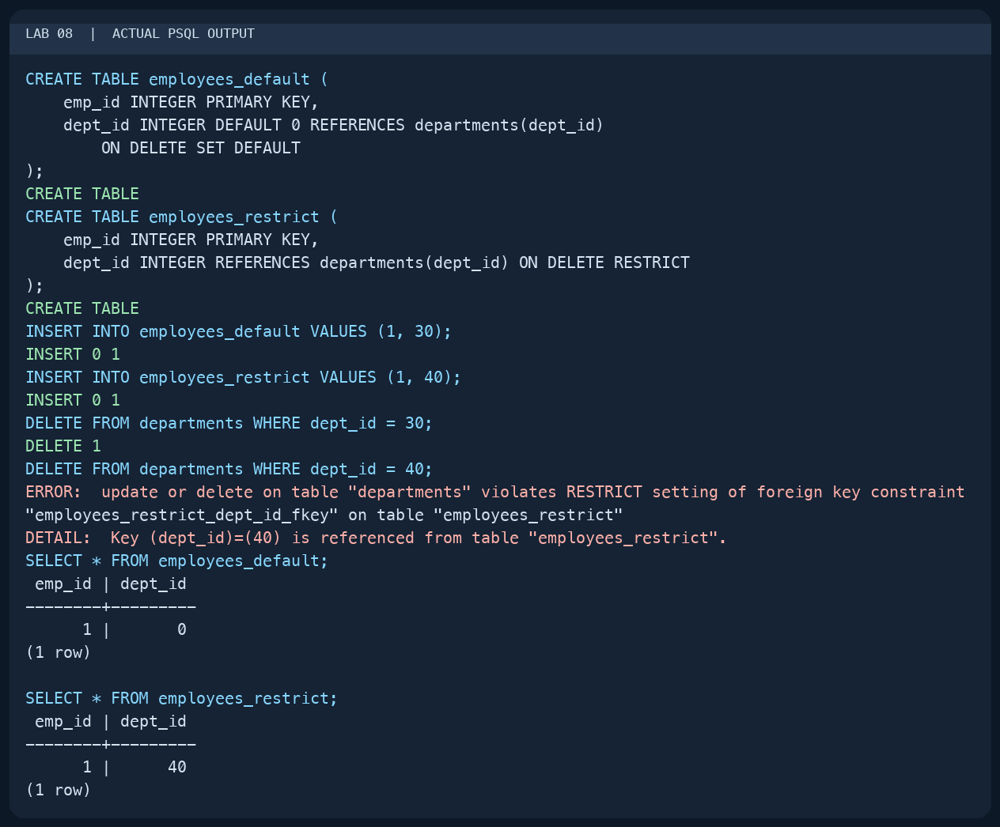
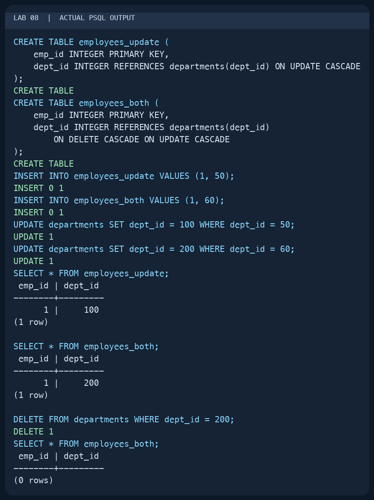
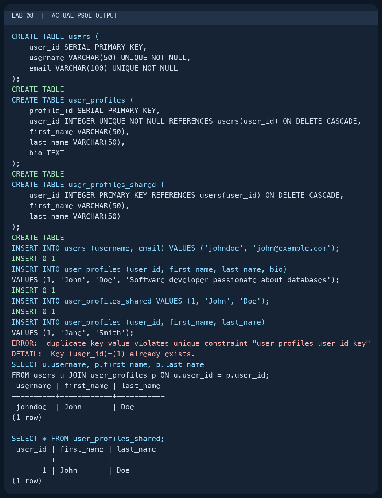
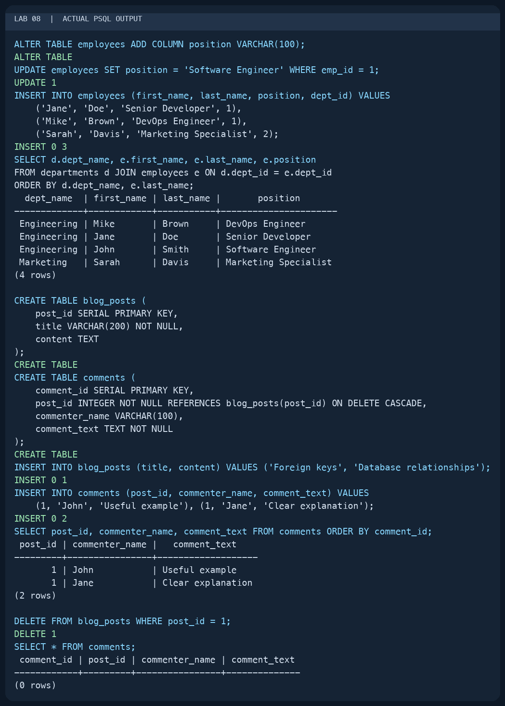
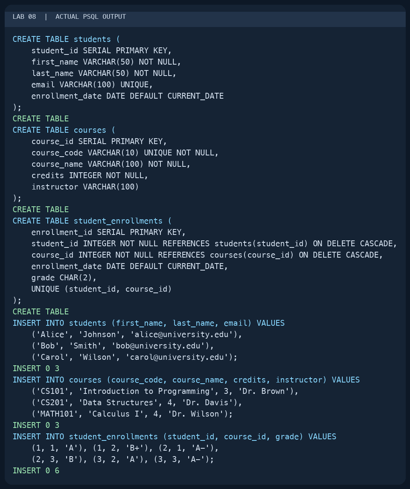
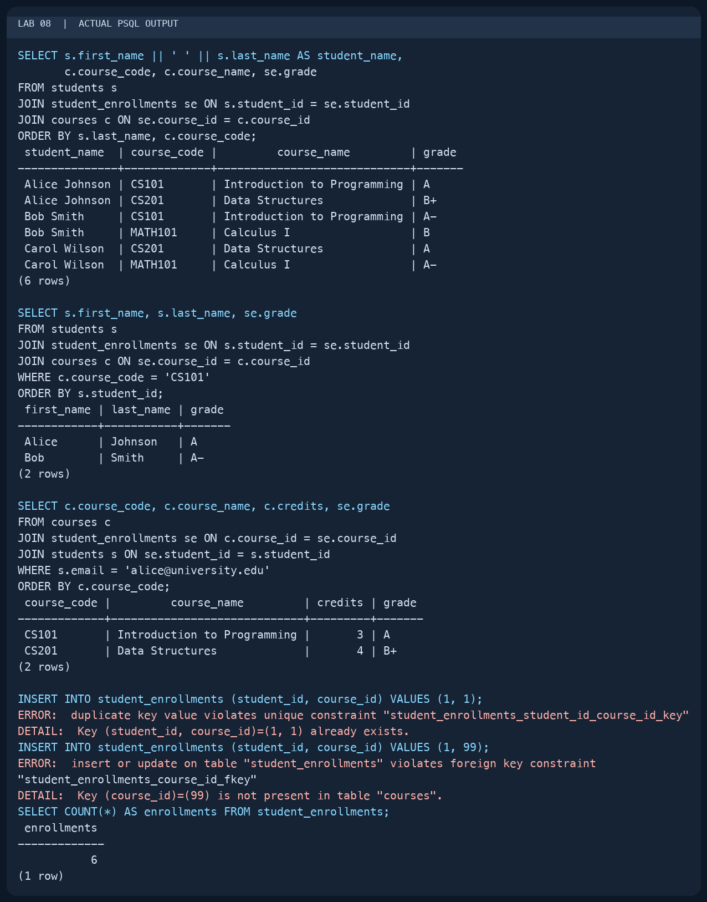

# Lab 08 — Foreign Keys and Relationships

AUCA Databases (COM-424.1) · Nikita Nosov

Source: [Foreign Keys and Relationships](https://docs.google.com/document/d/1HLQfBeDeBlFqEo0Z8jtA9E8YW-AmAQfw/edit)

This report records a local PostgreSQL 18.6 session. The images are readable PNG renderings of actual `psql` terminal output. I used separate tables for the handout's alternative foreign-key definitions so the examples could be compared in one database.

## 1. Create foreign keys in four ways

I created the parent table first. An employee's `dept_id` then references the department's primary key.

```text
psql postgres
```

```sql
CREATE DATABASE lab08_psql;
```

```text
\c lab08_psql
```

```sql
CREATE TABLE departments (
    dept_id SERIAL PRIMARY KEY,
    dept_name VARCHAR(100) NOT NULL,
    location VARCHAR(100)
);

CREATE TABLE employees (
    emp_id SERIAL PRIMARY KEY,
    first_name VARCHAR(50) NOT NULL,
    last_name VARCHAR(50) NOT NULL,
    dept_id INTEGER REFERENCES departments(dept_id)
);

CREATE TABLE employees_table (
    emp_id SERIAL PRIMARY KEY,
    dept_id INTEGER,
    FOREIGN KEY (dept_id) REFERENCES departments(dept_id)
);

CREATE TABLE employees_added (
    emp_id SERIAL PRIMARY KEY,
    dept_id INTEGER
);
ALTER TABLE employees_added ADD CONSTRAINT fk_added_department
    FOREIGN KEY (dept_id) REFERENCES departments(dept_id);

CREATE TABLE employees_named (
    emp_id SERIAL PRIMARY KEY,
    dept_id INTEGER,
    CONSTRAINT fk_named_department
        FOREIGN KEY (dept_id) REFERENCES departments(dept_id)
);
```

All four approaches succeeded. `\d employees` showed the primary key and the foreign key referencing `departments(dept_id)`.



## 2. Check referential integrity

I inserted Engineering, Marketing, and HR, followed by an employee in Engineering. I then attempted three operations that would break the relationship.

```sql
INSERT INTO departments (dept_name, location) VALUES
    ('Engineering', 'Building A'),
    ('Marketing', 'Building B'),
    ('HR', 'Building C');

INSERT INTO employees (first_name, last_name, dept_id)
VALUES ('John', 'Smith', 1);

INSERT INTO employees (first_name, last_name, dept_id)
VALUES ('Jane', 'Doe', 99);
UPDATE employees SET dept_id = 99 WHERE emp_id = 1;
DELETE FROM departments WHERE dept_id = 1;

SELECT emp_id, first_name, last_name, dept_id
FROM employees ORDER BY emp_id;
```

The valid insert returned `INSERT 0 1`. Both references to department 99 failed because that department did not exist. Deleting department 1 also failed because John still referenced it. The final query showed John with `dept_id = 1`, confirming that the failed operations did not change the relationship.



## 3. Compare ON DELETE actions

I added separate parent rows for each action. Department 0 is a valid default destination; it is needed because `SET DEFAULT` must still satisfy the foreign key.

```sql
INSERT INTO departments (dept_id, dept_name) VALUES
    (0, 'Unassigned'), (10, 'Cascade Example'),
    (20, 'Set Null Example'), (30, 'Set Default Example'),
    (40, 'Restrict Example'), (50, 'Update Example'),
    (60, 'Combined Example');

CREATE TABLE employees_cascade (
    emp_id INTEGER PRIMARY KEY,
    dept_id INTEGER REFERENCES departments(dept_id) ON DELETE CASCADE
);
CREATE TABLE employees_nullable (
    emp_id INTEGER PRIMARY KEY,
    dept_id INTEGER REFERENCES departments(dept_id) ON DELETE SET NULL
);
INSERT INTO employees_cascade VALUES (1, 10);
INSERT INTO employees_nullable VALUES (1, 20);

SELECT * FROM employees_cascade;
SELECT * FROM employees_nullable;
DELETE FROM departments WHERE dept_id = 10;
DELETE FROM departments WHERE dept_id = 20;
SELECT * FROM employees_cascade;
SELECT * FROM employees_nullable;
```

`CASCADE` removed the child row: the final query returned zero rows. `SET NULL` kept the employee and displayed an empty `dept_id` field, representing SQL `NULL`.



```sql
CREATE TABLE employees_default (
    emp_id INTEGER PRIMARY KEY,
    dept_id INTEGER DEFAULT 0 REFERENCES departments(dept_id)
        ON DELETE SET DEFAULT
);
CREATE TABLE employees_restrict (
    emp_id INTEGER PRIMARY KEY,
    dept_id INTEGER REFERENCES departments(dept_id) ON DELETE RESTRICT
);
INSERT INTO employees_default VALUES (1, 30);
INSERT INTO employees_restrict VALUES (1, 40);
DELETE FROM departments WHERE dept_id = 30;
DELETE FROM departments WHERE dept_id = 40;
SELECT * FROM employees_default;
SELECT * FROM employees_restrict;
```

`SET DEFAULT` changed the child's department to 0. `RESTRICT` rejected the deletion of department 40 and preserved its child row. PostgreSQL's default action is `NO ACTION`, rather than the `RESTRICT (default)` wording in the handout; the plain foreign key in section 2 demonstrated its immediate constraint check.



## 4. Update a parent key and combine cascades

```sql
CREATE TABLE employees_update (
    emp_id INTEGER PRIMARY KEY,
    dept_id INTEGER REFERENCES departments(dept_id) ON UPDATE CASCADE
);
CREATE TABLE employees_both (
    emp_id INTEGER PRIMARY KEY,
    dept_id INTEGER REFERENCES departments(dept_id)
        ON DELETE CASCADE ON UPDATE CASCADE
);
INSERT INTO employees_update VALUES (1, 50);
INSERT INTO employees_both VALUES (1, 60);
UPDATE departments SET dept_id = 100 WHERE dept_id = 50;
UPDATE departments SET dept_id = 200 WHERE dept_id = 60;
SELECT * FROM employees_update;
SELECT * FROM employees_both;
DELETE FROM departments WHERE dept_id = 200;
SELECT * FROM employees_both;
```

The child keys automatically became 100 and 200. Deleting department 200 then removed the child in `employees_both`, showing both actions on the same foreign key.



## 5. Create a one-to-one relationship

I used `UNIQUE NOT NULL` on `user_profiles.user_id` so a user could have at most one profile. I also created the handout's alternative with a shared primary key.

```sql
CREATE TABLE users (
    user_id SERIAL PRIMARY KEY,
    username VARCHAR(50) UNIQUE NOT NULL,
    email VARCHAR(100) UNIQUE NOT NULL
);
CREATE TABLE user_profiles (
    profile_id SERIAL PRIMARY KEY,
    user_id INTEGER UNIQUE NOT NULL REFERENCES users(user_id) ON DELETE CASCADE,
    first_name VARCHAR(50),
    last_name VARCHAR(50),
    bio TEXT
);
CREATE TABLE user_profiles_shared (
    user_id INTEGER PRIMARY KEY REFERENCES users(user_id) ON DELETE CASCADE,
    first_name VARCHAR(50),
    last_name VARCHAR(50)
);
INSERT INTO users (username, email) VALUES ('johndoe', 'john@example.com');
INSERT INTO user_profiles (user_id, first_name, last_name, bio)
VALUES (1, 'John', 'Doe', 'Software developer passionate about databases');
INSERT INTO user_profiles_shared VALUES (1, 'John', 'Doe');
INSERT INTO user_profiles (user_id, first_name, last_name)
VALUES (1, 'Jane', 'Smith');
SELECT u.username, p.first_name, p.last_name
FROM users u JOIN user_profiles p ON u.user_id = p.user_id;
SELECT * FROM user_profiles_shared;
```

The second profile for user 1 failed with a unique-constraint error. The join returned `johndoe`, John, Doe; the alternative table also contained one profile. These constraints prevent a second profile but do not require every user to have one.



## 6. Create one-to-many relationships

Engineering has several employees, while each employee references one department. I added the position column used in the handout's relationship query.

```sql
ALTER TABLE employees ADD COLUMN position VARCHAR(100);
UPDATE employees SET position = 'Software Engineer' WHERE emp_id = 1;
INSERT INTO employees (first_name, last_name, position, dept_id) VALUES
    ('Jane', 'Doe', 'Senior Developer', 1),
    ('Mike', 'Brown', 'DevOps Engineer', 1),
    ('Sarah', 'Davis', 'Marketing Specialist', 2);
SELECT d.dept_name, e.first_name, e.last_name, e.position
FROM departments d JOIN employees e ON d.dept_id = e.dept_id
ORDER BY d.dept_name, e.last_name;
```

The query returned three Engineering employees and one Marketing employee. I also created the post/comment example and inserted two comments for one post.

```sql
CREATE TABLE blog_posts (
    post_id SERIAL PRIMARY KEY,
    title VARCHAR(200) NOT NULL,
    content TEXT
);
CREATE TABLE comments (
    comment_id SERIAL PRIMARY KEY,
    post_id INTEGER NOT NULL REFERENCES blog_posts(post_id) ON DELETE CASCADE,
    commenter_name VARCHAR(100),
    comment_text TEXT NOT NULL
);
INSERT INTO blog_posts (title, content)
VALUES ('Foreign keys', 'Database relationships');
INSERT INTO comments (post_id, commenter_name, comment_text) VALUES
    (1, 'John', 'Useful example'), (1, 'Jane', 'Clear explanation');
SELECT post_id, commenter_name, comment_text FROM comments ORDER BY comment_id;
DELETE FROM blog_posts WHERE post_id = 1;
SELECT * FROM comments;
```

Both comments initially referenced post 1. After its deletion, the comments query returned zero rows.



## 7. Create a many-to-many relationship

The junction table connects students and courses. Its two foreign keys validate the references, and `UNIQUE (student_id, course_id)` prevents duplicate enrollment in the same course.

```sql
CREATE TABLE students (
    student_id SERIAL PRIMARY KEY,
    first_name VARCHAR(50) NOT NULL,
    last_name VARCHAR(50) NOT NULL,
    email VARCHAR(100) UNIQUE,
    enrollment_date DATE DEFAULT CURRENT_DATE
);
CREATE TABLE courses (
    course_id SERIAL PRIMARY KEY,
    course_code VARCHAR(10) UNIQUE NOT NULL,
    course_name VARCHAR(100) NOT NULL,
    credits INTEGER NOT NULL,
    instructor VARCHAR(100)
);
CREATE TABLE student_enrollments (
    enrollment_id SERIAL PRIMARY KEY,
    student_id INTEGER NOT NULL REFERENCES students(student_id) ON DELETE CASCADE,
    course_id INTEGER NOT NULL REFERENCES courses(course_id) ON DELETE CASCADE,
    enrollment_date DATE DEFAULT CURRENT_DATE,
    grade CHAR(2),
    UNIQUE (student_id, course_id)
);
```

I inserted the handout's Alice, Bob, and Carol; CS101, CS201, and MATH101; and six enrollment rows. The exact inserts appear in the recorded output.



```sql
SELECT s.first_name || ' ' || s.last_name AS student_name,
       c.course_code, c.course_name, se.grade
FROM students s
JOIN student_enrollments se ON s.student_id = se.student_id
JOIN courses c ON se.course_id = c.course_id
ORDER BY s.last_name, c.course_code;

SELECT s.first_name, s.last_name, se.grade
FROM students s
JOIN student_enrollments se ON s.student_id = se.student_id
JOIN courses c ON se.course_id = c.course_id
WHERE c.course_code = 'CS101'
ORDER BY s.student_id;

SELECT c.course_code, c.course_name, c.credits, se.grade
FROM courses c
JOIN student_enrollments se ON c.course_id = se.course_id
JOIN students s ON se.student_id = s.student_id
WHERE s.email = 'alice@university.edu'
ORDER BY c.course_code;

INSERT INTO student_enrollments (student_id, course_id) VALUES (1, 1);
INSERT INTO student_enrollments (student_id, course_id) VALUES (1, 99);
SELECT COUNT(*) AS enrollments FROM student_enrollments;
```

The complete join returned six rows. CS101 had Alice and Bob, and Alice's course query returned CS101 and CS201. Duplicate enrollment and a reference to missing course 99 both failed. The final enrollment count remained six.


