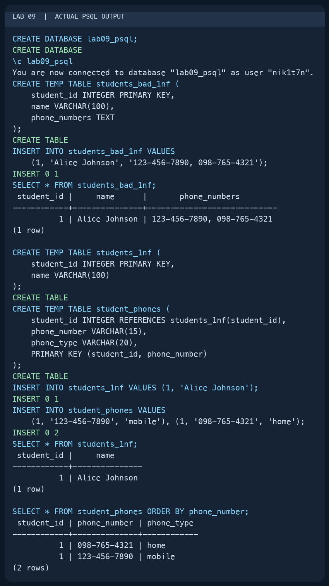
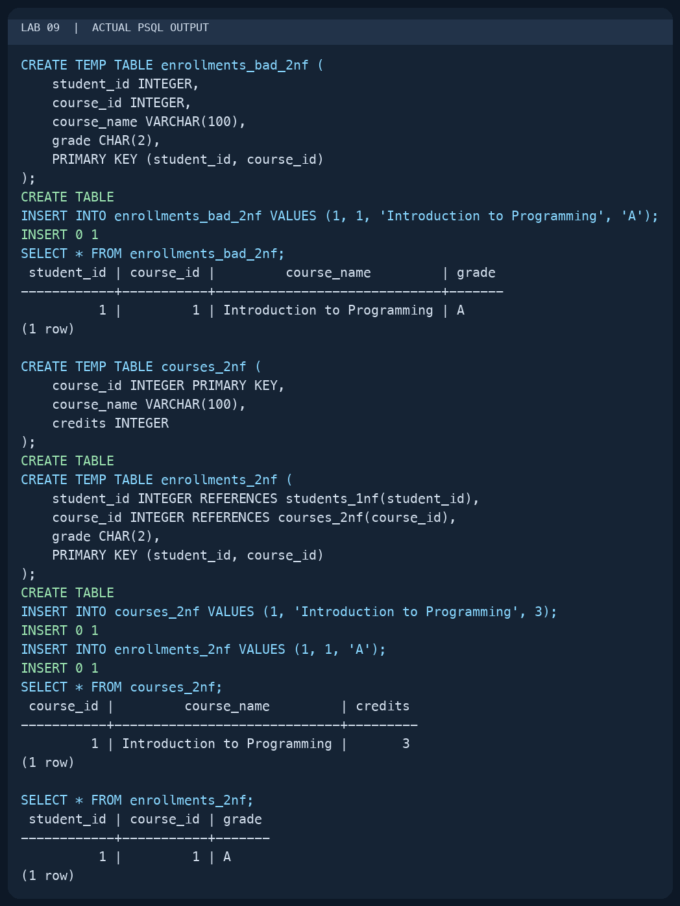
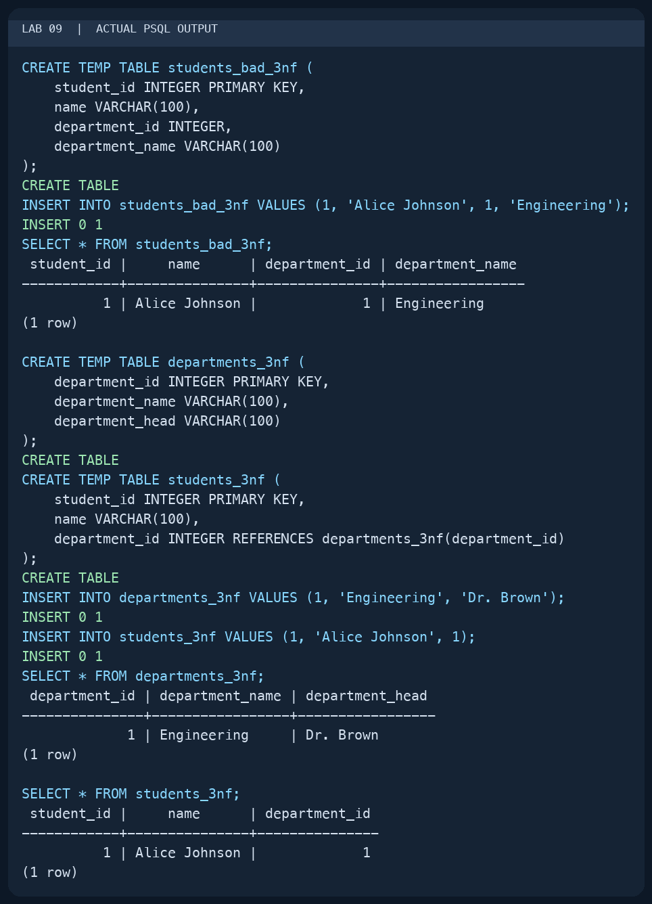
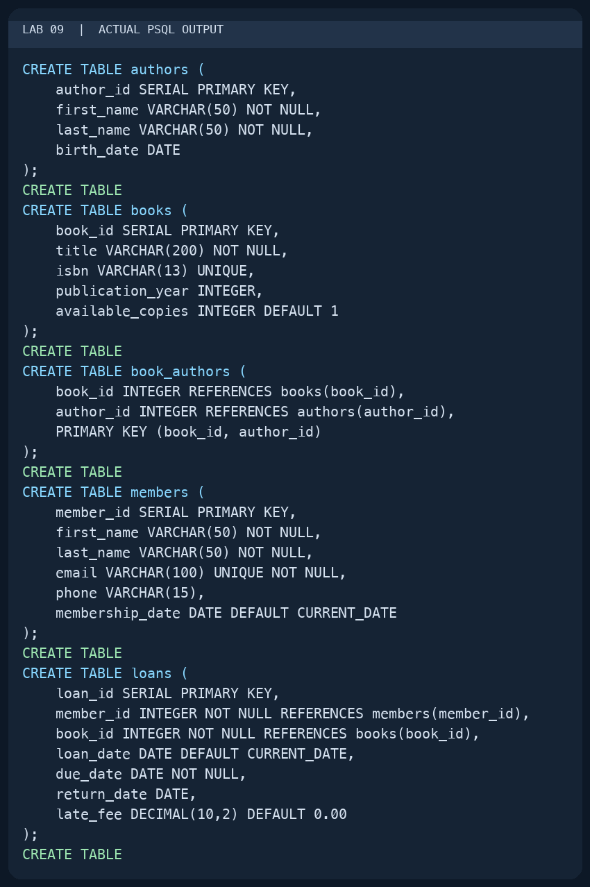
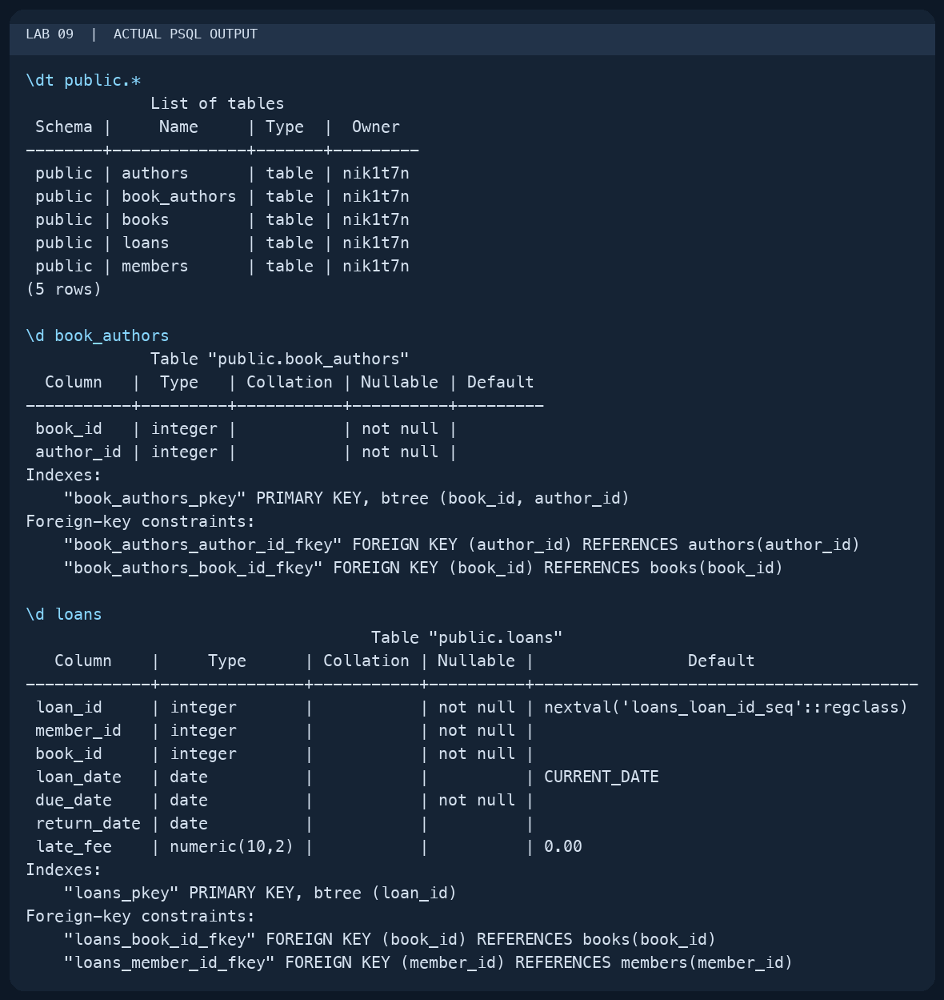
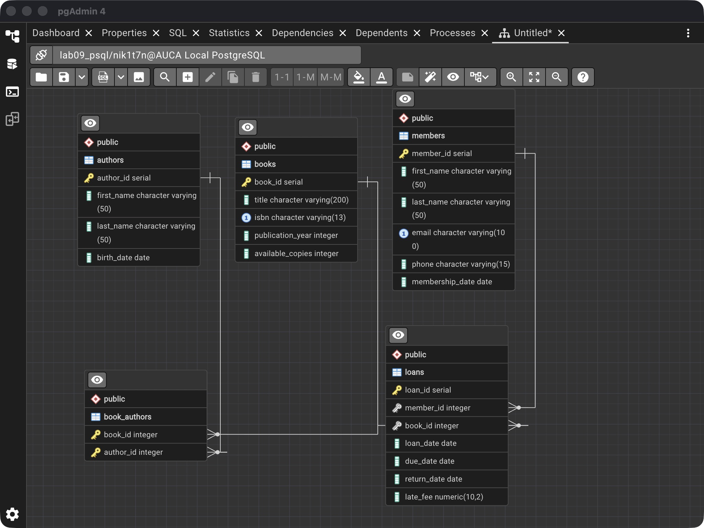

# Lab 09 — Database Design Basics

AUCA Databases (COM-424.1) · Nikita Nosov

Source: [Database Design Basics](https://docs.google.com/document/d/1UjwMCGbcdKjChfTVb-8JA_Ixq6cw7IJQ/edit)

This report records a local PostgreSQL 18.6 session. The terminal images are readable PNG renderings of actual `psql` output, and the ER diagram is a pgAdmin screenshot. I used temporary tables for the normalization comparisons and permanent tables for the handout's library design.

## 1. Identify entities, attributes, and relationships

In the university example, Student, Course, and Professor are entities. Their IDs are key attributes. Names, emails, course credits, and dates of birth describe the entities. A structured address can be divided into smaller attributes; age can be calculated from date of birth instead of stored as a separate value.

Students enroll in courses through a many-to-many relationship, which needs an enrollment table. A professor teaches multiple courses through a one-to-many relationship. These relationships determine where foreign keys belong when the conceptual model becomes a table design.

For the library, the requirements are to track books, authors, members, and borrowing history, including due dates and late fees. I identified five tables: `authors`, `books`, `book_authors`, `members`, and `loans`. A book may have multiple authors, so `book_authors` connects the first two tables. Each loan references one member and one book.

## 2. First normal form: separate phone numbers

I created a database for this lab. The first comparison reproduces the handout's multiple-phone-number problem. I used Alice as an illustrative row to make the difference visible.

```text
psql postgres
```

```sql
CREATE DATABASE lab09_psql;
```

```text
\c lab09_psql
```

```sql
CREATE TEMP TABLE students_bad_1nf (
    student_id INTEGER PRIMARY KEY,
    name VARCHAR(100),
    phone_numbers TEXT
);
INSERT INTO students_bad_1nf VALUES
    (1, 'Alice Johnson', '123-456-7890, 098-765-4321');
SELECT * FROM students_bad_1nf;

CREATE TEMP TABLE students_1nf (
    student_id INTEGER PRIMARY KEY,
    name VARCHAR(100)
);
CREATE TEMP TABLE student_phones (
    student_id INTEGER REFERENCES students_1nf(student_id),
    phone_number VARCHAR(15),
    phone_type VARCHAR(20),
    PRIMARY KEY (student_id, phone_number)
);
INSERT INTO students_1nf VALUES (1, 'Alice Johnson');
INSERT INTO student_phones VALUES
    (1, '123-456-7890', 'mobile'), (1, '098-765-4321', 'home');
SELECT * FROM students_1nf;
SELECT * FROM student_phones ORDER BY phone_number;
```

The first design held two phone numbers in one text field. The normalized design returned one student row and two phone rows, with one phone number per row. The composite primary key prevents the same phone number from being repeated for the same student.



## 3. Second normal form: remove a partial dependency

In the bad enrollment design, the primary key is `(student_id, course_id)`, but `course_name` depends only on `course_id`. I moved course information to its own table and kept the grade with the enrollment.

```sql
CREATE TEMP TABLE enrollments_bad_2nf (
    student_id INTEGER,
    course_id INTEGER,
    course_name VARCHAR(100),
    grade CHAR(2),
    PRIMARY KEY (student_id, course_id)
);
INSERT INTO enrollments_bad_2nf VALUES
    (1, 1, 'Introduction to Programming', 'A');
SELECT * FROM enrollments_bad_2nf;

CREATE TEMP TABLE courses_2nf (
    course_id INTEGER PRIMARY KEY,
    course_name VARCHAR(100),
    credits INTEGER
);
CREATE TEMP TABLE enrollments_2nf (
    student_id INTEGER REFERENCES students_1nf(student_id),
    course_id INTEGER REFERENCES courses_2nf(course_id),
    grade CHAR(2),
    PRIMARY KEY (student_id, course_id)
);
INSERT INTO courses_2nf VALUES (1, 'Introduction to Programming', 3);
INSERT INTO enrollments_2nf VALUES (1, 1, 'A');
SELECT * FROM courses_2nf;
SELECT * FROM enrollments_2nf;
```

The corrected enrollment contained only the student ID, course ID, and grade. The course name and credits appeared once in `courses_2nf`, where they depend on the whole key of that table.



## 4. Third normal form: remove a transitive dependency

The department name describes a department, not a student. Keeping it in each student row would repeat it and make department renaming harder.

```sql
CREATE TEMP TABLE students_bad_3nf (
    student_id INTEGER PRIMARY KEY,
    name VARCHAR(100),
    department_id INTEGER,
    department_name VARCHAR(100)
);
INSERT INTO students_bad_3nf VALUES (1, 'Alice Johnson', 1, 'Engineering');
SELECT * FROM students_bad_3nf;

CREATE TEMP TABLE departments_3nf (
    department_id INTEGER PRIMARY KEY,
    department_name VARCHAR(100),
    department_head VARCHAR(100)
);
CREATE TEMP TABLE students_3nf (
    student_id INTEGER PRIMARY KEY,
    name VARCHAR(100),
    department_id INTEGER REFERENCES departments_3nf(department_id)
);
INSERT INTO departments_3nf VALUES (1, 'Engineering', 'Dr. Brown');
INSERT INTO students_3nf VALUES (1, 'Alice Johnson', 1);
SELECT * FROM departments_3nf;
SELECT * FROM students_3nf;
```

The corrected student row stored the department ID. Engineering and its head were stored in `departments_3nf`, removing the dependency from student ID through department ID to department name.



## 5. Implement the library design

I converted the library requirements into the handout's five tables. The IDs identify each entity. `book_authors` has a composite key, while `loans` records the borrowing event and its dates.

```sql
CREATE TABLE authors (
    author_id SERIAL PRIMARY KEY,
    first_name VARCHAR(50) NOT NULL,
    last_name VARCHAR(50) NOT NULL,
    birth_date DATE
);
CREATE TABLE books (
    book_id SERIAL PRIMARY KEY,
    title VARCHAR(200) NOT NULL,
    isbn VARCHAR(13) UNIQUE,
    publication_year INTEGER,
    available_copies INTEGER DEFAULT 1
);
CREATE TABLE book_authors (
    book_id INTEGER REFERENCES books(book_id),
    author_id INTEGER REFERENCES authors(author_id),
    PRIMARY KEY (book_id, author_id)
);
CREATE TABLE members (
    member_id SERIAL PRIMARY KEY,
    first_name VARCHAR(50) NOT NULL,
    last_name VARCHAR(50) NOT NULL,
    email VARCHAR(100) UNIQUE NOT NULL,
    phone VARCHAR(15),
    membership_date DATE DEFAULT CURRENT_DATE
);
CREATE TABLE loans (
    loan_id SERIAL PRIMARY KEY,
    member_id INTEGER NOT NULL REFERENCES members(member_id),
    book_id INTEGER NOT NULL REFERENCES books(book_id),
    loan_date DATE DEFAULT CURRENT_DATE,
    due_date DATE NOT NULL,
    return_date DATE,
    late_fee DECIMAL(10,2) DEFAULT 0.00
);
```

PostgreSQL returned `CREATE TABLE` for all five tables. No library rows were needed for this structure example.



```text
\dt public.*
\d book_authors
\d loans
```

The public schema contained five tables. `book_authors` showed its composite primary key and two foreign keys. `loans` showed its member/book references, required due date, and default values. The normalization tables were temporary and disappeared when the session ended.



## 6. View the entity relationships

I generated the library diagram from the existing `lab09_psql` database in pgAdmin. It shows books and authors linked through `book_authors`, and members and books linked through `loans`. The diagram uses the foreign keys created above.



The design followed requirements analysis, conceptual modeling, logical table design, and PostgreSQL implementation. The handout also introduces indexes, partitioning, and backup planning as physical-design considerations; its library example does not define additional commands for them.
