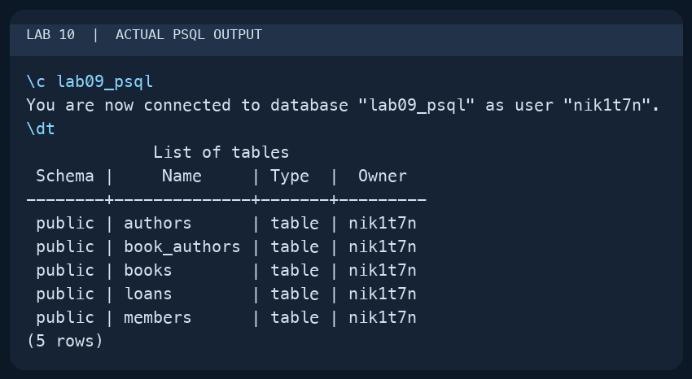
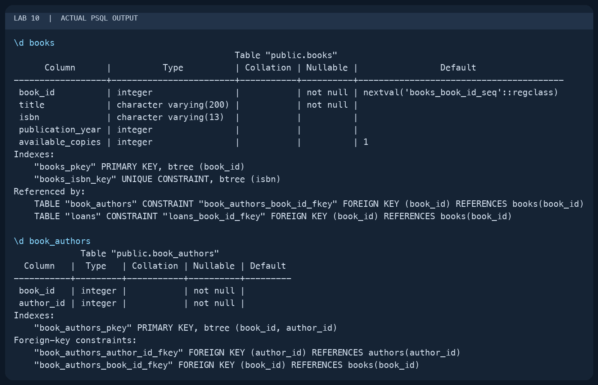
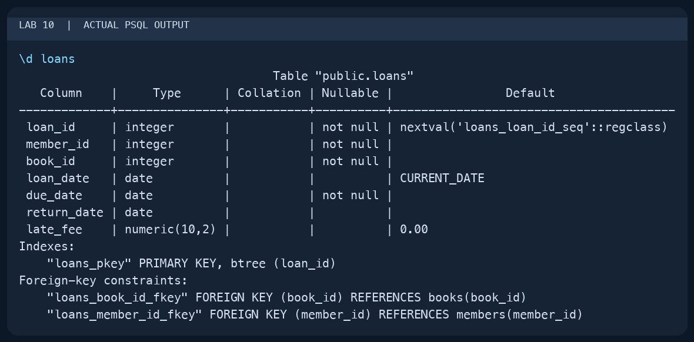

# Lab 10 — Viewing Database and Table Structure

AUCA Databases (COM-424.1) · Nikita Nosov

Source: [Viewing Database and Table Structure](https://docs.google.com/document/d/10Mzs-G_WIk6rxG1QF6IywiR-CuzAKEPC/edit)

This report records a local PostgreSQL 18.6 session and the library diagram generated in pgAdmin 4. The terminal images are readable PNG renderings of actual `psql` output. I used the existing library database from Lab 09 so its foreign-key relationships could be inspected.

## 1. List the tables

```text
psql postgres
\c lab09_psql
\dt
```

The connection changed to `lab09_psql`. `\dt` returned five tables in the public schema: `authors`, `book_authors`, `books`, `loans`, and `members`. The temporary normalization tables from Lab 09 were no longer present.



## 2. Inspect columns, types, and keys

```text
\d books
\d book_authors
```

The description of `books` showed its integer primary key, required title, unique ISBN, and default of 1 for available copies. It also listed the tables that reference a book.

`book_authors` contained two integer columns. Both were required because they belong to its composite primary key. Its foreign keys referenced `books(book_id)` and `authors(author_id)`.



```text
\d loans
```

The loan description showed its seven columns. `member_id`, `book_id`, and `due_date` were required; `return_date` could be null. `loan_date` defaulted to `CURRENT_DATE`, and `late_fee` defaulted to `0.00`. Two foreign keys connected the loan to its member and book.



## 3. Generate an ER diagram in pgAdmin

I registered the local PostgreSQL server in pgAdmin and opened `lab09_psql` in Object Explorer. I selected the database's **ERD For Database** command to generate the diagram from its existing tables, then fitted the diagram to the view.

The diagram showed all five library tables and four foreign-key links:

- `book_authors.book_id` → `books.book_id`
- `book_authors.author_id` → `authors.author_id`
- `loans.book_id` → `books.book_id`
- `loans.member_id` → `members.member_id`

Together, the first two links implement the many-to-many relationship between books and authors. The other links show that a member and a book can each be referenced by multiple loan records. The column and key information matched the psql descriptions.


