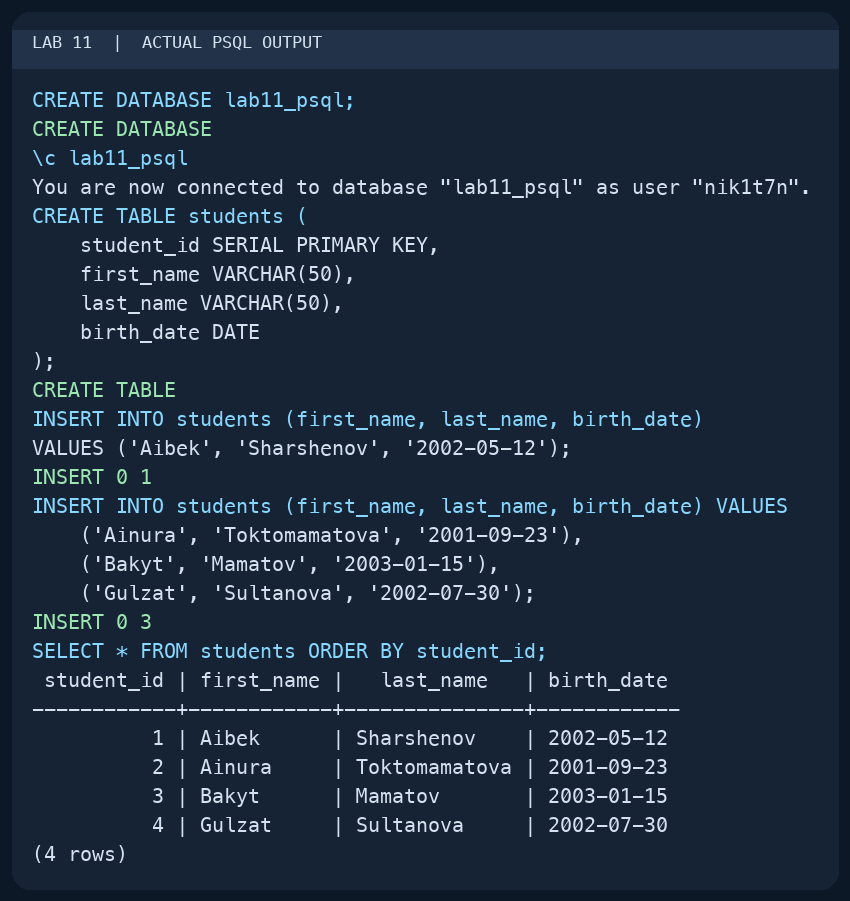
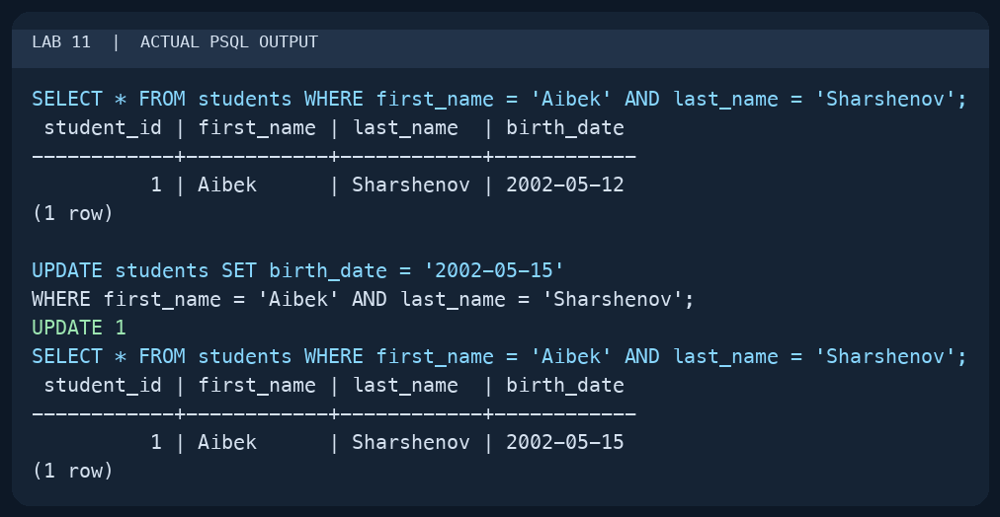
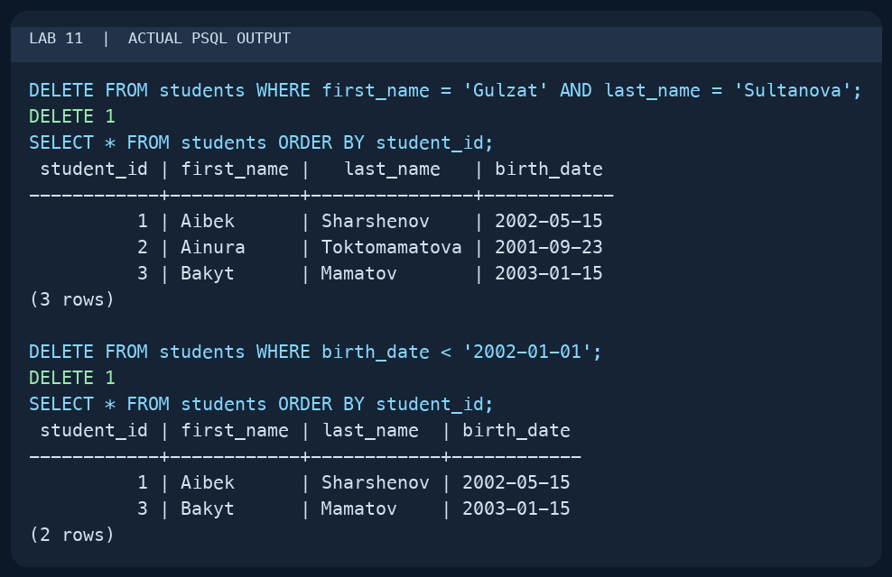
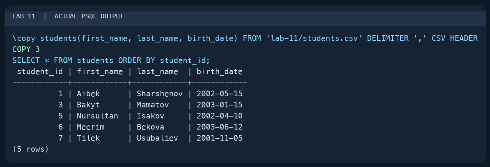
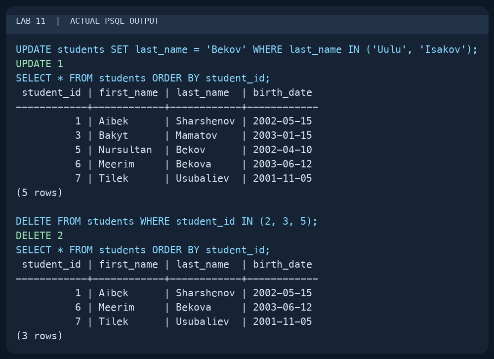

# Lab 11 — Basic Data Operations

AUCA Databases (COM-424.1) · Nikita Nosov

Source: [Basic Data Operations](https://docs.google.com/document/d/1RVpvu9cB8a5DvNdprKtkErKihBPt3OMs/edit)

This report records a local PostgreSQL 18.6 session. The images are readable PNG renderings of actual `psql` terminal output. I used the handout's student rows and ran its operations in order, checking the table after each change.

## 1. Create the table and insert rows

```text
psql postgres
```

```sql
CREATE DATABASE lab11_psql;
```

```text
\c lab11_psql
```

```sql
CREATE TABLE students (
    student_id SERIAL PRIMARY KEY,
    first_name VARCHAR(50),
    last_name VARCHAR(50),
    birth_date DATE
);
INSERT INTO students (first_name, last_name, birth_date)
VALUES ('Aibek', 'Sharshenov', '2002-05-12');

INSERT INTO students (first_name, last_name, birth_date) VALUES
    ('Ainura', 'Toktomamatova', '2001-09-23'),
    ('Bakyt', 'Mamatov', '2003-01-15'),
    ('Gulzat', 'Sultanova', '2002-07-30');

SELECT * FROM students ORDER BY student_id;
```

The single-row insert returned `INSERT 0 1`, and the multiple-row insert returned `INSERT 0 3`. The query showed four students with IDs 1 through 4.



## 2. Update a selected row

I selected Aibek's row before and after the update. The `WHERE` condition limited the change to that student.

```sql
SELECT * FROM students
WHERE first_name = 'Aibek' AND last_name = 'Sharshenov';

UPDATE students SET birth_date = '2002-05-15'
WHERE first_name = 'Aibek' AND last_name = 'Sharshenov';

SELECT * FROM students
WHERE first_name = 'Aibek' AND last_name = 'Sharshenov';
```

PostgreSQL returned `UPDATE 1`. Aibek's date changed from `2002-05-12` to `2002-05-15`.



## 3. Delete rows with conditions

```sql
DELETE FROM students
WHERE first_name = 'Gulzat' AND last_name = 'Sultanova';
SELECT * FROM students ORDER BY student_id;

DELETE FROM students WHERE birth_date < '2002-01-01';
SELECT * FROM students ORDER BY student_id;
```

The first command returned `DELETE 1` and removed Gulzat. The second also returned `DELETE 1` and removed Ainura, whose birth date was before the cutoff. Aibek and Bakyt remained. Each deletion used `WHERE`; omitting it would remove every row.



## 4. Import several rows from CSV

I prepared [students.csv](students.csv) with the three rows from the handout:

```csv
first_name,last_name,birth_date
Nursultan,Isakov,2002-04-10
Meerim,Bekova,2003-06-12
Tilek,Usubaliev,2001-11-05
```

I opened psql from the repository root and used `\copy` to read the local file. It performs the CSV import through the psql client; unlike server-side `COPY`, the path is resolved on the machine running psql.

```text
\copy students(first_name, last_name, birth_date) FROM 'lab-11/students.csv' DELIMITER ',' CSV HEADER
```

```sql
SELECT * FROM students ORDER BY student_id;
```

The import returned `COPY 3`. The table now contained five students. The new IDs were 5, 6, and 7: deleting earlier rows did not reset the `SERIAL` sequence.



## 5. Perform bulk updates and deletes

```sql
UPDATE students SET last_name = 'Bekov'
WHERE last_name IN ('Uulu', 'Isakov');
SELECT * FROM students ORDER BY student_id;

DELETE FROM students WHERE student_id IN (2, 3, 5);
SELECT * FROM students ORDER BY student_id;
```

The update returned `UPDATE 1`: Nursultan Isakov became Nursultan Bekov. There was no row with the surname Uulu, so the condition matched only one student.

The deletion returned `DELETE 2`, not three: ID 2 had already been removed by the date condition. IDs 3 and 5 were removed here. The final table contained Aibek (ID 1), Meerim (ID 6), and Tilek (ID 7).


