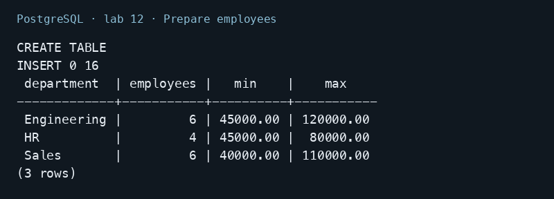
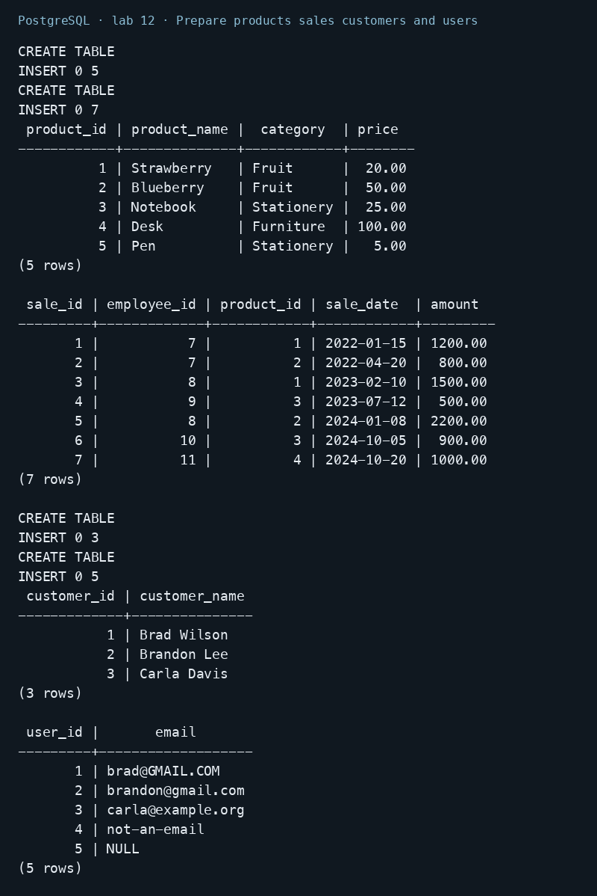
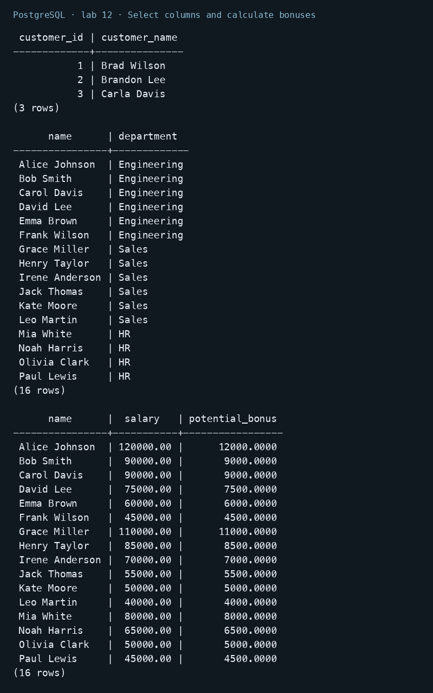
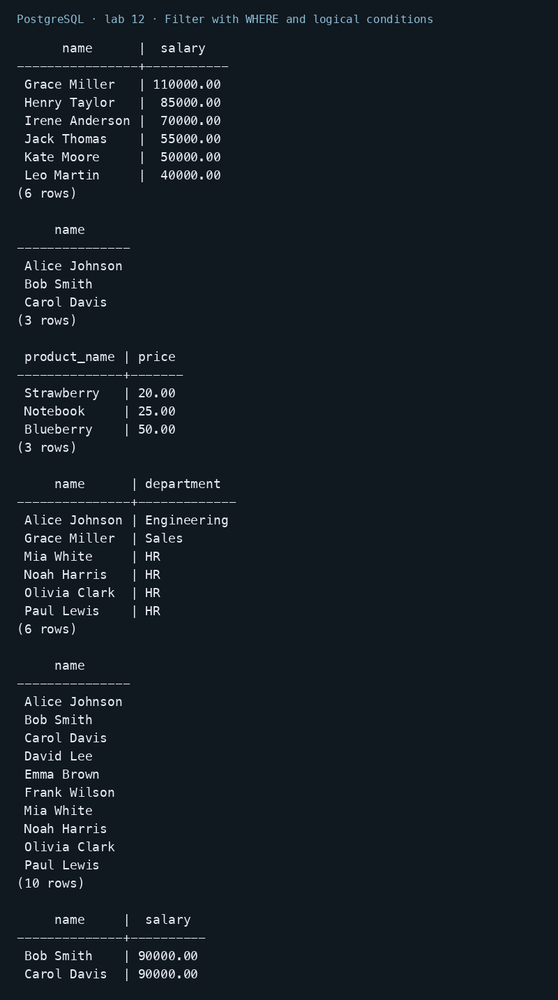
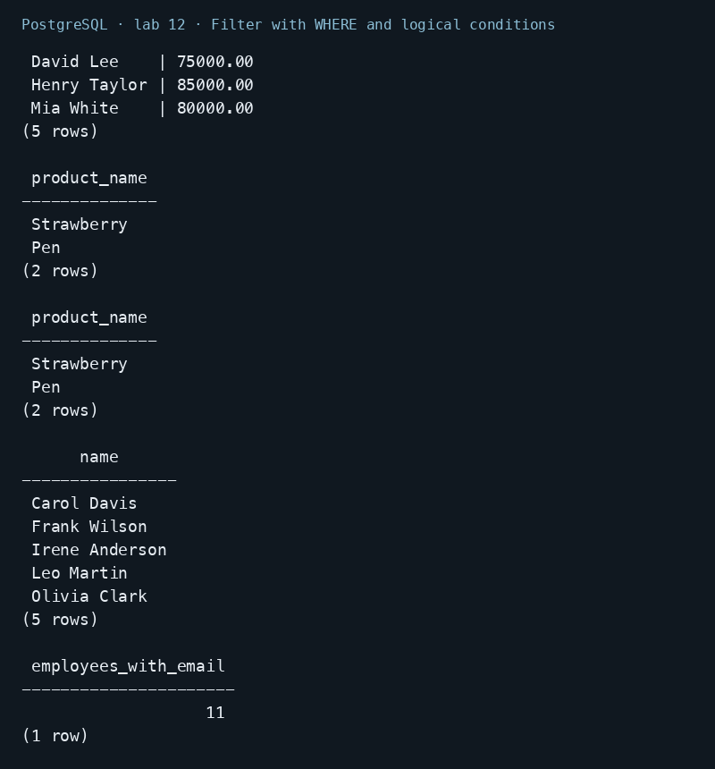
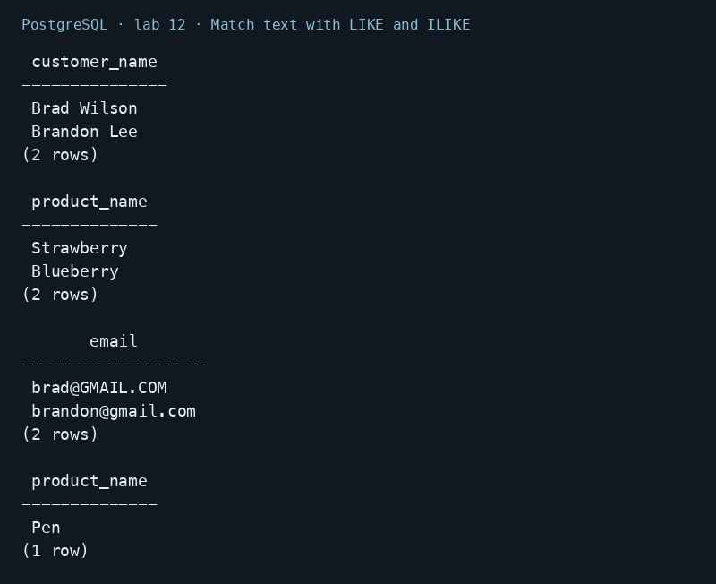
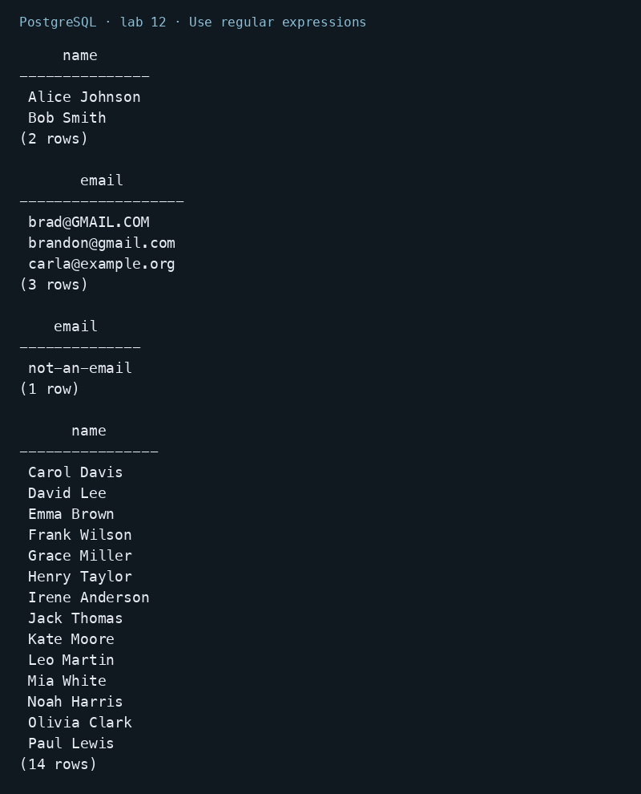
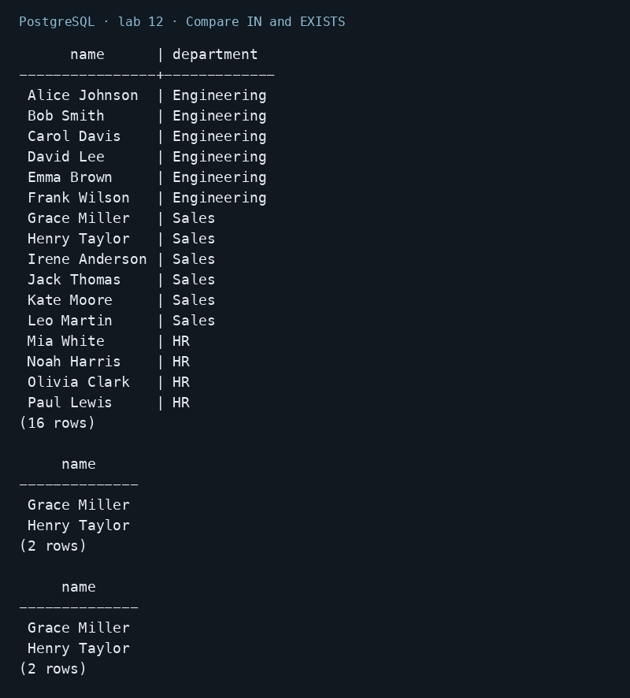
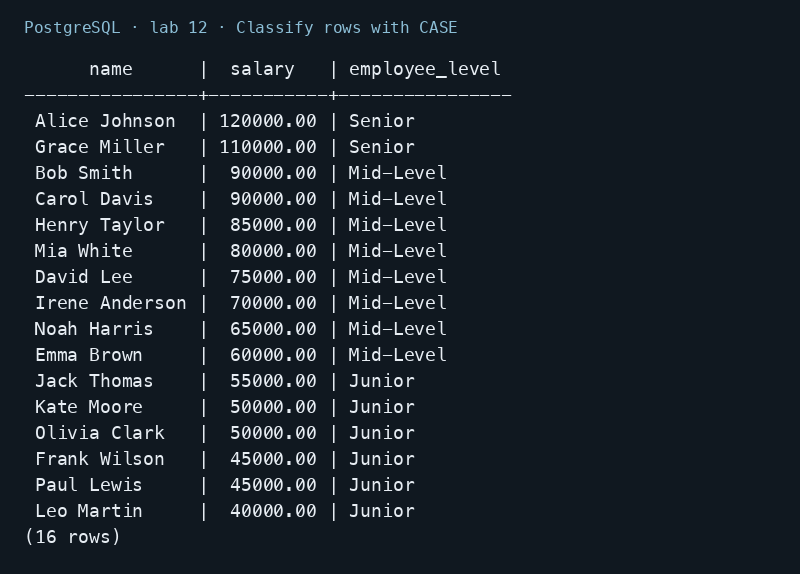
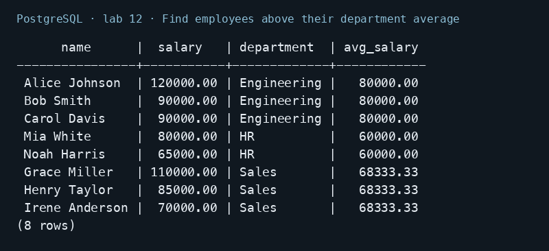

# Lab 12 — Querying Data

AUCA Databases (COM-424.1) · Nikita Nosov

Source: [Querying Data](https://docs.google.com/document/d/1-cihprgNppU8XEBNQh3kplBKjd1-9UPL/edit)

I ran the handout query types in PostgreSQL 18.6. The handout does not supply a complete dataset, so all additional teaching rows and table definitions are included below. Images are readable PNG renderings of actual psql output.

## Open the database

```text
psql postgres
```

```sql
CREATE DATABASE lab12_psql;
```

```text
\c lab12_psql
```

## 1. Prepare employees

```sql
CREATE TABLE employees (
    employee_id INTEGER PRIMARY KEY,
    first_name TEXT NOT NULL,
    last_name TEXT NOT NULL,
    name TEXT NOT NULL,
    department TEXT NOT NULL,
    department_id INTEGER NOT NULL,
    salary NUMERIC(10,2) NOT NULL,
    age INTEGER NOT NULL,
    email TEXT,
    hire_date DATE NOT NULL,
    experience_years INTEGER NOT NULL,
    bonus NUMERIC(10,2),
    manager_id INTEGER REFERENCES employees(employee_id),
    tenure INTEGER NOT NULL
);
INSERT INTO employees VALUES
 (1, 'Alice', 'Johnson', 'Alice Johnson', 'Engineering', 3, 120000, 42,
  'alice@example.com', '2018-01-15', 15, 12000, NULL, 8),
 (2, 'Bob', 'Smith', 'Bob Smith', 'Engineering', 3, 90000, 35,
  'bob@example.com', '2020-03-01', 10, 6000, 1, 6),
 (3, 'Carol', 'Davis', 'Carol Davis', 'Engineering', 3, 90000, 32,
  NULL, '2021-06-15', 8, NULL, 1, 5),
 (4, 'David', 'Lee', 'David Lee', 'Engineering', 3, 75000, 29,
  'david@example.com', '2023-02-01', 5, 3000, 2, 3),
 (5, 'Emma', 'Brown', 'Emma Brown', 'Engineering', 3, 60000, 26,
  'emma@example.com', '2024-07-01', 3, NULL, 2, 2),
 (6, 'Frank', 'Wilson', 'Frank Wilson', 'Engineering', 3, 45000, 24,
  NULL, '2025-01-10', 1, 0, 3, 1),
 (7, 'Grace', 'Miller', 'Grace Miller', 'Sales', 5, 110000, 51,
  'grace@example.com', '2017-04-20', 20, 10000, 1, 9),
 (8, 'Henry', 'Taylor', 'Henry Taylor', 'Sales', 5, 85000, 40,
  'henry@example.com', '2019-08-05', 12, 5000, 7, 7),
 (9, 'Irene', 'Anderson', 'Irene Anderson', 'Sales', 5, 70000, 34,
  NULL, '2022-09-01', 8, NULL, 7, 4),
 (10, 'Jack', 'Thomas', 'Jack Thomas', 'Sales', 5, 55000, 28,
  'jack@example.com', '2023-03-15', 4, 2000, 8, 3),
 (11, 'Kate', 'Moore', 'Kate Moore', 'Sales', 5, 50000, 25,
  'kate@example.com', '2024-01-20', 2, NULL, 8, 2),
 (12, 'Leo', 'Martin', 'Leo Martin', 'Sales', 5, 40000, 23,
  NULL, '2025-06-01', 1, 0, 9, 1),
 (13, 'Mia', 'White', 'Mia White', 'HR', 7, 80000, 54,
  'mia@example.com', '2016-10-01', 22, 4000, 1, 10),
 (14, 'Noah', 'Harris', 'Noah Harris', 'HR', 7, 65000, 38,
  'noah@example.com', '2020-02-01', 11, NULL, 13, 6),
 (15, 'Olivia', 'Clark', 'Olivia Clark', 'HR', 7, 50000, 29,
  NULL, '2023-11-01', 5, 1000, 13, 3),
 (16, 'Paul', 'Lewis', 'Paul Lewis', 'HR', 7, 45000, 26,
  'paul@example.com', '2024-04-01', 3, NULL, 14, 2);
SELECT department, COUNT(*) AS employees, MIN(salary), MAX(salary)
FROM employees GROUP BY department ORDER BY department;
```

The dataset contains 16 employees in three departments. Salaries, NULL emails, and different manager relationships make the query conditions observable. employee_id is used consistently for the identifier.



## 2. Prepare products sales customers and users

```sql
CREATE TABLE products (
    product_id INTEGER PRIMARY KEY,
    product_name TEXT NOT NULL,
    category TEXT NOT NULL,
    price NUMERIC(10,2) NOT NULL
);
INSERT INTO products VALUES
    (1, 'Strawberry', 'Fruit', 20.00),
    (2, 'Blueberry', 'Fruit', 50.00),
    (3, 'Notebook', 'Stationery', 25.00),
    (4, 'Desk', 'Furniture', 100.00),
    (5, 'Pen', 'Stationery', 5.00);
CREATE TABLE sales (
    sale_id INTEGER PRIMARY KEY,
    employee_id INTEGER REFERENCES employees(employee_id),
    product_id INTEGER REFERENCES products(product_id),
    sale_date DATE NOT NULL,
    amount NUMERIC(12,2) NOT NULL
);
INSERT INTO sales VALUES
    (1, 7, 1, '2022-01-15', 1200),
    (2, 7, 2, '2022-04-20', 800),
    (3, 8, 1, '2023-02-10', 1500),
    (4, 9, 3, '2023-07-12', 500),
    (5, 8, 2, '2024-01-08', 2200),
    (6, 10, 3, '2024-10-05', 900),
    (7, 11, 4, '2024-10-20', 1000);
SELECT * FROM products ORDER BY product_id;
SELECT * FROM sales ORDER BY sale_id;
CREATE TABLE customers (customer_id INTEGER PRIMARY KEY, customer_name TEXT);
INSERT INTO customers VALUES (1, 'Brad Wilson'), (2, 'Brandon Lee'), (3, 'Carla Davis');
CREATE TABLE users (user_id INTEGER PRIMARY KEY, email TEXT);
INSERT INTO users VALUES
    (1, 'brad@GMAIL.COM'), (2, 'brandon@gmail.com'),
    (3, 'carla@example.org'), (4, 'not-an-email'), (5, NULL);
SELECT * FROM customers ORDER BY customer_id;
SELECT * FROM users ORDER BY user_id;
```

Product prices include both BETWEEN boundaries, 20 and 50. Emails include mixed case, a different domain, an invalid string, and NULL.



## 3. Select columns and calculate bonuses

```sql
SELECT * FROM customers ORDER BY customer_id;
SELECT name, department FROM employees ORDER BY employee_id;
SELECT name, salary, salary * 0.10 AS potential_bonus
FROM employees ORDER BY employee_id;
```

SELECT * returns every column. A column list selects only the requested values. The calculated bonus is 10% of salary; AS gives that expression a readable output name.



## 4. Filter with WHERE and logical conditions

```sql
SELECT name, salary FROM employees WHERE department = 'Sales' ORDER BY employee_id;
SELECT name FROM employees
WHERE salary > 75000 AND department = 'Engineering' ORDER BY employee_id;
SELECT product_name, price FROM products
WHERE price BETWEEN 20 AND 50 ORDER BY price, product_id;
SELECT name, department FROM employees
WHERE department = 'HR' OR salary > 100000 ORDER BY employee_id;
SELECT name FROM employees WHERE NOT department = 'Sales' ORDER BY employee_id;
SELECT name, salary FROM employees WHERE salary >= 75000 AND salary <= 90000 ORDER BY employee_id;
SELECT product_name FROM products WHERE price <> 25 AND price < 50 ORDER BY product_id;
SELECT product_name FROM products WHERE price != 25 AND price < 50 ORDER BY product_id;
SELECT name FROM employees WHERE email IS NULL ORDER BY employee_id;
SELECT COUNT(*) AS employees_with_email FROM employees WHERE email IS NOT NULL;
```

Sales has six employees. The Engineering condition returns Alice, Bob, and Carol. BETWEEN includes Strawberry at 20 and Blueberry at 50, plus Notebook at 25. Both <> and != mean not equal. Five employees have NULL emails and 11 have non-NULL emails.





## 5. Match text with LIKE and ILIKE

```sql
SELECT customer_name FROM customers WHERE customer_name LIKE 'Bra%' ORDER BY customer_id;
SELECT product_name FROM products WHERE product_name LIKE '%berry' ORDER BY product_id;
SELECT email FROM users WHERE email ILIKE '%@gmail.com' ORDER BY user_id;
SELECT product_name FROM products WHERE product_name LIKE 'P_n' ORDER BY product_id;
```

Bra% matches Brad and Brandon. %berry matches Strawberry and Blueberry. ILIKE matches both Gmail addresses regardless of case. P_n matches Pen because underscore represents one character.



## 6. Use regular expressions

```sql
SELECT name FROM employees WHERE name ~ '^[AB]' ORDER BY employee_id;
SELECT email FROM users
WHERE email ~* '^[A-Z0-9._%+-]+@[A-Z0-9.-]+\.[A-Z]{2,}$' ORDER BY user_id;
SELECT email FROM users
WHERE email !~* '^[A-Z0-9._%+-]+@[A-Z0-9.-]+\.[A-Z]{2,}$' ORDER BY user_id;
SELECT name FROM employees WHERE name !~ '^[AB]' ORDER BY employee_id;
```

The name expression returns Alice and Bob. The case-insensitive email pattern accepts three addresses and rejects not-an-email. NULL is not returned by either match or non-match conditions. This is a simple teaching pattern, not complete email-address validation.



## 7. Compare IN and EXISTS

```sql
SELECT name, department FROM employees
WHERE department_id IN (3, 5, 7) ORDER BY employee_id;
SELECT name FROM employees
WHERE employee_id IN (SELECT employee_id FROM sales WHERE amount > 1000)
ORDER BY employee_id;
SELECT e.name FROM employees e
WHERE EXISTS (
    SELECT 1 FROM sales s
    WHERE s.employee_id = e.employee_id AND s.amount > 1000
) ORDER BY e.employee_id;
```

Both sales subqueries return Grace and Henry once each, even though Henry has more than one qualifying sale. EXISTS checks whether a matching row exists; performance depends on the actual plan and data.



## 8. Classify rows with CASE

```sql
SELECT name, salary,
    CASE
        WHEN salary > 100000 THEN 'Senior'
        WHEN salary BETWEEN 60000 AND 100000 THEN 'Mid-Level'
        ELSE 'Junior'
    END AS employee_level
FROM employees ORDER BY salary DESC, employee_id;
```

Alice and Grace are Senior. The 60000 boundary belongs to Mid-Level, while salaries below 60000 are Junior. ORDER BY makes the classification easy to inspect.



## 9. Find employees above their department average

```sql
WITH department_averages AS (
    SELECT department, AVG(salary) AS avg_salary
    FROM employees GROUP BY department
)
SELECT e.name, e.salary, e.department, ROUND(da.avg_salary, 2) AS avg_salary
FROM employees e
JOIN department_averages da ON e.department = da.department
WHERE e.salary > da.avg_salary
ORDER BY e.department, e.salary DESC, e.employee_id;
```

The CTE calculates one average per department. The outer query returns eight employees above their own department average: Alice, Bob, Carol, Grace, Henry, Irene, Mia, and Noah.



## Conclusion

The queries cover projection, calculations, filtering, sorting, text matching, subqueries, conditional output, and CTEs. Every displayed result was produced by the tables and rows defined in this report.
