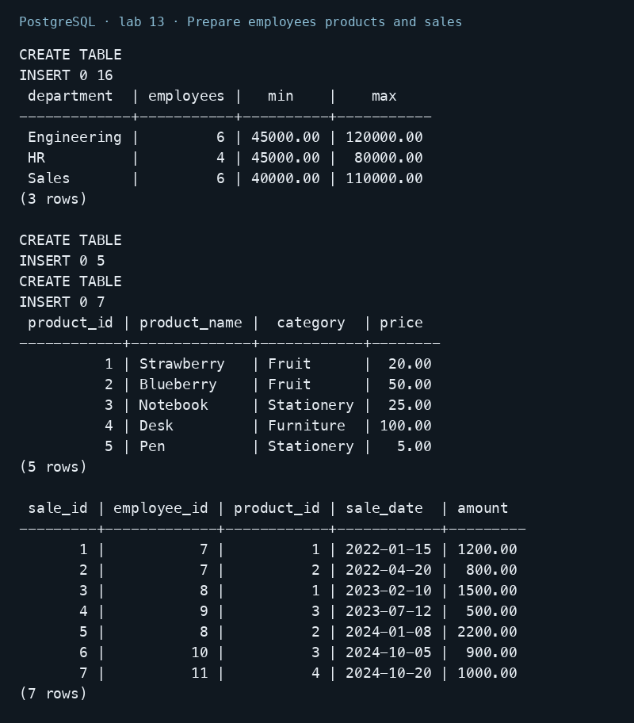
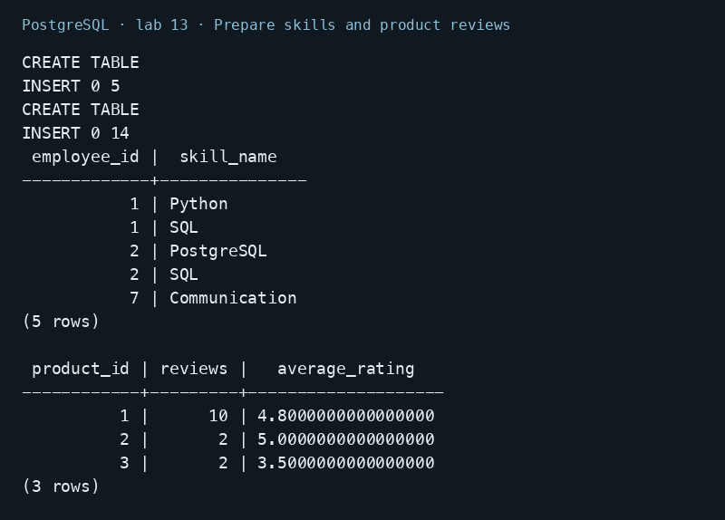
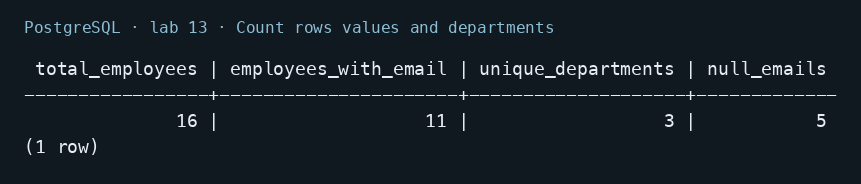
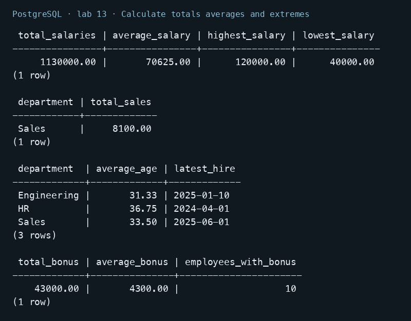
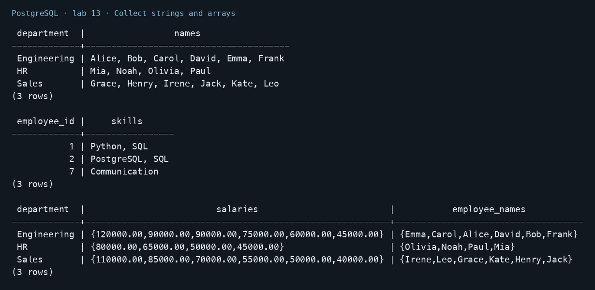
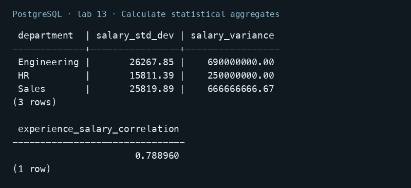
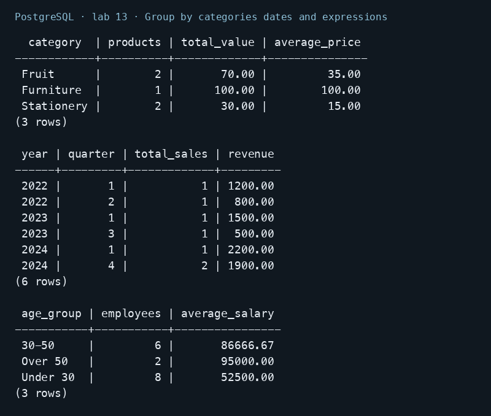
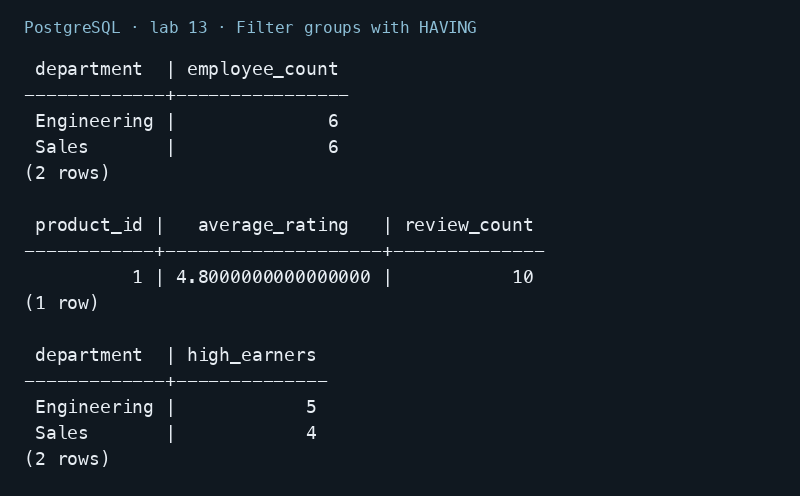
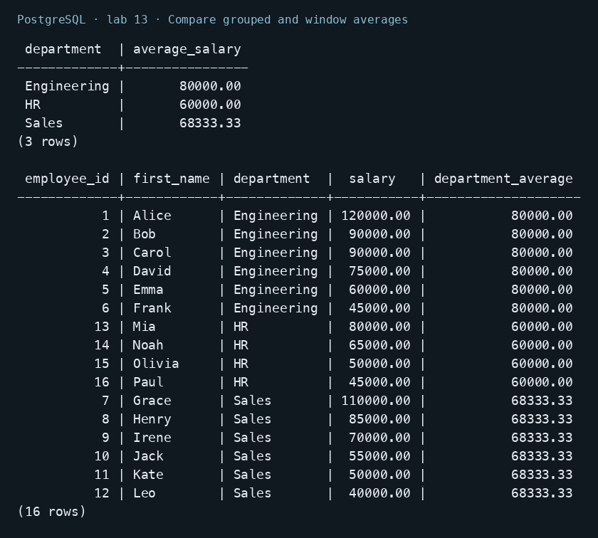
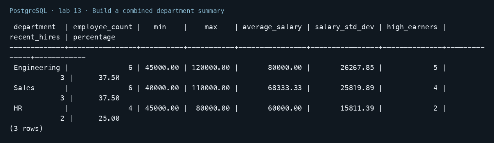

# Lab 13 — Aggregate Functions

AUCA Databases (COM-424.1) · Nikita Nosov

Source: [Aggregate Functions](https://docs.google.com/document/d/1CU4xZzAL52Sm0nzcEufCutvlu2C2Z2Yi/edit)

I ran the aggregate examples in PostgreSQL 18.6. All teaching rows are defined below because the handout supplies query examples without a complete database. Images are readable PNG renderings of actual psql output.

## Open the database

```text
psql postgres
```

```sql
CREATE DATABASE lab13_psql;
```

```text
\c lab13_psql
```

## 1. Prepare employees products and sales

```sql
CREATE TABLE employees (
    employee_id INTEGER PRIMARY KEY,
    first_name TEXT NOT NULL,
    last_name TEXT NOT NULL,
    name TEXT NOT NULL,
    department TEXT NOT NULL,
    department_id INTEGER NOT NULL,
    salary NUMERIC(10,2) NOT NULL,
    age INTEGER NOT NULL,
    email TEXT,
    hire_date DATE NOT NULL,
    experience_years INTEGER NOT NULL,
    bonus NUMERIC(10,2),
    manager_id INTEGER REFERENCES employees(employee_id),
    tenure INTEGER NOT NULL
);
INSERT INTO employees VALUES
 (1, 'Alice', 'Johnson', 'Alice Johnson', 'Engineering', 3, 120000, 42,
  'alice@example.com', '2018-01-15', 15, 12000, NULL, 8),
 (2, 'Bob', 'Smith', 'Bob Smith', 'Engineering', 3, 90000, 35,
  'bob@example.com', '2020-03-01', 10, 6000, 1, 6),
 (3, 'Carol', 'Davis', 'Carol Davis', 'Engineering', 3, 90000, 32,
  NULL, '2021-06-15', 8, NULL, 1, 5),
 (4, 'David', 'Lee', 'David Lee', 'Engineering', 3, 75000, 29,
  'david@example.com', '2023-02-01', 5, 3000, 2, 3),
 (5, 'Emma', 'Brown', 'Emma Brown', 'Engineering', 3, 60000, 26,
  'emma@example.com', '2024-07-01', 3, NULL, 2, 2),
 (6, 'Frank', 'Wilson', 'Frank Wilson', 'Engineering', 3, 45000, 24,
  NULL, '2025-01-10', 1, 0, 3, 1),
 (7, 'Grace', 'Miller', 'Grace Miller', 'Sales', 5, 110000, 51,
  'grace@example.com', '2017-04-20', 20, 10000, 1, 9),
 (8, 'Henry', 'Taylor', 'Henry Taylor', 'Sales', 5, 85000, 40,
  'henry@example.com', '2019-08-05', 12, 5000, 7, 7),
 (9, 'Irene', 'Anderson', 'Irene Anderson', 'Sales', 5, 70000, 34,
  NULL, '2022-09-01', 8, NULL, 7, 4),
 (10, 'Jack', 'Thomas', 'Jack Thomas', 'Sales', 5, 55000, 28,
  'jack@example.com', '2023-03-15', 4, 2000, 8, 3),
 (11, 'Kate', 'Moore', 'Kate Moore', 'Sales', 5, 50000, 25,
  'kate@example.com', '2024-01-20', 2, NULL, 8, 2),
 (12, 'Leo', 'Martin', 'Leo Martin', 'Sales', 5, 40000, 23,
  NULL, '2025-06-01', 1, 0, 9, 1),
 (13, 'Mia', 'White', 'Mia White', 'HR', 7, 80000, 54,
  'mia@example.com', '2016-10-01', 22, 4000, 1, 10),
 (14, 'Noah', 'Harris', 'Noah Harris', 'HR', 7, 65000, 38,
  'noah@example.com', '2020-02-01', 11, NULL, 13, 6),
 (15, 'Olivia', 'Clark', 'Olivia Clark', 'HR', 7, 50000, 29,
  NULL, '2023-11-01', 5, 1000, 13, 3),
 (16, 'Paul', 'Lewis', 'Paul Lewis', 'HR', 7, 45000, 26,
  'paul@example.com', '2024-04-01', 3, NULL, 14, 2);
SELECT department, COUNT(*) AS employees, MIN(salary), MAX(salary)
FROM employees GROUP BY department ORDER BY department;
CREATE TABLE products (
    product_id INTEGER PRIMARY KEY,
    product_name TEXT NOT NULL,
    category TEXT NOT NULL,
    price NUMERIC(10,2) NOT NULL
);
INSERT INTO products VALUES
    (1, 'Strawberry', 'Fruit', 20.00),
    (2, 'Blueberry', 'Fruit', 50.00),
    (3, 'Notebook', 'Stationery', 25.00),
    (4, 'Desk', 'Furniture', 100.00),
    (5, 'Pen', 'Stationery', 5.00);
CREATE TABLE sales (
    sale_id INTEGER PRIMARY KEY,
    employee_id INTEGER REFERENCES employees(employee_id),
    product_id INTEGER REFERENCES products(product_id),
    sale_date DATE NOT NULL,
    amount NUMERIC(12,2) NOT NULL
);
INSERT INTO sales VALUES
    (1, 7, 1, '2022-01-15', 1200),
    (2, 7, 2, '2022-04-20', 800),
    (3, 8, 1, '2023-02-10', 1500),
    (4, 9, 3, '2023-07-12', 500),
    (5, 8, 2, '2024-01-08', 2200),
    (6, 10, 3, '2024-10-05', 900),
    (7, 11, 4, '2024-10-20', 1000);
SELECT * FROM products ORDER BY product_id;
SELECT * FROM sales ORDER BY sale_id;
```

Engineering and Sales each contain six employees; HR contains four. The rows include NULL emails and bonuses, different ages, hire dates, and experience levels.



## 2. Prepare skills and product reviews

```sql
CREATE TABLE employee_skills (
    employee_id INTEGER REFERENCES employees(employee_id),
    skill_name TEXT NOT NULL,
    PRIMARY KEY (employee_id, skill_name)
);
INSERT INTO employee_skills VALUES
    (1, 'SQL'), (1, 'Python'), (2, 'PostgreSQL'), (2, 'SQL'), (7, 'Communication');
CREATE TABLE product_reviews (
    review_id INTEGER PRIMARY KEY,
    product_id INTEGER REFERENCES products(product_id),
    rating INTEGER CHECK (rating BETWEEN 1 AND 5)
);
INSERT INTO product_reviews VALUES
    (1,1,5), (2,1,5), (3,1,5), (4,1,5), (5,1,5),
    (6,1,5), (7,1,5), (8,1,5), (9,1,4), (10,1,4),
    (11,2,5), (12,2,5), (13,3,3), (14,3,4);
SELECT * FROM employee_skills ORDER BY employee_id, skill_name;
SELECT product_id, COUNT(*) AS reviews, AVG(rating) AS average_rating
FROM product_reviews GROUP BY product_id ORDER BY product_id;
```

Product 1 has ten reviews averaging 4.8. Product 2 averages 5 but has only two reviews, making the two HAVING conditions distinguishable.



## 3. Count rows values and departments

```sql
SELECT COUNT(*) AS total_employees,
       COUNT(email) AS employees_with_email,
       COUNT(DISTINCT department) AS unique_departments,
       COUNT(*) - COUNT(email) AS null_emails
FROM employees;
```

The result is 16 employees, 11 non-NULL email values, three departments, and five NULL emails. COUNT(*) counts rows; COUNT(email) skips NULL.



## 4. Calculate totals averages and extremes

```sql
SELECT SUM(salary) AS total_salaries,
       ROUND(AVG(salary), 2) AS average_salary,
       MAX(salary) AS highest_salary, MIN(salary) AS lowest_salary
FROM employees;
SELECT e.department, SUM(s.amount) AS total_sales
FROM sales s JOIN employees e ON s.employee_id = e.employee_id
GROUP BY e.department ORDER BY e.department;
SELECT department, ROUND(AVG(age), 2) AS average_age,
       MAX(hire_date) AS latest_hire
FROM employees GROUP BY department ORDER BY department;
SELECT SUM(bonus) AS total_bonus, ROUND(AVG(bonus), 2) AS average_bonus,
       COUNT(bonus) AS employees_with_bonus
FROM employees;
```

Total salary is 1130000 and average salary is 70625.00; the range is 40000–120000. Sales total 8100. Bonus calculations skip six NULL values but include the two zero bonuses; ten employees have a non-NULL bonus.



## 5. Collect strings and arrays

```sql
SELECT department, STRING_AGG(first_name, ', ' ORDER BY employee_id) AS names
FROM employees GROUP BY department ORDER BY department;
SELECT employee_id, STRING_AGG(skill_name, ', ' ORDER BY skill_name) AS skills
FROM employee_skills GROUP BY employee_id ORDER BY employee_id;
SELECT department,
       ARRAY_AGG(salary ORDER BY employee_id) AS salaries,
       ARRAY_AGG(first_name ORDER BY last_name, employee_id) AS employee_names
FROM employees GROUP BY department ORDER BY department;
```

STRING_AGG produces readable lists; ARRAY_AGG keeps a PostgreSQL array. Ordering inside the aggregate makes the element order explicit. Alice has Python and SQL; Bob has PostgreSQL and SQL.



## 6. Calculate statistical aggregates

```sql
SELECT department,
       ROUND(STDDEV(salary), 2) AS salary_std_dev,
       ROUND(VARIANCE(salary), 2) AS salary_variance
FROM employees GROUP BY department ORDER BY department;
SELECT ROUND(CORR(experience_years, salary)::NUMERIC, 6)
       AS experience_salary_correlation
FROM employees;
```

STDDEV and VARIANCE calculate sample statistics within each department. CORR measures the linear association between experience and salary in these teaching rows; it does not establish a causal relationship.



## 7. Group by categories dates and expressions

```sql
SELECT category, COUNT(*) AS products, SUM(price) AS total_value,
       ROUND(AVG(price), 2) AS average_price
FROM products GROUP BY category ORDER BY category;
SELECT EXTRACT(YEAR FROM sale_date) AS year,
       EXTRACT(QUARTER FROM sale_date) AS quarter,
       COUNT(*) AS total_sales, SUM(amount) AS revenue
FROM sales GROUP BY EXTRACT(YEAR FROM sale_date), EXTRACT(QUARTER FROM sale_date)
ORDER BY year, quarter;
SELECT CASE WHEN age < 30 THEN 'Under 30'
            WHEN age BETWEEN 30 AND 50 THEN '30-50'
            ELSE 'Over 50' END AS age_group,
       COUNT(*) AS employees, ROUND(AVG(salary), 2) AS average_salary
FROM employees
GROUP BY CASE WHEN age < 30 THEN 'Under 30'
              WHEN age BETWEEN 30 AND 50 THEN '30-50'
              ELSE 'Over 50' END
ORDER BY age_group;
```

The product summary contains three categories. Sales are grouped by year and quarter. Age groups contain six employees aged 30–50, two over 50, and eight under 30.



## 8. Filter groups with HAVING

```sql
SELECT department, COUNT(*) AS employee_count
FROM employees GROUP BY department HAVING COUNT(*) > 5 ORDER BY department;
SELECT product_id, AVG(rating) AS average_rating, COUNT(*) AS review_count
FROM product_reviews GROUP BY product_id
HAVING AVG(rating) > 4.0 AND COUNT(*) >= 10 ORDER BY product_id;
SELECT department, COUNT(*) AS high_earners
FROM employees WHERE salary > 50000
GROUP BY department HAVING COUNT(*) >= 3 ORDER BY department;
```

The first query returns Engineering and Sales, each with six employees. Only product 1 passes both review conditions. WHERE filters individual salaries before grouping; HAVING then filters the resulting group counts.



## 9. Compare grouped and window averages

```sql
SELECT department, ROUND(AVG(salary), 2) AS average_salary
FROM employees GROUP BY department ORDER BY department;
SELECT employee_id, first_name, department, salary,
       ROUND(AVG(salary) OVER (PARTITION BY department), 2) AS department_average
FROM employees ORDER BY department, employee_id;
```

GROUP BY returns three rows, one for each department. The window query returns all 16 employees and repeats the relevant department average beside each employee.



## 10. Build a combined department summary

```sql
SELECT department, COUNT(*) AS employee_count,
       MIN(salary), MAX(salary), ROUND(AVG(salary), 2) AS average_salary,
       ROUND(STDDEV(salary), 2) AS salary_std_dev,
       COUNT(CASE WHEN salary > 50000 THEN 1 END) AS high_earners,
       COUNT(CASE WHEN hire_date > '2023-01-01' THEN 1 END) AS recent_hires,
       ROUND(COUNT(*)::NUMERIC / (SELECT COUNT(*) FROM employees) * 100, 2)
           AS percentage
FROM employees GROUP BY department ORDER BY average_salary DESC;
```

Engineering and Sales each account for 37.50% of employees, and HR accounts for 25%. The numeric conversion prevents integer division. Conditional counts apply separate criteria within the same group.



## Conclusion

Aggregates reduce rows into summaries. GROUP BY chooses the groups, HAVING filters them, and window aggregates preserve the original rows. NULL handling and explicit ordering matter when interpreting results.
