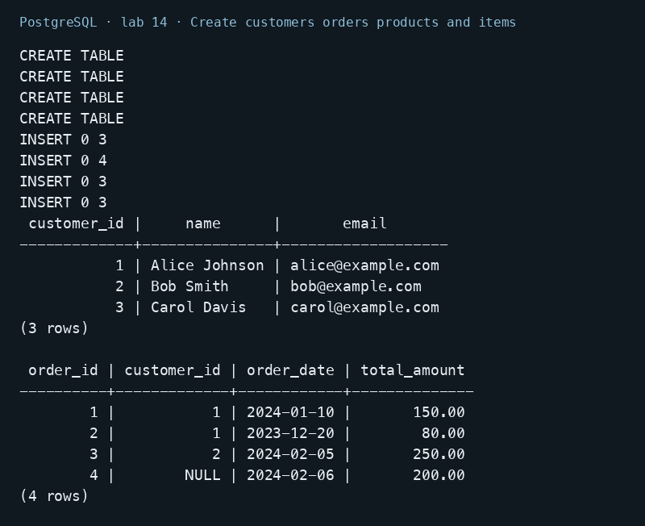
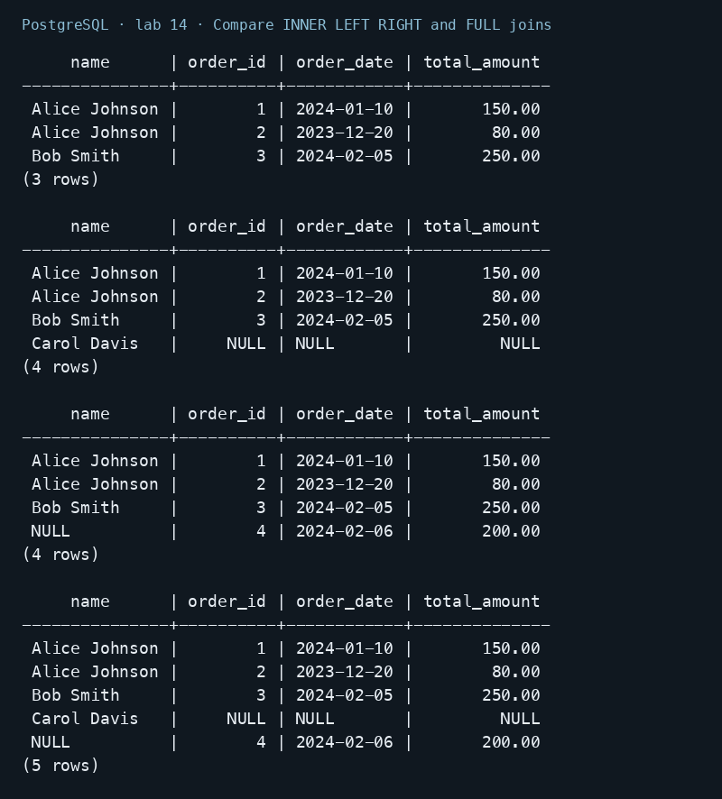
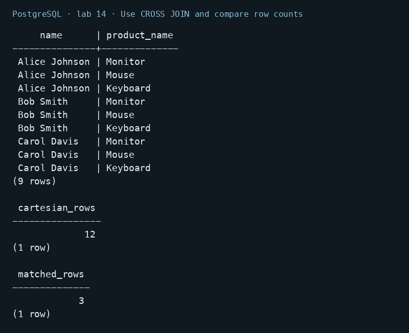
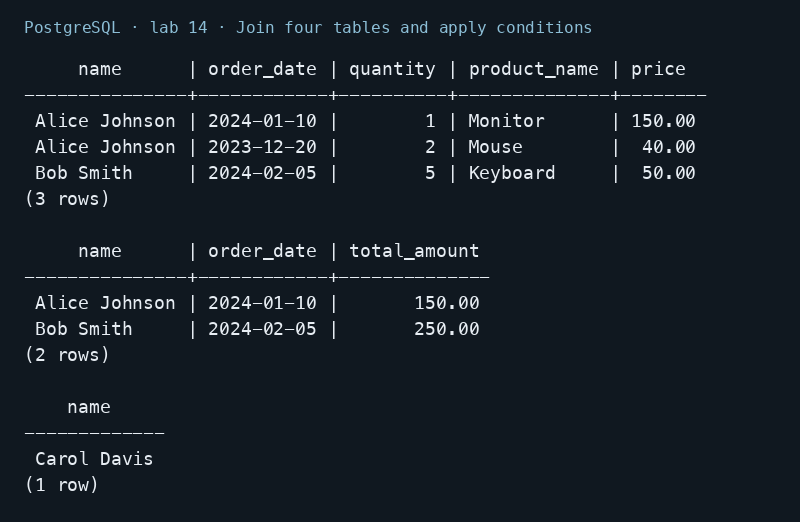
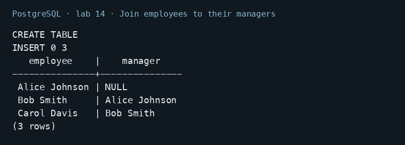
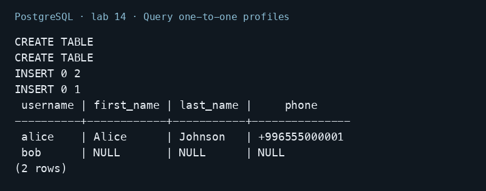
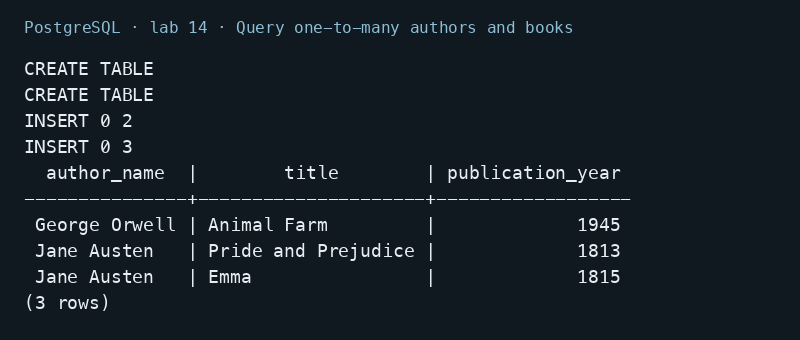
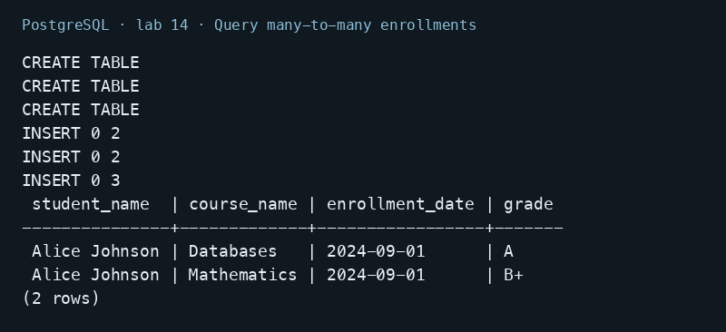
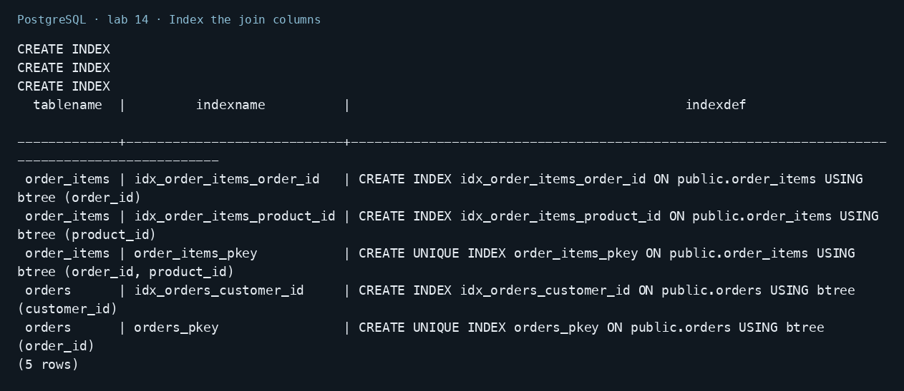

# Lab 14 — Joining Tables

AUCA Databases (COM-424.1) · Nikita Nosov

Source: [Joining Tables](https://docs.google.com/document/d/1LxE7hZ0vhc3xIfryMtvSnM64u8A0xoH0/edit)

I ran all five join types and the relationship examples in PostgreSQL 18.6. The additional teaching rows are defined below. Images are readable PNG renderings of actual psql output.

## Open the database

```text
psql postgres
```

```sql
CREATE DATABASE lab14_psql;
```

```text
\c lab14_psql
```

## 1. Create customers orders products and items

```sql
CREATE TABLE customers (
    customer_id SERIAL PRIMARY KEY, name VARCHAR(100), email VARCHAR(100)
);
CREATE TABLE orders (
    order_id SERIAL PRIMARY KEY,
    customer_id INTEGER REFERENCES customers(customer_id),
    order_date DATE, total_amount DECIMAL(10,2)
);
CREATE TABLE products (
    product_id INTEGER PRIMARY KEY, product_name TEXT NOT NULL, price NUMERIC(10,2)
);
CREATE TABLE order_items (
    order_id INTEGER REFERENCES orders(order_id),
    product_id INTEGER REFERENCES products(product_id),
    quantity INTEGER CHECK (quantity > 0),
    PRIMARY KEY (order_id, product_id)
);
INSERT INTO customers (name, email) VALUES
    ('Alice Johnson', 'alice@example.com'),
    ('Bob Smith', 'bob@example.com'),
    ('Carol Davis', 'carol@example.com');
INSERT INTO orders (customer_id, order_date, total_amount) VALUES
    (1, '2024-01-10', 150), (1, '2023-12-20', 80),
    (2, '2024-02-05', 250), (NULL, '2024-02-06', 200);
INSERT INTO products VALUES (1, 'Monitor', 150), (2, 'Mouse', 40), (3, 'Keyboard', 50);
INSERT INTO order_items VALUES (1, 1, 1), (2, 2, 2), (3, 3, 5);
SELECT * FROM customers ORDER BY customer_id;
SELECT * FROM orders ORDER BY order_id;
```

Carol has no orders. Order 4 has no customer: its nullable foreign key is NULL, which is valid. This lets outer joins show unmatched rows without violating referential integrity.



## 2. Compare INNER LEFT RIGHT and FULL joins

```sql
SELECT c.name, o.order_id, o.order_date, o.total_amount
FROM customers c INNER JOIN orders o ON c.customer_id = o.customer_id
ORDER BY c.customer_id, o.order_id;
SELECT c.name, o.order_id, o.order_date, o.total_amount
FROM customers c LEFT JOIN orders o ON c.customer_id = o.customer_id
ORDER BY c.customer_id, o.order_id;
SELECT c.name, o.order_id, o.order_date, o.total_amount
FROM customers c RIGHT JOIN orders o ON c.customer_id = o.customer_id
ORDER BY o.order_id;
SELECT c.name, o.order_id, o.order_date, o.total_amount
FROM customers c FULL OUTER JOIN orders o ON c.customer_id = o.customer_id
ORDER BY c.customer_id NULLS LAST, o.order_id;
```

INNER JOIN returns three matched orders. LEFT JOIN returns four rows, including Carol with NULL order fields. RIGHT JOIN returns all four orders, including order 4 with a NULL name. FULL OUTER JOIN returns five rows and preserves both unmatched sides.



## 3. Use CROSS JOIN and compare row counts

```sql
SELECT c.name, p.product_name
FROM customers c CROSS JOIN products p
ORDER BY c.customer_id, p.product_id;
SELECT COUNT(*) AS cartesian_rows FROM customers c, orders o;
SELECT COUNT(*) AS matched_rows
FROM customers c JOIN orders o ON c.customer_id = o.customer_id;
```

Three customers crossed with three products produce nine combinations. Omitting the relationship condition between customers and orders produces 12 combinations, whereas the correct join produces three matches.



## 4. Join four tables and apply conditions

```sql
SELECT c.name, o.order_date, oi.quantity, p.product_name, p.price
FROM customers c
JOIN orders o ON c.customer_id = o.customer_id
JOIN order_items oi ON o.order_id = oi.order_id
JOIN products p ON oi.product_id = p.product_id
ORDER BY o.order_id, p.product_id;
SELECT c.name, o.order_date, o.total_amount
FROM customers c JOIN orders o ON c.customer_id = o.customer_id
WHERE o.order_date >= '2024-01-01' AND o.total_amount > 100
ORDER BY o.order_id;
SELECT c.name FROM customers c
LEFT JOIN orders o ON c.customer_id = o.customer_id
WHERE o.order_id IS NULL ORDER BY c.customer_id;
```

The four-table query returns Monitor, Mouse, and Keyboard order lines with their customers. The date and amount conditions keep orders 1 and 3. The final anti-join finds Carol, the customer without an order; testing IS NULL is required.



## 5. Join employees to their managers

```sql
CREATE TABLE employees (
    employee_id INTEGER PRIMARY KEY, name TEXT NOT NULL,
    manager_id INTEGER REFERENCES employees(employee_id)
);
INSERT INTO employees VALUES
    (1, 'Alice Johnson', NULL), (2, 'Bob Smith', 1), (3, 'Carol Davis', 2);
SELECT e.name AS employee, m.name AS manager
FROM employees e LEFT JOIN employees m ON e.manager_id = m.employee_id
ORDER BY e.employee_id;
```

The same table has two aliases. Alice has no manager, Bob reports to Alice, and Carol reports to Bob. LEFT JOIN keeps Alice in the result.



## 6. Query one-to-one profiles

```sql
CREATE TABLE users (user_id INTEGER PRIMARY KEY, username TEXT UNIQUE NOT NULL);
CREATE TABLE user_profiles (
    user_id INTEGER PRIMARY KEY REFERENCES users(user_id),
    first_name TEXT, last_name TEXT, phone TEXT
);
INSERT INTO users VALUES (1, 'alice'), (2, 'bob');
INSERT INTO user_profiles VALUES (1, 'Alice', 'Johnson', '+996555000001');
SELECT u.username, p.first_name, p.last_name, p.phone
FROM users u LEFT JOIN user_profiles p ON u.user_id = p.user_id
ORDER BY u.user_id;
```

The profile key is also a foreign key, so each user has at most one profile. Bob remains visible with NULL profile fields. The phone number is a teaching value, not a personal contact.



## 7. Query one-to-many authors and books

```sql
CREATE TABLE authors (author_id INTEGER PRIMARY KEY, author_name TEXT NOT NULL);
CREATE TABLE books (
    book_id INTEGER PRIMARY KEY,
    author_id INTEGER REFERENCES authors(author_id),
    title TEXT NOT NULL, publication_year INTEGER
);
INSERT INTO authors VALUES (1, 'Jane Austen'), (2, 'George Orwell');
INSERT INTO books VALUES
    (1, 1, 'Pride and Prejudice', 1813), (2, 1, 'Emma', 1815),
    (3, 2, 'Animal Farm', 1945);
SELECT a.author_name, b.title, b.publication_year
FROM authors a JOIN books b ON a.author_id = b.author_id
ORDER BY a.author_name, b.publication_year;
```

Jane Austen appears twice because she has two books in this dataset. This handout model uses one author per book; it is separate from the many-to-many library model in Lab 09.



## 8. Query many-to-many enrollments

```sql
CREATE TABLE students (student_id INTEGER PRIMARY KEY, student_name TEXT NOT NULL);
CREATE TABLE courses (course_id INTEGER PRIMARY KEY, course_name TEXT NOT NULL);
CREATE TABLE enrollments (
    student_id INTEGER REFERENCES students(student_id),
    course_id INTEGER REFERENCES courses(course_id),
    enrollment_date DATE NOT NULL, grade TEXT,
    PRIMARY KEY (student_id, course_id)
);
INSERT INTO students VALUES (1, 'Alice Johnson'), (2, 'Bob Smith');
INSERT INTO courses VALUES (101, 'Databases'), (102, 'Mathematics');
INSERT INTO enrollments VALUES
    (1, 101, '2024-09-01', 'A'), (1, 102, '2024-09-01', 'B+'),
    (2, 101, '2024-09-01', NULL);
SELECT s.student_name, c.course_name, e.enrollment_date, e.grade
FROM students s
JOIN enrollments e ON s.student_id = e.student_id
JOIN courses c ON e.course_id = c.course_id
WHERE e.grade IS NOT NULL ORDER BY s.student_name, c.course_name;
```

The junction table connects each student to several courses and each course to several students. The grade filter returns Alice's two graded enrollments and excludes Bob's ungraded enrollment.



## 9. Index the join columns

```sql
CREATE INDEX idx_orders_customer_id ON orders(customer_id);
CREATE INDEX idx_order_items_order_id ON order_items(order_id);
CREATE INDEX idx_order_items_product_id ON order_items(product_id);
SELECT tablename, indexname, indexdef FROM pg_indexes
WHERE tablename IN ('orders', 'order_items') ORDER BY tablename, indexname;
```

The requested indexes were created. PostgreSQL already has a composite primary-key index on order_items(order_id, product_id), whose leading column can also support order_id lookups. The standalone order_id index is shown for the handout exercise and is redundant for many workloads. Aliases improve readability; they do not inherently make a query faster.



## Conclusion

The join type determines which unmatched rows survive. ON defines the relationship, and a junction table is necessary for many-to-many queries. The examples returned actual matches, unmatched rows, and Cartesian products.
