# Lab 15 — Advanced Querying

AUCA Databases (COM-424.1) · Nikita Nosov

Source: [Advanced Querying](https://docs.google.com/document/d/1gU37bli-KJzA6MgdamHLFV24tYdpaHL8/edit)

I ran the advanced query examples in PostgreSQL 18.6. All additional teaching tables and rows are included. Images are readable PNG renderings of actual psql output.

## Open the database

```text
psql postgres
```

```sql
CREATE DATABASE lab15_psql;
```

```text
\c lab15_psql
```

## 1. Prepare employees orders warehouses and sales

```sql
CREATE TABLE employees (
    employee_id INTEGER PRIMARY KEY,
    first_name TEXT NOT NULL,
    last_name TEXT NOT NULL,
    name TEXT NOT NULL,
    department TEXT NOT NULL,
    department_id INTEGER NOT NULL,
    salary NUMERIC(10,2) NOT NULL,
    age INTEGER NOT NULL,
    email TEXT,
    hire_date DATE NOT NULL,
    experience_years INTEGER NOT NULL,
    bonus NUMERIC(10,2),
    manager_id INTEGER REFERENCES employees(employee_id),
    tenure INTEGER NOT NULL
);
INSERT INTO employees VALUES
 (1, 'Alice', 'Johnson', 'Alice Johnson', 'Engineering', 3, 120000, 42,
  'alice@example.com', '2018-01-15', 15, 12000, NULL, 8),
 (2, 'Bob', 'Smith', 'Bob Smith', 'Engineering', 3, 90000, 35,
  'bob@example.com', '2020-03-01', 10, 6000, 1, 6),
 (3, 'Carol', 'Davis', 'Carol Davis', 'Engineering', 3, 90000, 32,
  NULL, '2021-06-15', 8, NULL, 1, 5),
 (4, 'David', 'Lee', 'David Lee', 'Engineering', 3, 75000, 29,
  'david@example.com', '2023-02-01', 5, 3000, 2, 3),
 (5, 'Emma', 'Brown', 'Emma Brown', 'Engineering', 3, 60000, 26,
  'emma@example.com', '2024-07-01', 3, NULL, 2, 2),
 (6, 'Frank', 'Wilson', 'Frank Wilson', 'Engineering', 3, 45000, 24,
  NULL, '2025-01-10', 1, 0, 3, 1),
 (7, 'Grace', 'Miller', 'Grace Miller', 'Sales', 5, 110000, 51,
  'grace@example.com', '2017-04-20', 20, 10000, 1, 9),
 (8, 'Henry', 'Taylor', 'Henry Taylor', 'Sales', 5, 85000, 40,
  'henry@example.com', '2019-08-05', 12, 5000, 7, 7),
 (9, 'Irene', 'Anderson', 'Irene Anderson', 'Sales', 5, 70000, 34,
  NULL, '2022-09-01', 8, NULL, 7, 4),
 (10, 'Jack', 'Thomas', 'Jack Thomas', 'Sales', 5, 55000, 28,
  'jack@example.com', '2023-03-15', 4, 2000, 8, 3),
 (11, 'Kate', 'Moore', 'Kate Moore', 'Sales', 5, 50000, 25,
  'kate@example.com', '2024-01-20', 2, NULL, 8, 2),
 (12, 'Leo', 'Martin', 'Leo Martin', 'Sales', 5, 40000, 23,
  NULL, '2025-06-01', 1, 0, 9, 1),
 (13, 'Mia', 'White', 'Mia White', 'HR', 7, 80000, 54,
  'mia@example.com', '2016-10-01', 22, 4000, 1, 10),
 (14, 'Noah', 'Harris', 'Noah Harris', 'HR', 7, 65000, 38,
  'noah@example.com', '2020-02-01', 11, NULL, 13, 6),
 (15, 'Olivia', 'Clark', 'Olivia Clark', 'HR', 7, 50000, 29,
  NULL, '2023-11-01', 5, 1000, 13, 3),
 (16, 'Paul', 'Lewis', 'Paul Lewis', 'HR', 7, 45000, 26,
  'paul@example.com', '2024-04-01', 3, NULL, 14, 2);
SELECT department, COUNT(*) AS employees, MIN(salary), MAX(salary)
FROM employees GROUP BY department ORDER BY department;
CREATE TABLE orders (
    order_id INTEGER PRIMARY KEY, region_id INTEGER,
    product_name TEXT NOT NULL, amount NUMERIC(12,2), status TEXT
);
INSERT INTO orders VALUES
    (1, 1, 'Monitor', 600000, 'High Priority'),
    (2, 1, 'Keyboard', 500000, 'Medium Priority'),
    (3, 2, 'Mouse', 200000, 'Low Priority'),
    (4, 2, 'Desk', 300000, 'Pending');
CREATE TABLE warehouse_1 (product_id INTEGER PRIMARY KEY, product_name TEXT, quantity INTEGER);
CREATE TABLE warehouse_2 (product_id INTEGER PRIMARY KEY, product_name TEXT, quantity INTEGER);
INSERT INTO warehouse_1 VALUES (1, 'Monitor', 5), (2, 'Mouse', 0), (3, 'Keyboard', 0);
INSERT INTO warehouse_2 VALUES (2, 'Mouse', 0), (3, 'Keyboard', 4), (4, 'Desk', 2);
CREATE TABLE sales (product_name TEXT, year INTEGER, sales_amount NUMERIC(10,2));
INSERT INTO sales VALUES
    ('Monitor', 2022, 100), ('Monitor', 2023, 150), ('Monitor', 2024, 200),
    ('Mouse', 2022, 50), ('Mouse', 2023, 75), ('Mouse', 2024, 100);
SELECT * FROM orders ORDER BY order_id;
SELECT * FROM warehouse_1 ORDER BY product_id;
SELECT * FROM warehouse_2 ORDER BY product_id;
SELECT * FROM sales ORDER BY product_name, year;
```

The data includes tied salaries, a multi-level manager hierarchy, overlapping warehouse products, and sales for three years. Region 1 has sales above the handout threshold of 1000000.

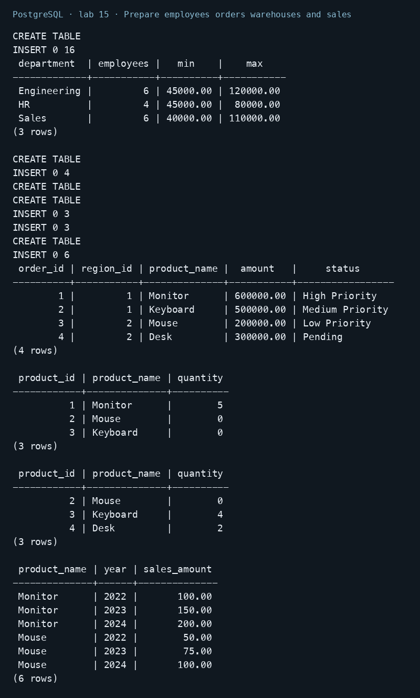

## 2. Use scalar row and table subqueries

```sql
SELECT first_name, last_name, salary
FROM employees WHERE salary > (SELECT AVG(salary) FROM employees)
ORDER BY salary DESC, employee_id;
SELECT name, department, salary FROM employees
WHERE (department, salary) = (
    SELECT department, salary FROM employees WHERE employee_id = 2
) ORDER BY employee_id;
SELECT department, employee_count FROM (
    SELECT department, COUNT(*) AS employee_count
    FROM employees GROUP BY department
) AS department_counts WHERE employee_count > 5 ORDER BY department;
```

The scalar subquery supplies the company average of 70625. The row subquery matches Bob and Carol, who share both department and salary. The table subquery finds Engineering and Sales with six employees each.

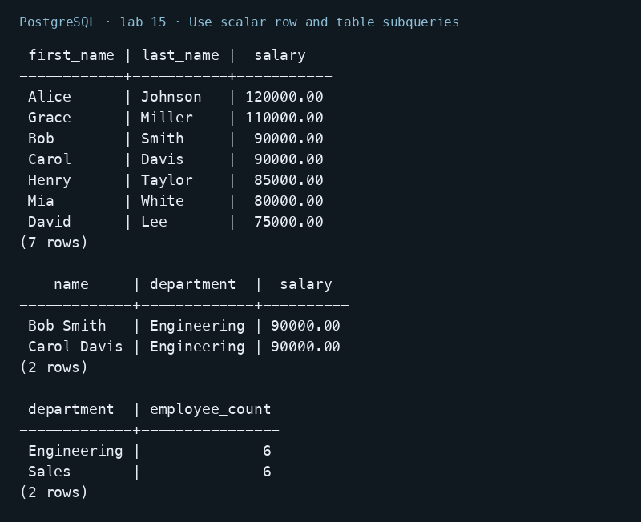

## 3. Summarize regions with a CTE

```sql
WITH regional_sales AS (
    SELECT region_id, SUM(amount) AS total_sales
    FROM orders GROUP BY region_id
)
SELECT region_id, total_sales FROM regional_sales
WHERE total_sales > 1000000 ORDER BY region_id;
```

The CTE produces one total per region. Only region 1 passes the threshold, with 1100000; region 2 totals 500000.

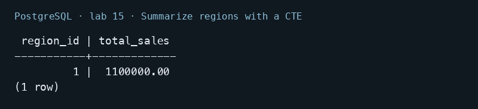

## 4. Build a recursive organization chart

```sql
WITH RECURSIVE org_chart AS (
    SELECT employee_id, first_name, last_name, manager_id, 0 AS depth
    FROM employees WHERE manager_id IS NULL
    UNION ALL
    SELECT e.employee_id, e.first_name, e.last_name, e.manager_id, oc.depth + 1
    FROM employees e JOIN org_chart oc ON e.manager_id = oc.employee_id
)
SELECT * FROM org_chart ORDER BY depth, employee_id;
```

Alice is the root at depth 0. The recursive term follows manager_id and returns all 16 employees across four levels, ending at depth 3. The teaching hierarchy is acyclic.

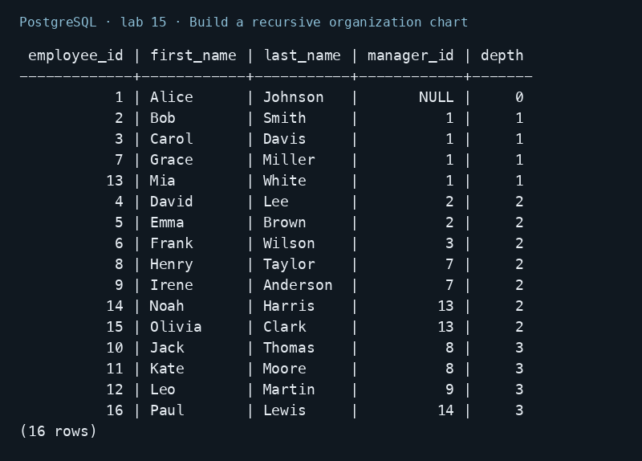

## 5. Compare the four set operations

```sql
SELECT product_name FROM warehouse_1
UNION SELECT product_name FROM warehouse_2 ORDER BY product_name;
SELECT product_name FROM warehouse_1
UNION ALL SELECT product_name FROM warehouse_2 ORDER BY product_name;
SELECT product_id FROM warehouse_1 WHERE quantity = 0
INTERSECT SELECT product_id FROM warehouse_2 WHERE quantity = 0 ORDER BY product_id;
SELECT product_id FROM warehouse_1
EXCEPT SELECT product_id FROM warehouse_2 ORDER BY product_id;
```

UNION returns four distinct products; UNION ALL retains six input rows. Only Mouse (ID 2) is out of stock in both warehouses. EXCEPT returns Monitor (ID 1), which appears only in warehouse_1.

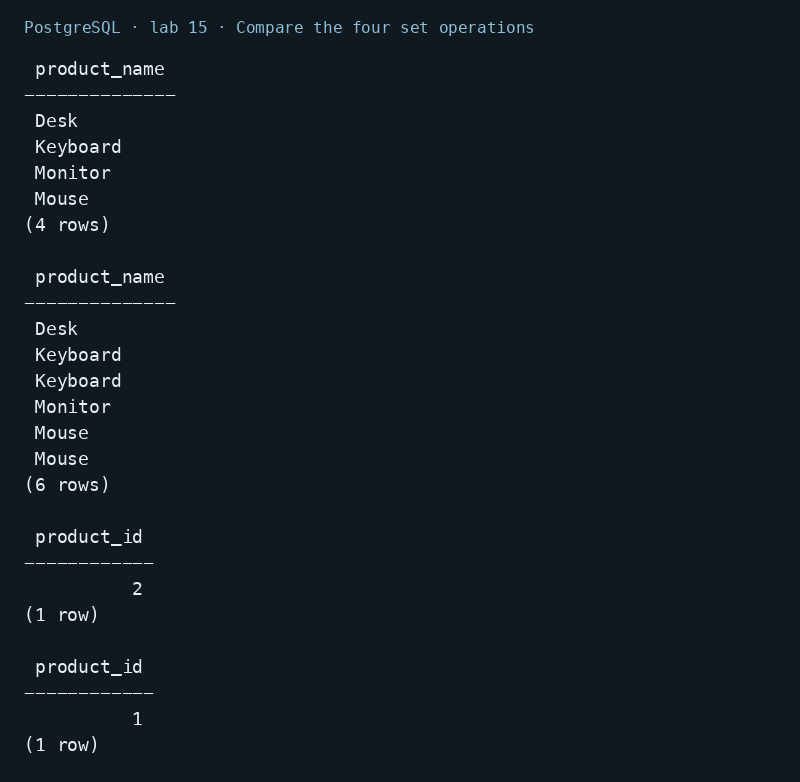

## 6. Rank employees and calculate window values

```sql
SELECT first_name, department, salary,
       ROW_NUMBER() OVER (PARTITION BY department ORDER BY salary DESC, employee_id) AS row_number,
       RANK() OVER (PARTITION BY department ORDER BY salary DESC) AS salary_rank,
       DENSE_RANK() OVER (PARTITION BY department ORDER BY salary DESC) AS dense_rank
FROM employees ORDER BY department, salary DESC, employee_id;
SELECT employee_id, first_name, department, salary,
       SUM(salary) OVER (PARTITION BY department) AS department_total,
       ROUND(AVG(salary) OVER (PARTITION BY department), 2) AS department_average,
       LAG(salary) OVER (PARTITION BY department ORDER BY salary DESC, employee_id) AS previous_salary,
       LEAD(salary) OVER (PARTITION BY department ORDER BY salary DESC, employee_id) AS next_salary
FROM employees ORDER BY department, salary DESC, employee_id;
```

Bob and Carol both receive rank 2. The next Engineering salary receives RANK 4 but DENSE_RANK 3. ROW_NUMBER remains unique. LAG and LEAD return adjacent salaries; the first or last missing neighbor is NULL.

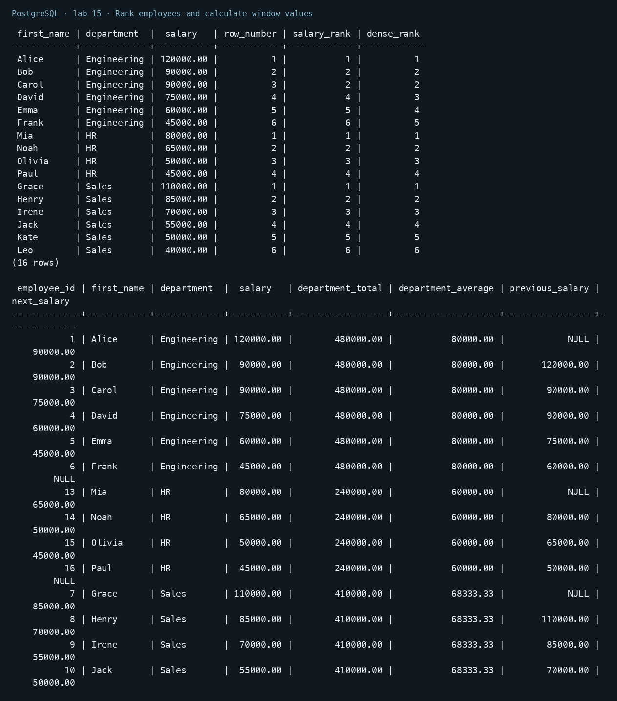

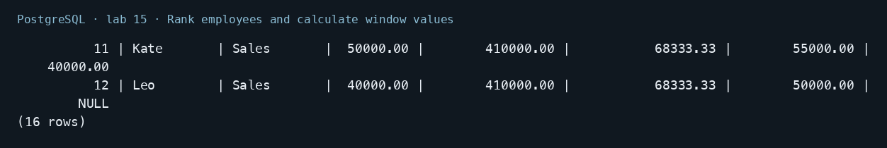

## 7. Pivot and unpivot yearly sales

```sql
CREATE VIEW pivoted_sales AS
SELECT product_name,
    SUM(CASE WHEN year = 2022 THEN sales_amount ELSE 0 END) AS year_2022,
    SUM(CASE WHEN year = 2023 THEN sales_amount ELSE 0 END) AS year_2023,
    SUM(CASE WHEN year = 2024 THEN sales_amount ELSE 0 END) AS year_2024
FROM sales GROUP BY product_name;
SELECT * FROM pivoted_sales ORDER BY product_name;
SELECT product_name, '2022' AS year, year_2022 AS sales_amount FROM pivoted_sales
UNION ALL
SELECT product_name, '2023', year_2023 FROM pivoted_sales
UNION ALL
SELECT product_name, '2024', year_2024 FROM pivoted_sales
ORDER BY product_name, year;
```

Conditional aggregation turns six sales rows into two rows with three year columns. UNION ALL converts those columns back into six rows. This uses the handout's conditional-aggregation approach; crosstab is an alternative requiring the tablefunc extension.

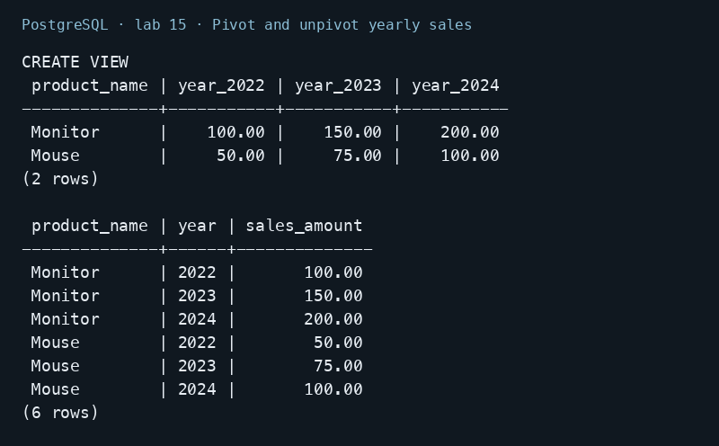

## 8. Filter aggregates and define a custom sort order

```sql
SELECT employee_id, department,
    SUM(salary) OVER (PARTITION BY department) AS total_department_salary,
    ROUND(AVG(salary) FILTER (WHERE tenure > 5) OVER (), 2) AS experienced_average
FROM employees ORDER BY employee_id;
SELECT product_name, status FROM orders
ORDER BY CASE status
    WHEN 'High Priority' THEN 1
    WHEN 'Medium Priority' THEN 2
    WHEN 'Low Priority' THEN 3
    ELSE 4
END, order_id;
```

FILTER limits the average to employees whose tenure exceeds five years while retaining every output row. CASE orders High, Medium, Low, then Pending rather than sorting the status strings alphabetically.

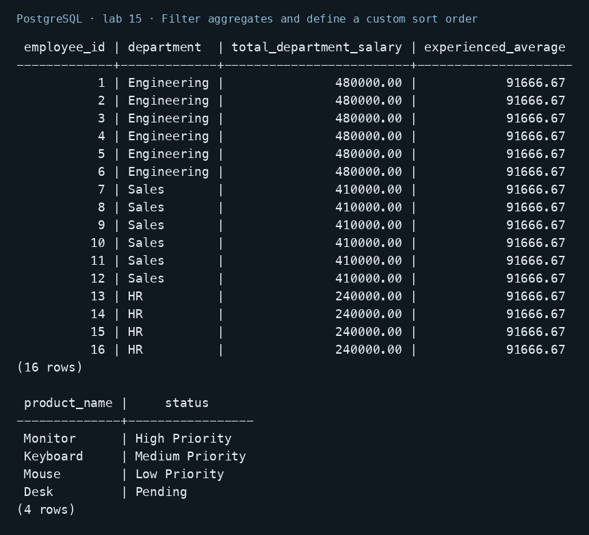

## 9. Inspect execution plans and an index

```sql
ANALYZE employees;
EXPLAIN SELECT employee_id, first_name, salary
FROM employees WHERE department = 'Engineering' ORDER BY salary DESC;
EXPLAIN ANALYZE SELECT employee_id, first_name, salary
FROM employees WHERE department = 'Engineering' ORDER BY salary DESC;
CREATE INDEX idx_employees_department_salary ON employees(department, salary DESC);
ANALYZE employees;
EXPLAIN ANALYZE SELECT employee_id, first_name, salary
FROM employees WHERE department = 'Engineering' ORDER BY salary DESC;
SELECT indexname, indexdef FROM pg_indexes WHERE tablename = 'employees' ORDER BY indexname;
SELECT employee_id, first_name, salary FROM employees
WHERE department = 'Engineering' ORDER BY salary DESC, employee_id LIMIT 3;
```

EXPLAIN shows the estimated plan; EXPLAIN ANALYZE actually runs the SELECT and reports rows and timing. On this 16-row table the planner can prefer a sequential scan even after the index exists. The report does not infer a speedup from one tiny run. The final query selects only needed columns and limits the output to three rows.

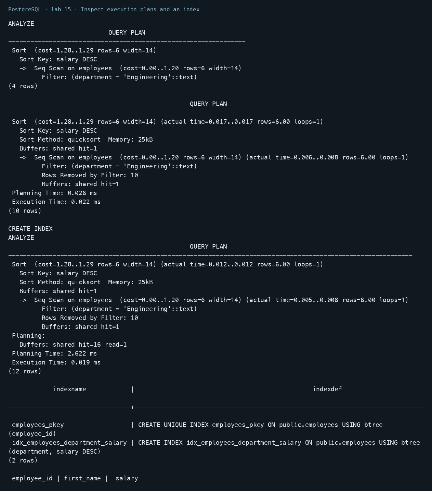

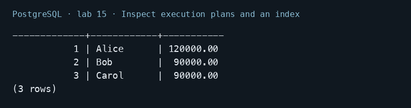

## Conclusion

Subqueries and CTEs structure calculations, recursion follows a hierarchy, set operators combine result sets, and windows preserve row detail. Conditional aggregation reshapes data. Optimization decisions should follow the actual execution plan and workload.
