# Lab 16 — Transactions and ACID Properties

AUCA Databases (COM-424.1) · Nikita Nosov

Source: [Transactions and ACID Properties](https://docs.google.com/document/d/1dgJPa86-PnyEBxg-cHCSPlxmeJ3an0oZ/edit)

I ran transactions in PostgreSQL 18.6, including two real concurrent psql connections for isolation and locking. All teaching rows and constraints are defined below. Images are readable PNG renderings of actual output.

## Open the database

```text
psql postgres
```

```sql
CREATE DATABASE lab16_psql;
```

```text
\c lab16_psql
```

## 1. Create accounts and order tables

```sql
CREATE TABLE accounts (
    account_id INTEGER PRIMARY KEY, owner TEXT NOT NULL,
    balance NUMERIC(10,2) NOT NULL CHECK (balance >= 0)
);
INSERT INTO accounts VALUES (1, 'Alice', 2000), (2, 'Bob', 1000);
CREATE TABLE customers (
    customer_id SERIAL PRIMARY KEY, name TEXT NOT NULL, email TEXT UNIQUE
);
INSERT INTO customers (name, email) VALUES ('Alice', 'alice@example.com');
CREATE TABLE products (
    product_id SERIAL PRIMARY KEY, name TEXT NOT NULL,
    price NUMERIC(10,2) NOT NULL CHECK (price >= 0)
);
CREATE TABLE inventory (
    product_id INTEGER PRIMARY KEY,
    stock INTEGER NOT NULL CHECK (stock >= 0)
);
INSERT INTO inventory VALUES (101, 10), (102, 5);
CREATE TABLE orders (
    order_id SERIAL PRIMARY KEY,
    customer_id INTEGER NOT NULL REFERENCES customers(customer_id),
    total NUMERIC(10,2) NOT NULL CHECK (total >= 0)
);
CREATE TABLE order_items (
    item_id SERIAL PRIMARY KEY,
    order_id INTEGER REFERENCES orders(order_id),
    product_id INTEGER REFERENCES inventory(product_id),
    quantity INTEGER NOT NULL CHECK (quantity > 0)
);
CREATE TABLE logs (log_id SERIAL PRIMARY KEY, message TEXT NOT NULL);
SELECT * FROM accounts ORDER BY account_id;
SELECT SUM(balance) AS total_balance FROM accounts;
```

The two accounts initially total 3000. Explicit CHECK constraints enforce nonnegative balances, stock, prices, and order totals. The negative-price example would not fail without its CHECK constraint.

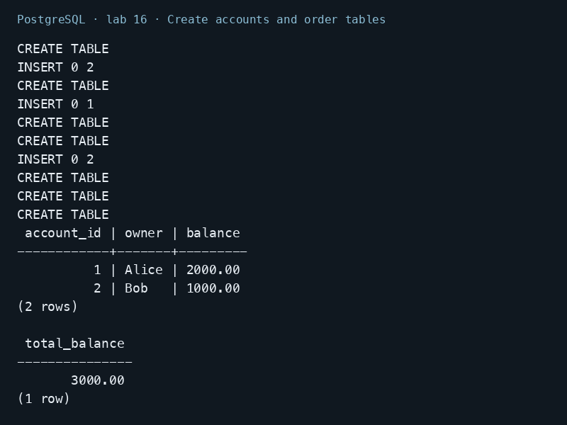

## 2. Commit and roll back transfers

```sql
BEGIN;
UPDATE accounts SET balance = balance - 100 WHERE account_id = 1;
UPDATE accounts SET balance = balance + 100 WHERE account_id = 2;
COMMIT;
SELECT * FROM accounts ORDER BY account_id;
START TRANSACTION;
UPDATE accounts SET balance = balance - 100 WHERE account_id = 1;
UPDATE accounts SET balance = balance + 100 WHERE account_id = 2;
ROLLBACK;
SELECT * FROM accounts ORDER BY account_id;
BEGIN TRANSACTION;
SELECT balance FROM accounts WHERE account_id = 1 FOR UPDATE;
UPDATE accounts SET balance = balance - 500 WHERE account_id = 1;
UPDATE accounts SET balance = balance + 500 WHERE account_id = 2;
COMMIT;
SELECT * FROM accounts ORDER BY account_id;
SELECT SUM(balance) AS total_balance FROM accounts;
```

The first COMMIT saves balances 1900 and 1100. ROLLBACK cancels the next transfer. The 500 transfer then commits balances 1400 and 1600. The total remains 3000. BEGIN, BEGIN TRANSACTION, and START TRANSACTION start an explicit transaction.

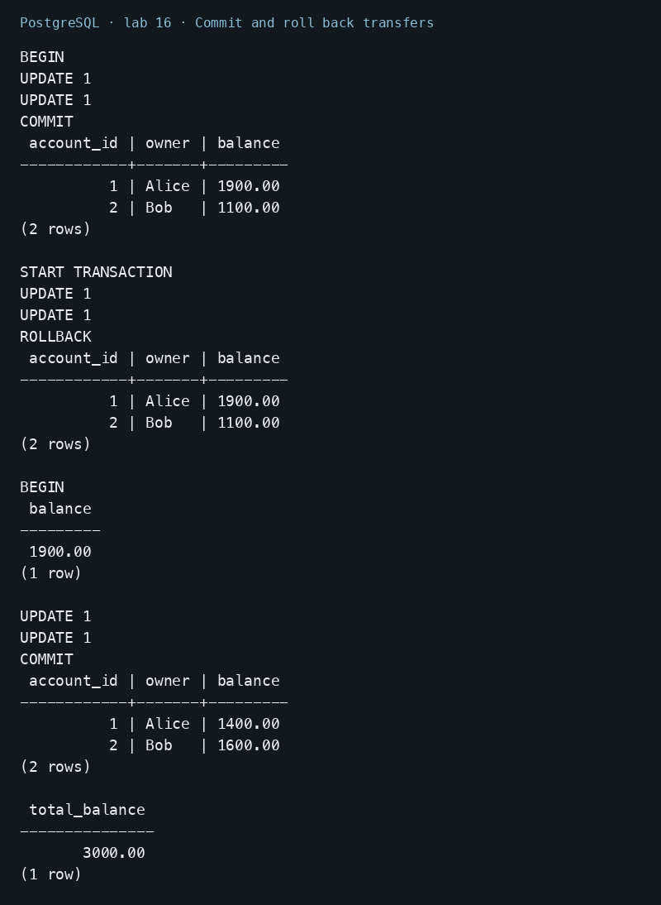

## 3. Commit related orders and inventory changes

```sql
BEGIN;
INSERT INTO orders (customer_id, total) VALUES (1, 250.00) RETURNING order_id;
INSERT INTO order_items (order_id, product_id, quantity)
VALUES (currval('orders_order_id_seq'), 101, 2);
UPDATE inventory SET stock = stock - 2 WHERE product_id = 101;
COMMIT;
BEGIN;
INSERT INTO customers (name, email) VALUES ('John Doe', 'john@email.com') RETURNING customer_id;
INSERT INTO orders (customer_id, total)
VALUES (currval('customers_customer_id_seq'), 100.00);
COMMIT;
SELECT * FROM orders ORDER BY order_id;
SELECT * FROM order_items ORDER BY item_id;
SELECT * FROM inventory ORDER BY product_id;
```

Order 1, its line, and the stock change commit together: product 101 now has stock 8. John receives customer ID 2 and order 2 references him. A named sequence currval avoids the ambiguity of LASTVAL when several sequences are used.

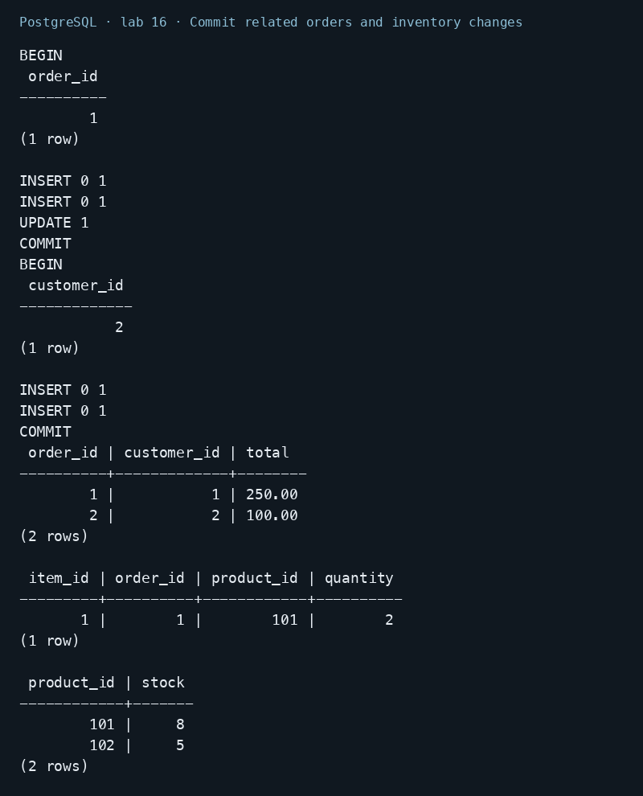

## 4. Roll back all changes after a constraint error

```sql
BEGIN;
UPDATE accounts SET balance = balance - 100 WHERE account_id = 1;
UPDATE inventory SET stock = -1 WHERE product_id = 101;
SELECT * FROM accounts;
ROLLBACK;
SELECT * FROM accounts ORDER BY account_id;
SELECT * FROM inventory ORDER BY product_id;
```

The negative stock violates CHECK. The following SELECT fails because the transaction is aborted. ROLLBACK also cancels the earlier debit, so balances stay 1400 and 1600 and stock stays 8. This demonstrates atomicity and constraint-based consistency.

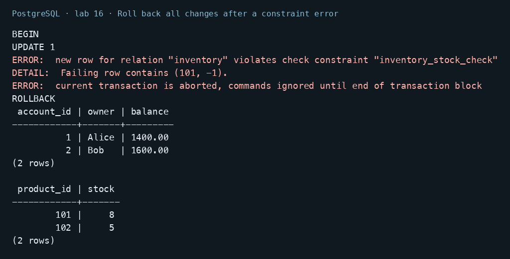

## 5. Keep the customer and replace an order using a savepoint

```sql
BEGIN;
INSERT INTO customers (name, email) VALUES ('Alice Example', 'alice2@email.com');
SAVEPOINT after_customer_insert;
INSERT INTO orders (customer_id, total)
VALUES (currval('customers_customer_id_seq'), 500.00);
ROLLBACK TO SAVEPOINT after_customer_insert;
INSERT INTO orders (customer_id, total)
VALUES (currval('customers_customer_id_seq'), 300.00);
COMMIT;
SELECT c.customer_id, c.name, o.order_id, o.total
FROM customers c JOIN orders o ON c.customer_id = o.customer_id
WHERE c.email = 'alice2@email.com';
```

The customer survives because it was inserted before the savepoint. The 500 order is discarded and only the 300 order commits. Its order ID is 4: rolling back an insert does not undo a sequence increment.

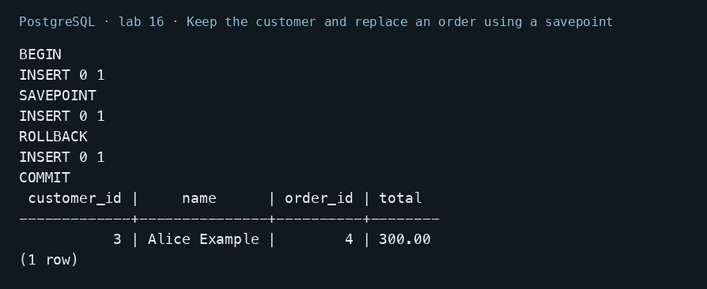

## 6. Recover from an error with multiple savepoints

```sql
BEGIN;
INSERT INTO products (name, price) VALUES ('Laptop', 999.99);
SAVEPOINT sp1;
INSERT INTO products (name, price) VALUES ('Mouse', 25.99);
SAVEPOINT sp2;
INSERT INTO products (name, price) VALUES ('Invalid Product', -50.00);
ROLLBACK TO SAVEPOINT sp2;
INSERT INTO products (name, price) VALUES ('Keyboard', 79.99);
RELEASE SAVEPOINT sp2;
RELEASE SAVEPOINT sp1;
COMMIT;
SELECT * FROM products ORDER BY product_id;
BEGIN;
INSERT INTO logs (message) VALUES ('Starting process');
SAVEPOINT process_start;
INSERT INTO logs (message) VALUES ('Process completed');
RELEASE SAVEPOINT process_start;
COMMIT;
SELECT * FROM logs ORDER BY log_id;
```

The invalid price is rejected. Rolling back to sp2 clears the error and keeps Laptop and Mouse; Keyboard then commits too. Product IDs contain a gap because the failed insert consumed a sequence value. RELEASE removes a savepoint without undoing its changes.

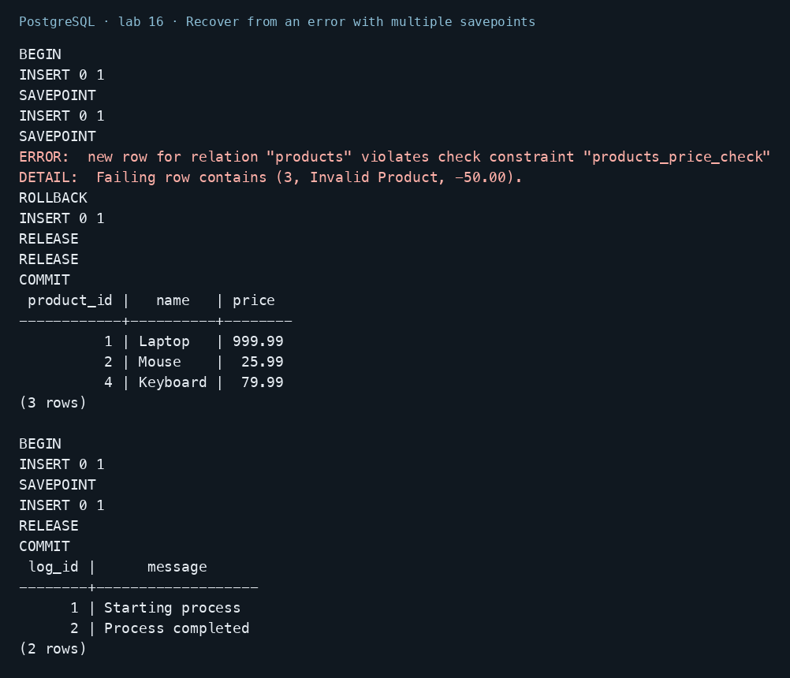

## 7. Handle insufficient funds in PostgreSQL

```sql
BEGIN;
DO $$
DECLARE
    current_balance NUMERIC;
BEGIN
    SELECT balance INTO current_balance FROM accounts
    WHERE account_id = 1 FOR UPDATE;
    IF current_balance < 3000 THEN
        RAISE EXCEPTION 'Insufficient funds';
    END IF;
    UPDATE accounts SET balance = balance - 3000 WHERE account_id = 1;
    UPDATE accounts SET balance = balance + 3000 WHERE account_id = 2;
EXCEPTION
    WHEN raise_exception THEN
        RAISE NOTICE 'Transfer cancelled: %', SQLERRM;
END $$;
COMMIT;
SELECT * FROM accounts ORDER BY account_id;
```

The exception block reports insufficient funds and leaves both balances unchanged. PostgreSQL uses RAISE EXCEPTION and exception conditions; the handout's Oracle-style exception declaration and inner ROLLBACK are not valid here.

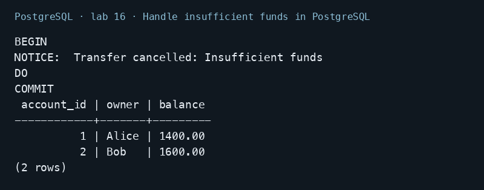

## 8. Observe READ COMMITTED in two sessions

```sql
-- Session A
BEGIN ISOLATION LEVEL READ COMMITTED;
SELECT balance FROM accounts WHERE account_id = 1;
-- Session B
BEGIN;
UPDATE accounts SET balance = balance + 100 WHERE account_id = 1;
-- Session A: before B commits
SELECT balance FROM accounts WHERE account_id = 1;
-- Session B
COMMIT;
-- Session A: after B commits
SELECT balance FROM accounts WHERE account_id = 1;
COMMIT;
```

Session A reads 1400 before and during B's uncommitted update. After B commits, the next SELECT reads 1500. There is no dirty read, but the repeated query can change under READ COMMITTED.

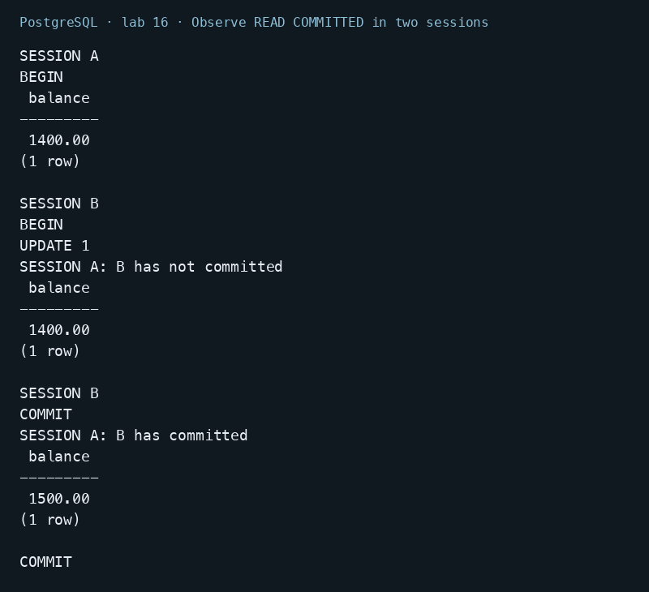

## 9. Observe REPEATABLE READ and phantom prevention

```sql
-- Session A
BEGIN ISOLATION LEVEL REPEATABLE READ;
SELECT account_id, balance FROM accounts WHERE balance > 1450 ORDER BY account_id;
-- Session B
BEGIN;
UPDATE accounts SET balance = balance + 100 WHERE account_id = 1;
INSERT INTO accounts VALUES (3, 'Carol', 2000);
COMMIT;
-- Session A
SELECT account_id, balance FROM accounts WHERE balance > 1450 ORDER BY account_id;
COMMIT;
SELECT account_id, balance FROM accounts WHERE balance > 1450 ORDER BY account_id;
```

A initially sees Alice at 1500 and Bob at 1600. Inside the same transaction it still sees those rows after B commits an update and adds Carol. After COMMIT it sees Alice at 1600, Bob at 1600, and Carol at 2000. PostgreSQL REPEATABLE READ prevents both changed-row reads and phantom rows.

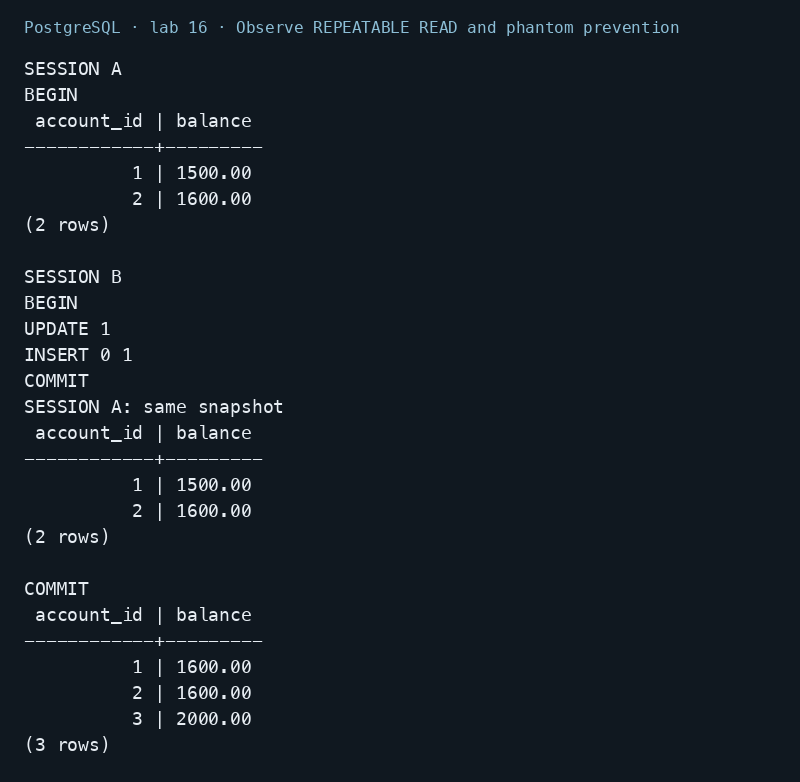

## 10. Check READ UNCOMMITTED without dirty reads

```sql
-- Session B
BEGIN;
UPDATE accounts SET balance = 1700 WHERE account_id = 1;
-- Session A
BEGIN ISOLATION LEVEL READ UNCOMMITTED;
SHOW transaction_isolation;
SELECT balance FROM accounts WHERE account_id = 1;
COMMIT;
-- Session B
ROLLBACK;
```

Although the requested level is named read uncommitted, A reads the committed value 1600 rather than B's 1700. PostgreSQL implements this level with READ COMMITTED behavior.

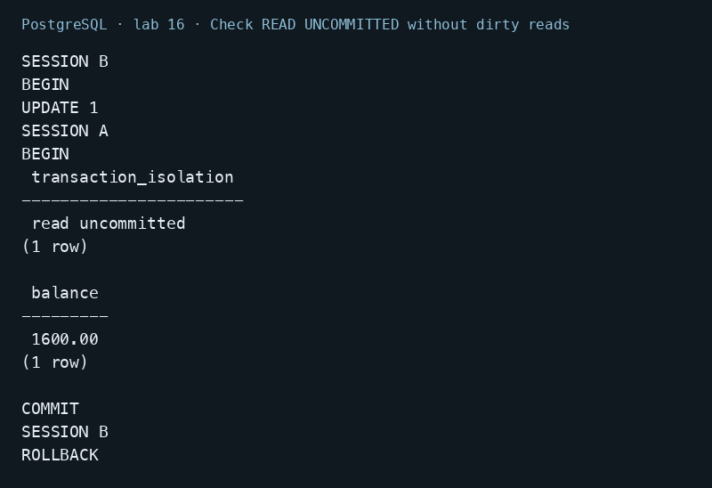

## 11. Observe a SERIALIZABLE conflict

```sql
-- Session A
BEGIN ISOLATION LEVEL SERIALIZABLE;
SELECT SUM(balance) FROM accounts;
-- Session B
BEGIN ISOLATION LEVEL SERIALIZABLE;
SELECT SUM(balance) FROM accounts;
-- Session A
UPDATE accounts SET balance = balance + 10 WHERE account_id = 1;
-- Session B
UPDATE accounts SET balance = balance + 10 WHERE account_id = 2;
-- Session A
COMMIT;
-- Session B
COMMIT;
-- New query
SELECT * FROM accounts ORDER BY account_id;
```

Both transactions read all balances and then update different accounts. PostgreSQL detects the serialization anomaly and rejects one transaction. Only one increment persists. Applications must retry the whole rejected transaction when using SERIALIZABLE.

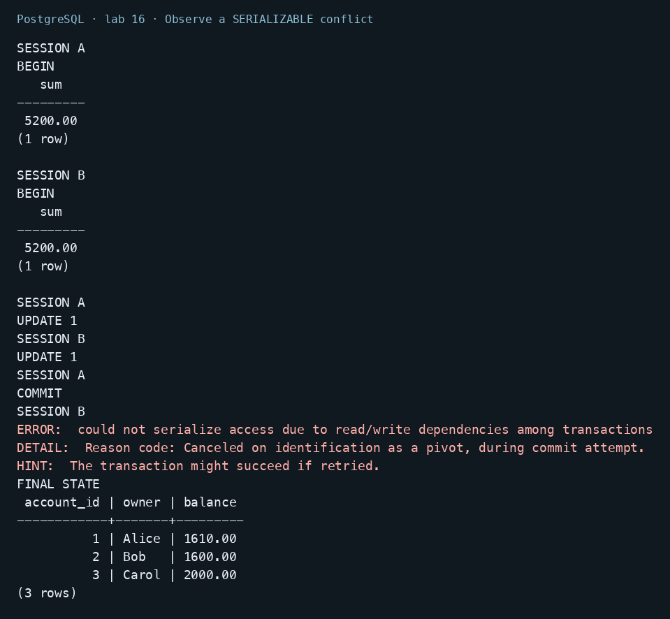

## 12. Monitor an actual blocking transaction

```sql
-- Session A
BEGIN;
SELECT * FROM accounts WHERE account_id = 1 FOR UPDATE;
-- Session B (a separate psql connection)
BEGIN;
UPDATE accounts SET balance = balance + 1 WHERE account_id = 1;
-- Monitor connection, while B is waiting
SELECT application_name, wait_event_type, wait_event,
       cardinality(pg_blocking_pids(pid)) AS blocking_sessions
FROM pg_stat_activity
WHERE application_name = 'lab16_lock_waiter';
-- Session A
COMMIT;
-- Session B: UPDATE completes; discard the demonstration increment
ROLLBACK;
```

The monitor observed B waiting on a Lock with one blocking session. Releasing A's row lock allowed B's update to complete. B then rolled back. The connection names were set when opening the two psql sessions.

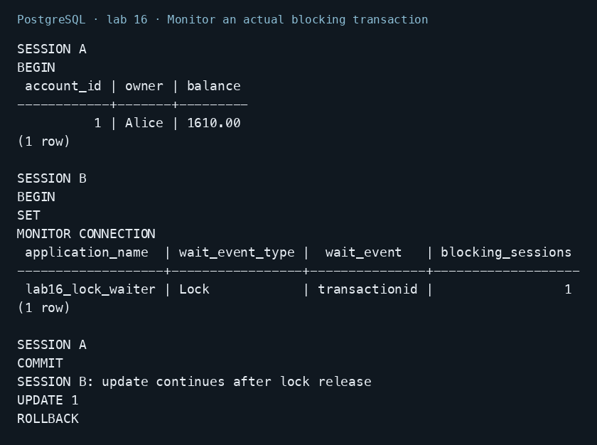

## 13. Set isolation correctly and read committed data again

```sql
BEGIN;
SET TRANSACTION ISOLATION LEVEL REPEATABLE READ;
SHOW transaction_isolation;
COMMIT;
SELECT account_id, owner, balance FROM accounts ORDER BY account_id;
SELECT SUM(balance) AS final_total FROM accounts;
```

SET TRANSACTION belongs inside a transaction before its data queries. This final SELECT ran in a new connection and could read the committed rows. The later isolation exercises intentionally changed balances and added an account, so their final total differs from the transfer-only total of 3000. A new connection verifies persistence across connections; it is not a simulated power-failure test.

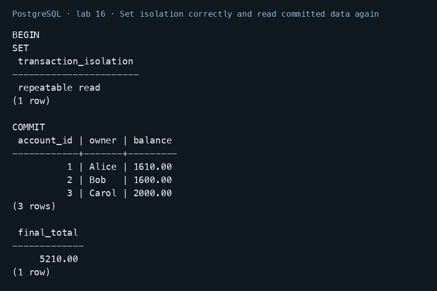

## ACID summary

- **Atomicity:** the stock error rolled back the preceding debit.
- **Consistency:** CHECK and foreign-key constraints rejected invalid states.
- **Isolation:** separate connections demonstrated snapshots, blocking, and a serialization conflict.
- **Durability:** committed changes remained visible from a new connection.

PostgreSQL-specific isolation behavior was checked against the [official documentation](https://www.postgresql.org/docs/18/transaction-iso.html). Transactions should be short, and serialization failures require retrying the complete transaction.
