# Lab 17 — Data Import/Export and Backup

AUCA Databases (COM-424.1) · Nikita Nosov

Source: [Data Import/Export and Backup](https://docs.google.com/document/d/1qLJkCgDSG3LaymACkhLxd_r6B5nqHRmU/edit)

I ran CSV transfers, logical backup and restore, WAL archiving, physical recovery, and migration in PostgreSQL 18.6. Dedicated local clusters use ports 55417–55420. All rows are teaching data defined below. Images are readable PNG renderings of actual command output.

## 1. Start an isolated PostgreSQL cluster

```bash
mkdir -p /tmp/auca-lab17/archive
initdb -D /tmp/auca-lab17/primary -A trust
cat >> /tmp/auca-lab17/primary/postgresql.conf <<'CONF'
listen_addresses = '127.0.0.1'
port = 55417
unix_socket_directories = '/tmp/auca-lab17'
shared_buffers = '16MB'
max_connections = 20
wal_level = logical
max_wal_senders = 5
max_replication_slots = 10
wal_keep_size = '64MB'
archive_mode = on
archive_command = 'test ! -f /tmp/auca-lab17/archive/%f && cp %p /tmp/auca-lab17/archive/%f'
CONF
pg_ctl -D /tmp/auca-lab17/primary -l /tmp/auca-lab17/primary.log start
psql -h localhost -p 55417 postgres -c 'SHOW port; SHOW wal_level; SHOW archive_mode;'
```

The cluster listens only on localhost and has its own directory and port. Trust authentication is limited to this local teaching setup. Logical WAL also supports physical backups and replication. -D selects a data directory; -p selects the port. The existing PostgreSQL service on port 5432 is separate.

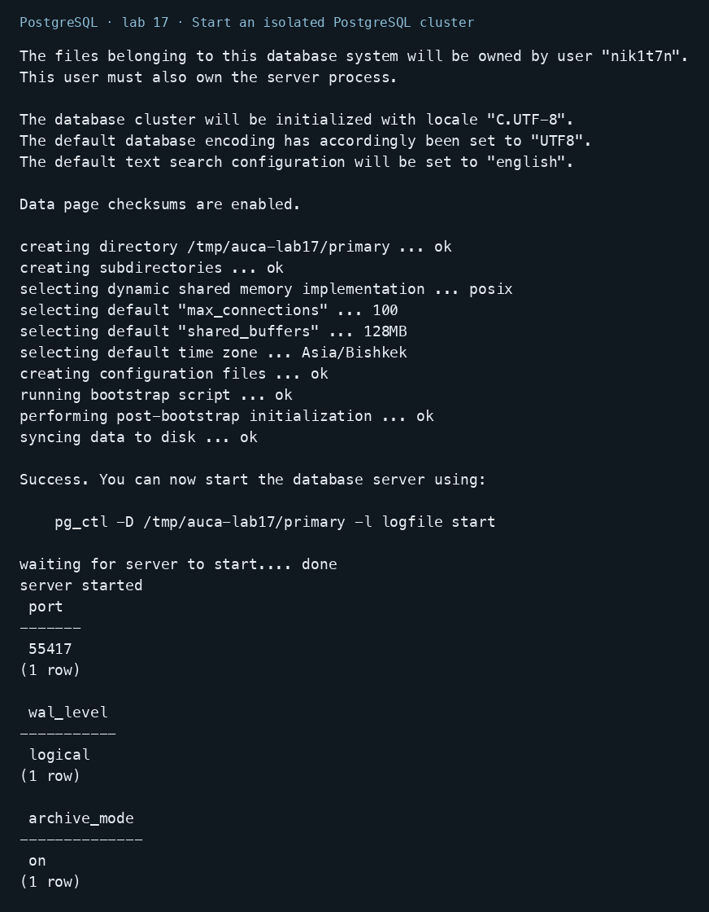

## Open the database

```text
psql -h localhost -p 55417 postgres
```

```sql
CREATE DATABASE lab17_psql;
```

```text
\c lab17_psql
```

SQL blocks below run in this database unless another connection is shown. Shell commands run from the database-labs repository root.

## 2. Create the source tables and rows

```sql
CREATE TABLE departments (department_id INTEGER PRIMARY KEY, name TEXT UNIQUE NOT NULL);
CREATE TABLE employees (
    employee_id INTEGER GENERATED ALWAYS AS IDENTITY PRIMARY KEY,
    first_name TEXT NOT NULL, last_name TEXT NOT NULL, email TEXT,
    department_id INTEGER REFERENCES departments(department_id)
);
CREATE TABLE products (
    product_id INTEGER PRIMARY KEY, product_name TEXT NOT NULL,
    price NUMERIC(10,2) NOT NULL CHECK (price >= 0)
);
CREATE TABLE customers (customer_id INTEGER PRIMARY KEY, name TEXT NOT NULL, email TEXT);
CREATE TABLE orders (
    order_id INTEGER PRIMARY KEY, customer_id INTEGER REFERENCES customers(customer_id),
    order_date DATE NOT NULL, total NUMERIC(10,2) NOT NULL
);
CREATE TABLE customer_feedback (feedback_id INTEGER PRIMARY KEY, comment TEXT);
CREATE TABLE audit_log (message TEXT);
CREATE TABLE recovery_events (event_id INTEGER PRIMARY KEY, description TEXT NOT NULL);
INSERT INTO departments VALUES (1, 'IT'), (2, 'Sales');
INSERT INTO employees (first_name, last_name, email, department_id) VALUES
    ('Alice', 'Johnson', 'alice@example.com', 1),
    ('Bob', 'Smith', NULL, 2);
INSERT INTO products VALUES (1, 'Notebook', 25), (2, 'Mouse', 40), (3, 'Keyboard', 50);
INSERT INTO customers VALUES
    (1, 'Alice Johnson', 'alice@example.com'), (2, 'Bob Smith', NULL);
INSERT INTO orders VALUES (1, 1, '2024-01-15', 25), (2, 2, '2024-01-16', 40);
INSERT INTO customer_feedback VALUES
    (1, 'Good, useful product'), (2, 'The label says "USB"'), (3, 'Спасибо');
INSERT INTO audit_log VALUES ('Created the teaching database');
INSERT INTO recovery_events VALUES (1, 'Baseline before physical backup');
SELECT * FROM products ORDER BY product_id;
SELECT * FROM customer_feedback ORDER BY feedback_id;
```

The source has related employees/departments and orders/customers, price constraints, NULL values, embedded punctuation, and UTF-8 text. These rows are the actual input for the following transfers and restores.

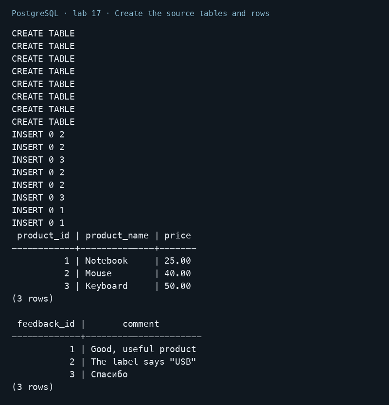

## 3. Export CSV query results and special values

```sql
COPY products TO '/Users/nik1t7n/Projects/database-labs/lab-17/data/products.csv' WITH CSV HEADER;
COPY (SELECT e.first_name, e.last_name, e.email
      FROM employees e JOIN departments d ON e.department_id = d.department_id
      WHERE d.name = 'IT')
TO '/Users/nik1t7n/Projects/database-labs/lab-17/data/it_employees.csv' WITH CSV HEADER;
COPY employees TO '/Users/nik1t7n/Projects/database-labs/lab-17/data/employees.txt' WITH CSV HEADER DELIMITER '|' NULL 'N/A';
COPY customers TO '/Users/nik1t7n/Projects/database-labs/lab-17/data/customers.csv' WITH CSV HEADER DELIMITER ';' QUOTE '"';
COPY orders TO '/Users/nik1t7n/Projects/database-labs/lab-17/data/orders.csv' WITH (FORMAT CSV, HEADER, FORCE_QUOTE (order_date));
COPY customer_feedback TO '/Users/nik1t7n/Projects/database-labs/lab-17/data/feedback.csv'
WITH CSV HEADER DELIMITER ',' QUOTE '"' ESCAPE '"' ENCODING 'UTF8';
```

COPY writes files from the server process. Because this server runs locally as my macOS user, the repository paths are accessible. Export counts are 3 products, 1 IT employee, 2 employees, 2 customers, 2 orders, and 3 feedback rows. FORCE_QUOTE quotes the date field; it does not change the date format.

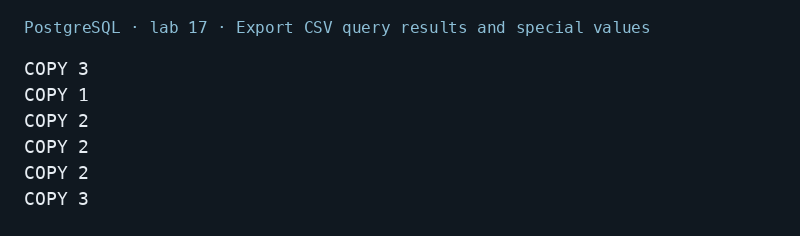

## 4. Inspect the exported files

```bash
cat lab-17/data/products.csv
cat lab-17/data/employees.txt
cat lab-17/data/feedback.csv
cat lab-17/data/orders.csv
```

The files contain headers. The pipe-delimited employee export represents Bob's NULL email as N/A. CSV quotes fields containing commas and doubles embedded quotation marks. UTF-8 preserves the Cyrillic feedback text. The exported files are included in data/.

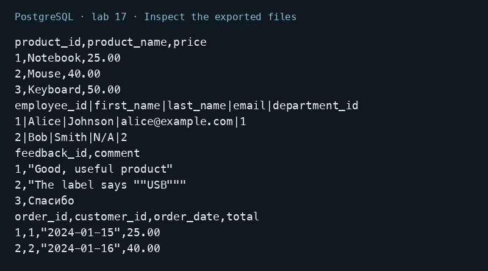

## 5. Import CSV and handle a conversion error

```sql
CREATE TABLE imported_products (LIKE products INCLUDING ALL);
COPY imported_products FROM '/Users/nik1t7n/Projects/database-labs/lab-17/data/products.csv' WITH CSV HEADER ENCODING 'UTF8';
CREATE TABLE imported_employees (LIKE employees INCLUDING ALL);
COPY imported_employees(first_name, last_name, email)
FROM '/Users/nik1t7n/Projects/database-labs/lab-17/data/new_employees.csv' WITH CSV HEADER;
CREATE TABLE imported_feedback (LIKE customer_feedback INCLUDING ALL);
COPY imported_feedback FROM '/Users/nik1t7n/Projects/database-labs/lab-17/data/feedback.csv' WITH CSV HEADER ENCODING 'UTF8';
CREATE TABLE accepted_products (LIKE products INCLUDING ALL);
COPY accepted_products FROM '/Users/nik1t7n/Projects/database-labs/lab-17/data/products_with_errors.csv'
WITH (FORMAT CSV, HEADER, ON_ERROR IGNORE);
SELECT * FROM imported_products ORDER BY product_id;
SELECT employee_id, first_name, last_name, email, department_id FROM imported_employees;
SELECT * FROM imported_feedback ORDER BY feedback_id;
SELECT * FROM accepted_products ORDER BY product_id;
```

The normal import restores all three products and the UTF-8 feedback. A column-list import lets the identity value be generated and leaves department_id NULL. ON_ERROR IGNORE skips the non-numeric price row and loads IDs 10 and 12; it does not skip every possible constraint error.

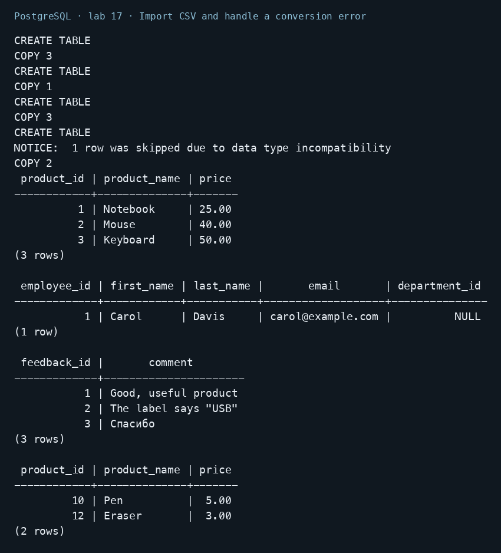

## 6. Check that COPY still enforces constraints

```sql
COPY accepted_products FROM '/Users/nik1t7n/Projects/database-labs/lab-17/data/products_with_errors.csv'
WITH (FORMAT CSV, HEADER, ON_ERROR IGNORE);
SELECT * FROM accepted_products ORDER BY product_id;
```

Repeating the import hits duplicate primary key 10 and fails, despite ON_ERROR IGNORE. The two existing rows remain. This option handles input conversion errors, not duplicate-key or CHECK violations.

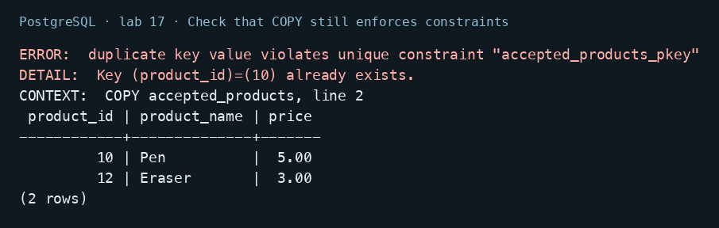

## 7. Create logical backups

```bash
pg_dump -h localhost -p 55417 lab17_psql -f lab-17/backups/lab17.sql
pg_dump -h localhost -p 55417 -Fc lab17_psql -f lab-17/backups/lab17.dump
pg_dump -h localhost -p 55417 -s lab17_psql -f lab-17/backups/schema.sql
pg_dump -h localhost -p 55417 -a lab17_psql -f lab-17/backups/data.sql
pg_dump -h localhost -p 55417 -t products lab17_psql -f lab-17/backups/products.sql
pg_dump -h localhost -p 55417 -T audit_log lab17_psql -f /tmp/auca-lab17/without-audit.sql
ls -lh lab-17/backups
```

The default format is a SQL script. -Fc creates a custom archive, -f selects the output file, -s saves only definitions, -a saves only data, -t selects a table, and -T excludes one. The files preserve only this teaching database. Ownership commands are included by default; -O would omit them in plain SQL and is specified on pg_restore for an archive.

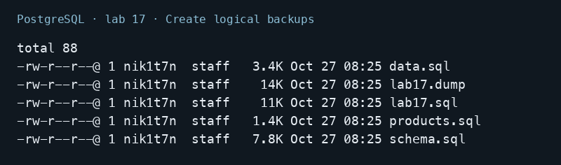

## 8. Restore SQL and custom-format backups

```bash
createdb -h localhost -p 55417 lab17_sql_restore
psql -h localhost -p 55417 lab17_sql_restore -f lab-17/backups/lab17.sql
createdb -h localhost -p 55417 lab17_archive_restore
pg_restore -h localhost -p 55417 -d lab17_archive_restore lab-17/backups/lab17.dump
psql -h localhost -p 55417 lab17_archive_restore -c 'SELECT * FROM products ORDER BY product_id; SELECT COUNT(*) AS feedback_rows FROM customer_feedback;'
```

Both the plain SQL restore and custom archive restore succeeded in new databases. The archive restore contains three products and three feedback rows. -d selects the existing destination database for pg_restore.

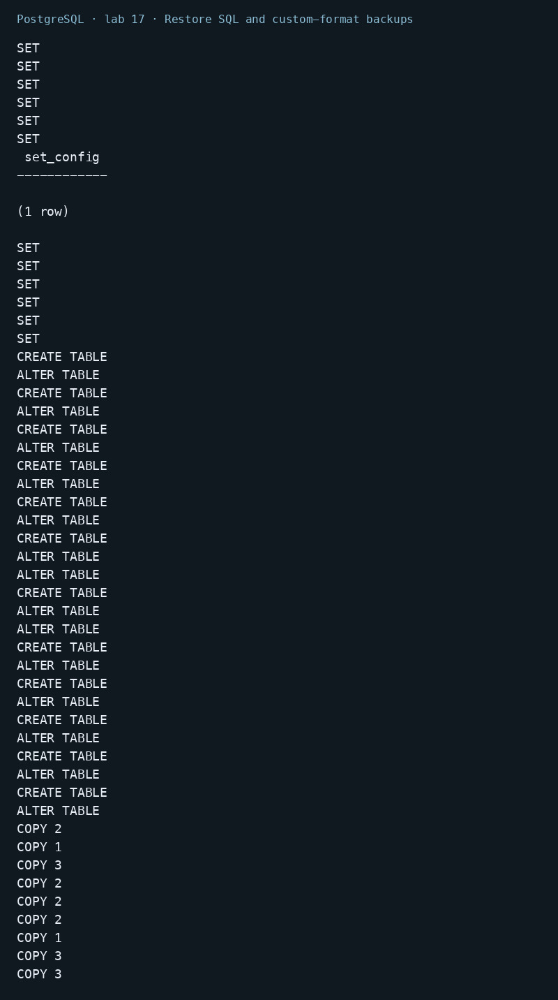

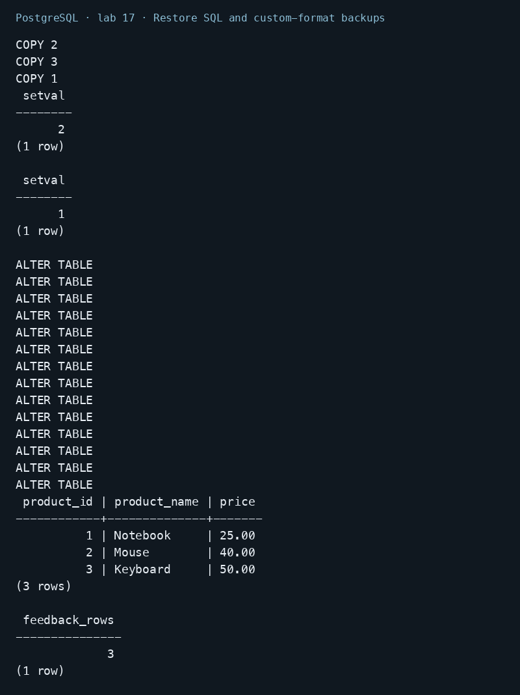

## 9. Restore selected objects and validate the archive

```bash
pg_restore --list lab-17/backups/lab17.dump
createdb -h localhost -p 55417 lab17_selected_restore
pg_restore -h localhost -p 55417 -d lab17_selected_restore -t products lab-17/backups/lab17.dump
createdb -h localhost -p 55417 lab17_split_restore
psql -h localhost -p 55417 lab17_split_restore -f lab-17/backups/schema.sql
psql -h localhost -p 55417 lab17_split_restore -f lab-17/backups/data.sql
createdb -h localhost -p 55417 lab17_parallel_restore
pg_restore -h localhost -p 55417 -j 2 -d lab17_parallel_restore lab-17/backups/lab17.dump
psql -h localhost -p 55417 lab17_selected_restore -c 'SELECT * FROM products ORDER BY product_id;'
psql -h localhost -p 55417 lab17_split_restore -c 'SELECT COUNT(*) AS products FROM products;'
psql -h localhost -p 55417 lab17_parallel_restore -c 'SELECT COUNT(*) AS products FROM products;'
```

Listing an archive inspects its contents; restoring it checks more. A selected-table restore loads products, while separate schema/data files and the two-worker archive restore also produce three products. -j 2 requests two restore workers; it is not a performance claim. A -t archive restore does not automatically include every dependent object or post-data constraint, so the complete restore is used for integrity checks.

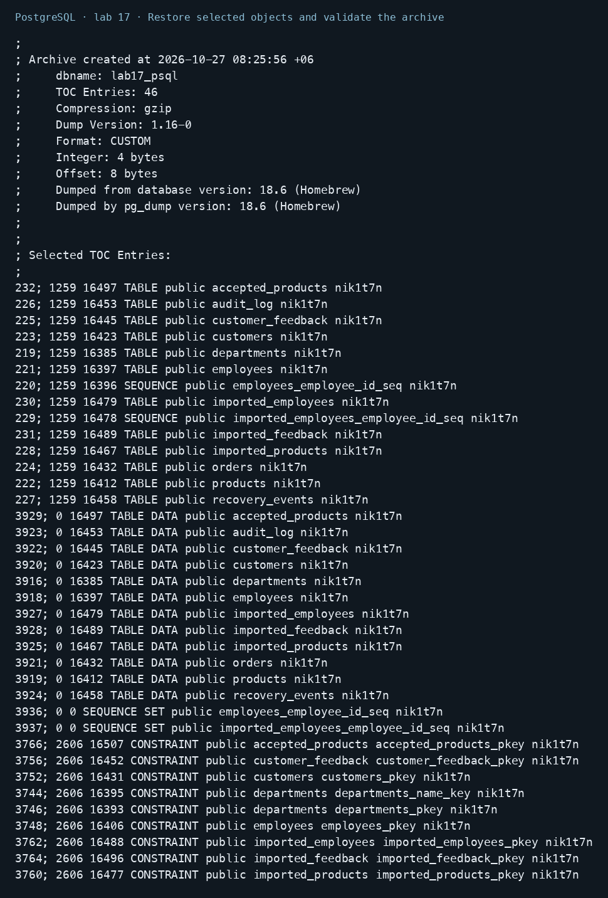

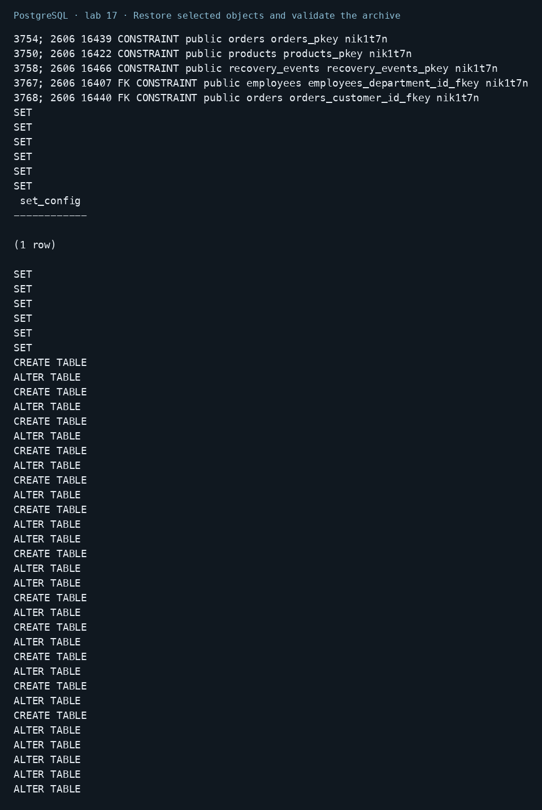

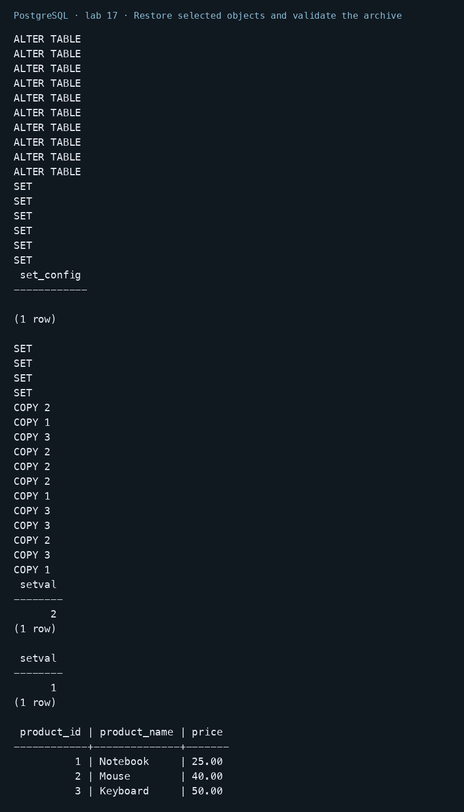

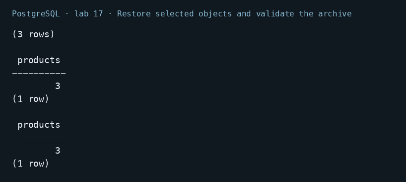

## 10. Verify restored rows and constraints

```sql
-- Run in lab17_psql, lab17_sql_restore, and lab17_archive_restore
SELECT COUNT(*) AS products, SUM(price) AS price_sum FROM products;
SELECT COUNT(*) AS customers FROM customers;
SELECT COUNT(*) AS orders FROM orders;
SELECT COUNT(*) AS feedback_rows FROM customer_feedback;
SELECT conrelid::regclass AS table_name, contype, pg_get_constraintdef(oid)
FROM pg_constraint WHERE conrelid IN ('products'::regclass, 'orders'::regclass)
ORDER BY conrelid::regclass::text, contype, pg_get_constraintdef(oid);
SELECT COUNT(*) AS orphan_orders FROM orders o
LEFT JOIN customers c ON o.customer_id = c.customer_id
WHERE c.customer_id IS NULL;
SELECT * FROM customer_feedback ORDER BY feedback_id;
-- In lab17_archive_restore: both commands must fail
INSERT INTO products VALUES (1, 'Duplicate', 1);
INSERT INTO orders VALUES (99, 999, '2024-01-17', 1);
```

The source and both complete restores match: 3 products totaling 115, 2 customers, 2 orders, 3 feedback rows, and zero orphan orders. Primary keys, CHECK, NOT NULL, and the order foreign key survived restoration. Duplicate product and nonexistent customer references were rejected.

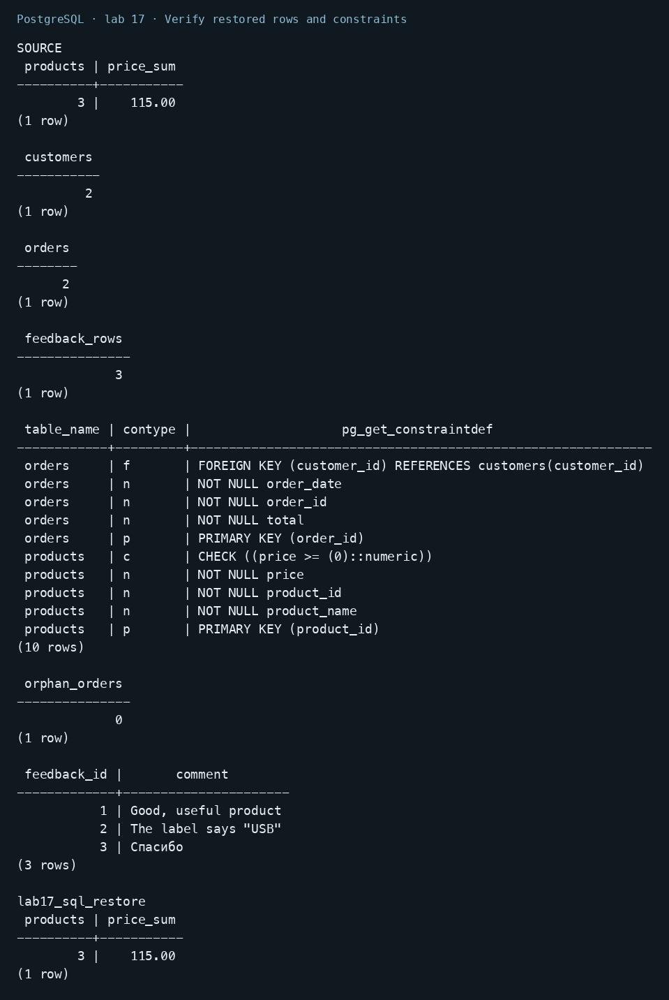

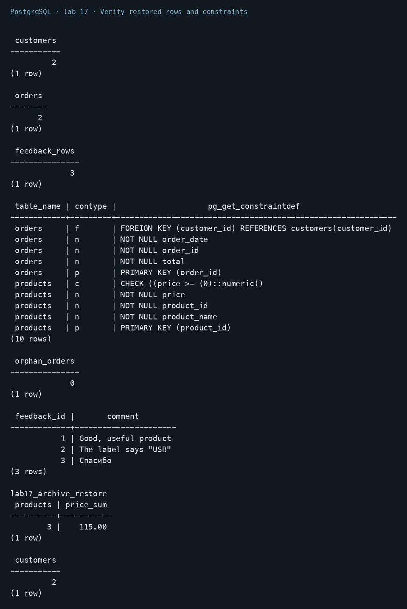

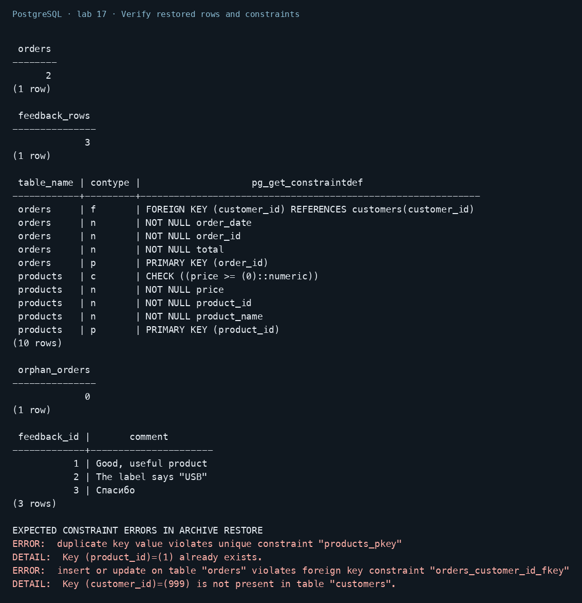

## 11. Back up the dedicated cluster and create a dated copy

```bash
pg_dumpall -h localhost -p 55417 -f /tmp/auca-lab17/cluster.sql
mkdir -p /tmp/auca-lab17/daily
backup_stamp=$(date +%Y%m%d_%H%M%S)
pg_dump -h localhost -p 55417 -Fc lab17_psql -f "/tmp/auca-lab17/daily/lab17_${backup_stamp}.dump"
find /tmp/auca-lab17/daily -name 'lab17_*.dump' -mtime +7 -print
find /tmp/auca-lab17/daily -name 'lab17_*.dump' -mtime +7 -delete
ls -lh /tmp/auca-lab17/cluster.sql /tmp/auca-lab17/daily
```

pg_dumpall captured only the isolated teaching cluster, including its roles and databases. The one-shot dated backup completed. The seven-day retention search found no old copies, so nothing was deleted. These commands could be scheduled for daily use; no system-wide schedule was installed.

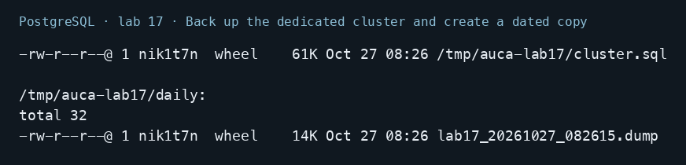

## 12. Create and verify a physical base backup

```bash
pg_basebackup -h localhost -p 55417 -D /tmp/auca-lab17/base -X stream -c fast
pg_verifybackup /tmp/auca-lab17/base
ls -lh /tmp/auca-lab17/base/backup_label /tmp/auca-lab17/base/backup_manifest
```

The base backup contains the whole isolated cluster. -X stream includes the necessary WAL, and -c fast requests an immediate checkpoint for this small exercise. pg_verifybackup verified the manifest and required WAL. Unlike pg_dump, this physical backup can be combined with archived WAL for recovery.

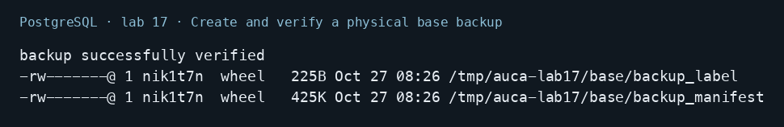

## 13. Archive changes around a named recovery point

```sql
INSERT INTO recovery_events VALUES (2, 'Keep this committed change');
SELECT pg_create_restore_point('before_accidental_delete');
DELETE FROM products WHERE product_id = 2;
INSERT INTO recovery_events VALUES (3, 'After the recovery target');
SELECT * FROM products ORDER BY product_id;
SELECT * FROM recovery_events ORDER BY event_id;
SELECT pg_switch_wal();
SELECT archived_count, last_archived_wal, failed_count FROM pg_stat_archiver;
```

After the base backup, event 2 was committed and a named restore point was recorded. The later deletion removed Mouse and event 3 was added. WAL archiving retained the history needed to recover the earlier state. pg_switch_wal is called with SELECT.

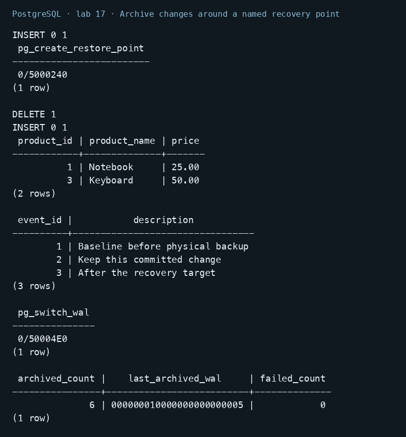

## 14. Recover the base backup to the named point

```bash
cp -R /tmp/auca-lab17/base /tmp/auca-lab17/recovered
cat >> /tmp/auca-lab17/recovered/postgresql.auto.conf <<'CONF'
port = 55420
archive_mode = off
restore_command = 'cp /tmp/auca-lab17/archive/%f %p'
recovery_target_name = 'before_accidental_delete'
recovery_target_action = 'promote'
CONF
touch /tmp/auca-lab17/recovered/recovery.signal
pg_ctl -D /tmp/auca-lab17/recovered -l /tmp/auca-lab17/recovered.log start
psql -h localhost -p 55420 lab17_psql -c 'SELECT pg_is_in_recovery(); SELECT * FROM products ORDER BY product_id; SELECT * FROM recovery_events ORDER BY event_id;'
```

Recovery replayed WAL through the named point and promoted the recovered cluster. Mouse is present again, event 2 is retained, and event 3 is absent. Recovery settings belong in PostgreSQL configuration; recovery.signal is an empty marker. A time or transaction-ID target can be used instead of a named target, but only the named-target recovery was run here.

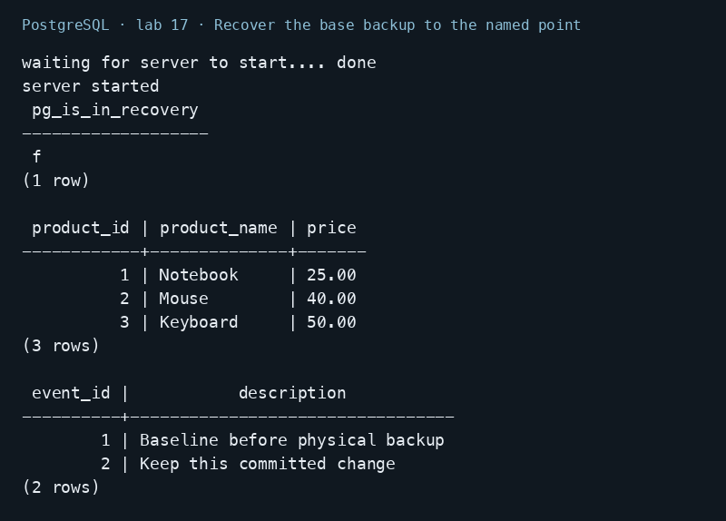

## 15. Compare the source with the recovered state

```sql
-- Source connection: psql -h localhost -p 55417 lab17_psql
SELECT * FROM products ORDER BY product_id;
SELECT * FROM recovery_events ORDER BY event_id;
-- Recovered connection: psql -h localhost -p 55420 lab17_psql
SELECT * FROM products ORDER BY product_id;
SELECT * FROM recovery_events ORDER BY event_id;
```

The source still has two products and three events. The recovered cluster has three products and only events 1 and 2. This proves that recovery replayed a post-backup change while excluding later changes, rather than merely restoring the original base copy.

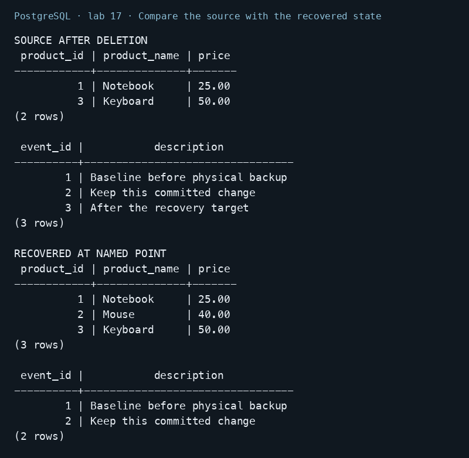

## 16. Migrate with dump and restore

```bash
pg_dump -h localhost -p 55417 -Fc lab17_psql -f /tmp/auca-lab17/migration.dump
createdb -h localhost -p 55417 lab17_migrated
pg_restore -h localhost -p 55417 -d lab17_migrated /tmp/auca-lab17/migration.dump
psql -h localhost -p 55417 lab17_migrated -c 'SELECT COUNT(*) AS products, SUM(price) AS price_sum FROM products; SELECT * FROM recovery_events ORDER BY event_id;'
```

The destination database reflects the source at migration time: two products totaling 75 and all three recovery events. This differs intentionally from the earlier backup and the point-in-time recovered database.

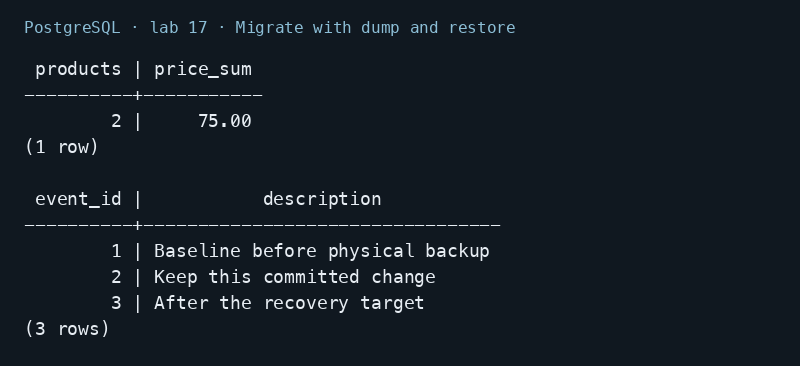

## 17. Start a separate logical-replication subscriber

```bash
initdb -D /tmp/auca-lab17/subscriber -A trust
cat >> /tmp/auca-lab17/subscriber/postgresql.conf <<'CONF'
listen_addresses = '127.0.0.1'
port = 55418
unix_socket_directories = '/tmp/auca-lab17'
shared_buffers = '16MB'
max_connections = 20
CONF
pg_ctl -D /tmp/auca-lab17/subscriber -l /tmp/auca-lab17/subscriber.log start
createdb -h localhost -p 55418 lab17_subscriber
```

Logical replication uses a second real cluster. The subscriber schema must exist before synchronization because logical replication does not copy CREATE TABLE definitions.

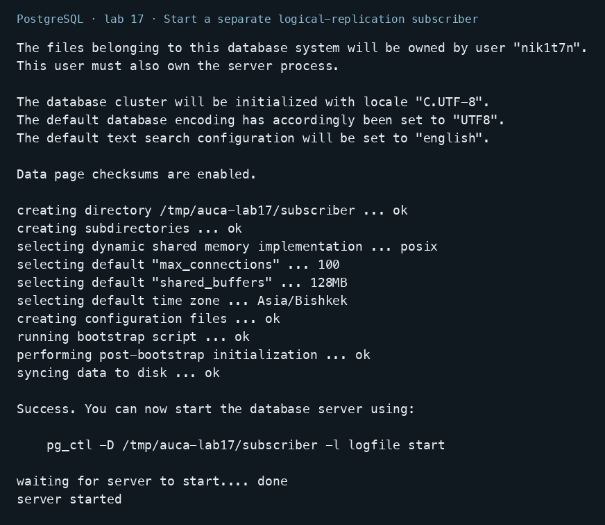

## 18. Replicate initial rows and later changes

```sql
-- Publisher: port 55417, lab17_psql
CREATE TABLE migration_customers (customer_id INTEGER PRIMARY KEY, name TEXT NOT NULL);
INSERT INTO migration_customers VALUES (1, 'Alice'), (2, 'Bob');
CREATE PUBLICATION migration_pub FOR TABLE migration_customers;
-- Subscriber: port 55418, lab17_subscriber
CREATE TABLE migration_customers (customer_id INTEGER PRIMARY KEY, name TEXT NOT NULL);
CREATE SUBSCRIPTION migration_sub
CONNECTION 'host=127.0.0.1 port=55417 dbname=lab17_psql user=nik1t7n'
PUBLICATION migration_pub;
SELECT * FROM migration_customers ORDER BY customer_id;
-- Publisher
UPDATE migration_customers SET name = 'Alice Updated' WHERE customer_id = 1;
INSERT INTO migration_customers VALUES (3, 'Carol');
DELETE FROM migration_customers WHERE customer_id = 2;
-- Subscriber, after synchronization
SELECT * FROM migration_customers ORDER BY customer_id;
SELECT subname, received_lsn, latest_end_lsn FROM pg_stat_subscription;
```

The subscriber initially received Alice and Bob. It then received the UPDATE, INSERT, and DELETE and contained only Alice Updated and Carol. The subscription statistics show received WAL positions. This exercises actual asynchronous logical replication between clusters.

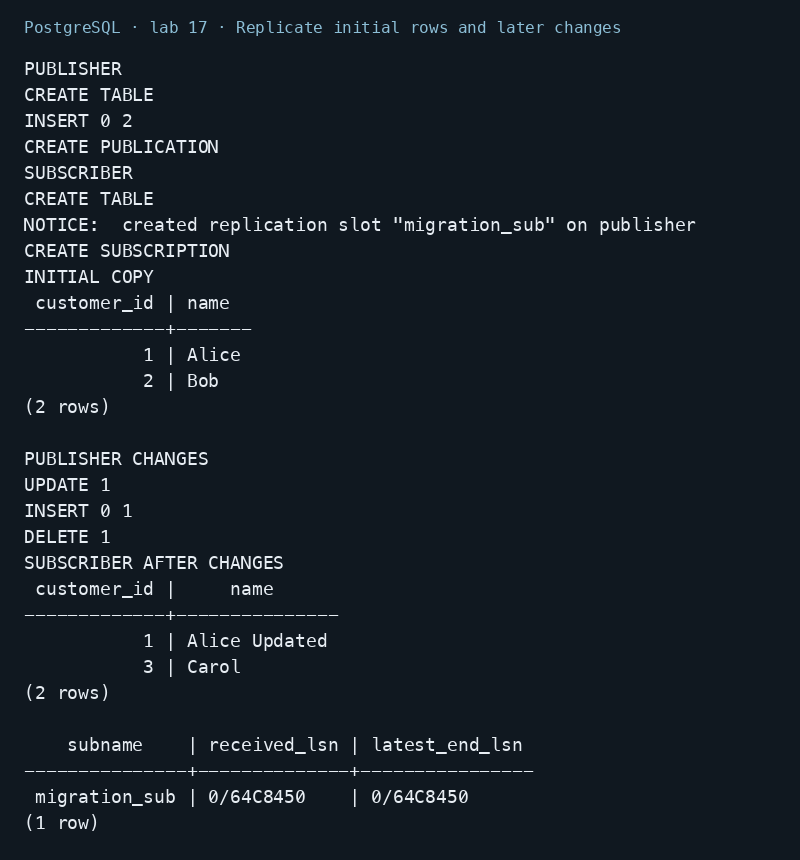

## 19. Start a physical streaming standby

```bash
pg_basebackup -h localhost -p 55417 -D /tmp/auca-lab17/standby -R -X stream -c fast
cat >> /tmp/auca-lab17/standby/postgresql.auto.conf <<'CONF'
port = 55419
archive_mode = off
CONF
pg_ctl -D /tmp/auca-lab17/standby -l /tmp/auca-lab17/standby.log start
psql -h localhost -p 55419 lab17_psql -c 'SELECT pg_is_in_recovery(); SELECT * FROM migration_customers ORDER BY customer_id;'
```

-R writes the standby connection configuration and standby.signal. The standby uses its own port and remains in recovery mode. Physical replication copies the entire cluster, unlike the publication that selected one table. This setup is asynchronous and does not imply zero downtime or zero data loss.

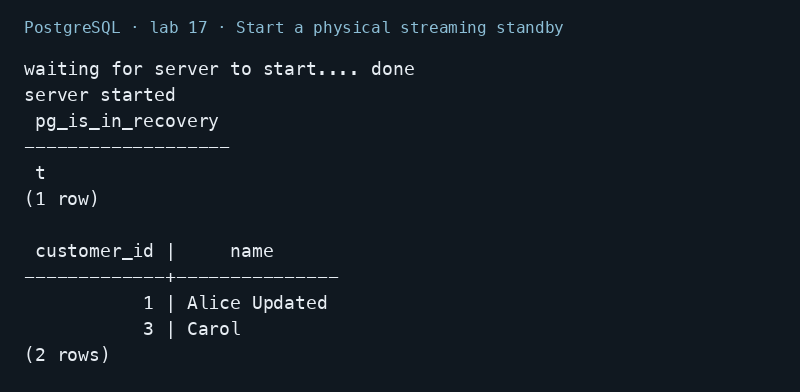

## 20. Observe streamed changes and read-only behavior

```sql
-- Primary: port 55417
INSERT INTO migration_customers VALUES (4, 'David');
-- Standby: port 55419, after replay catches up
SELECT * FROM migration_customers ORDER BY customer_id;
SELECT status, sender_host, sender_port FROM pg_stat_wal_receiver;
INSERT INTO migration_customers VALUES (99, 'Forbidden write');
```

David arrived on the standby through streaming replication. pg_stat_wal_receiver reported streaming from port 55417. A direct insert on the standby was rejected because recovery connections are read-only.

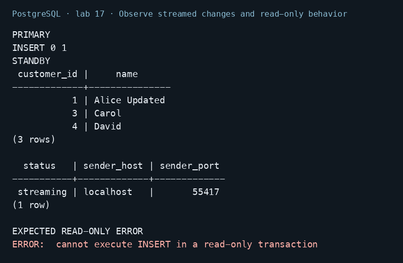

## 21. Extract transform and merge customer rows

```sql
CREATE TABLE staging_customers AS SELECT * FROM customers WHERE false;
CREATE TABLE target_customers (LIKE customers INCLUDING ALL);
INSERT INTO target_customers VALUES (1, 'Old Alice', 'old@example.com');
COPY (SELECT * FROM customers ORDER BY customer_id LIMIT 10000 OFFSET 0)
TO '/Users/nik1t7n/Projects/database-labs/lab-17/data/customers_batch.csv' WITH CSV HEADER;
COPY staging_customers FROM '/Users/nik1t7n/Projects/database-labs/lab-17/data/customers_batch.csv' WITH CSV HEADER;
UPDATE staging_customers SET name = UPPER(name);
INSERT INTO target_customers SELECT * FROM staging_customers
ON CONFLICT (customer_id) DO UPDATE
SET name = EXCLUDED.name, email = EXCLUDED.email;
SELECT * FROM staging_customers ORDER BY customer_id;
SELECT * FROM target_customers ORDER BY customer_id;
```

The extraction writes a deterministic ordered batch. Loading fills the staging table, the transformation uppercases names, and the merge updates Alice and inserts Bob. The source customers remain unchanged. Large changing datasets need a stable snapshot and appropriate batching rather than blindly increasing OFFSET.

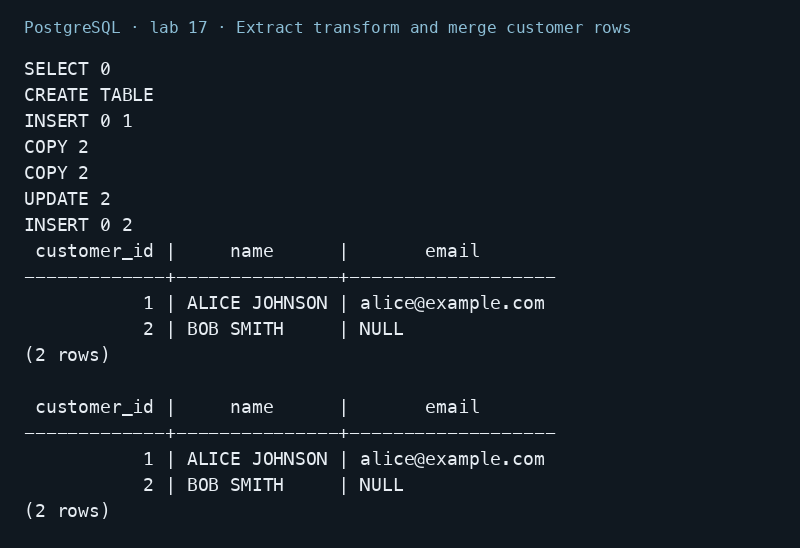

## 22. Prepare a partition for separate migration

```sql
CREATE TABLE large_table (
    record_id INTEGER NOT NULL, recorded_on DATE NOT NULL, value TEXT,
    PRIMARY KEY (record_id, recorded_on)
) PARTITION BY RANGE (recorded_on);
CREATE TABLE large_table_2023 PARTITION OF large_table
FOR VALUES FROM ('2023-01-01') TO ('2024-01-01');
CREATE TABLE large_table_2024 PARTITION OF large_table
FOR VALUES FROM ('2024-01-01') TO ('2025-01-01');
INSERT INTO large_table VALUES
    (1, '2023-03-01', 'First 2023 row'), (2, '2023-10-01', 'Second 2023 row'),
    (3, '2024-01-15', '2024 row');
SELECT tableoid::regclass AS partition_name, * FROM large_table ORDER BY record_id;
```

The parent routes two rows into the 2023 partition and one into 2024. These are small teaching rows used to demonstrate the migration mechanism, not a large-data performance benchmark.

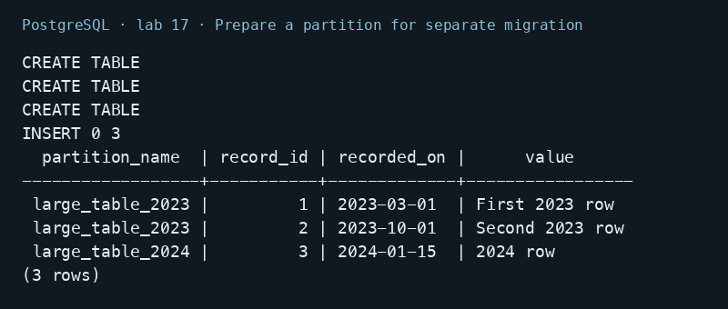

## 23. Move one partition with its parent schema

```bash
pg_dump -h localhost -p 55417 -t large_table -t large_table_2023 lab17_psql -f /tmp/auca-lab17/partition.sql
createdb -h localhost -p 55417 lab17_partition_target
psql -h localhost -p 55417 lab17_partition_target -f /tmp/auca-lab17/partition.sql
psql -h localhost -p 55417 lab17_partition_target -c 'SELECT * FROM large_table_2023 ORDER BY record_id;'
psql -h localhost -p 55417 lab17_psql -c "SELECT pid, application_name, state FROM pg_stat_activity WHERE application_name = 'pg_dump';"
```

The dump includes the partitioned parent schema and the selected 2023 partition, so its attachment and index dependencies restore correctly. Only the two 2023 rows migrate; the 2024 partition is not selected. The monitoring query returned no active pg_dump because this small export had already finished.

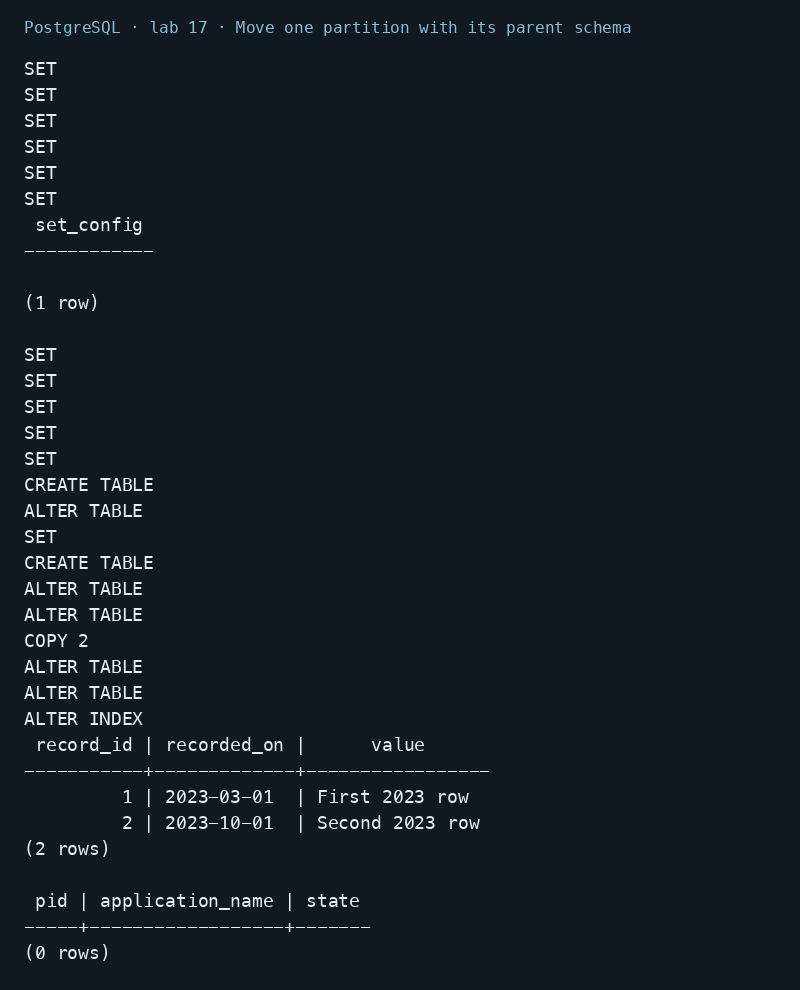

## 24. Clean a separate copy of the WAL archive

```bash
cp -R /tmp/auca-lab17/archive /tmp/auca-lab17/archive-cleanup
wal_file=$(find /tmp/auca-lab17/archive-cleanup -name '00000001000000*' -type f | sort | tail -1)
pg_archivecleanup -d /tmp/auca-lab17/archive-cleanup "$(basename "$wal_file")"
ls /tmp/auca-lab17/archive-cleanup
```

pg_archivecleanup removed older WAL files from a separate copy of the real archive; -d prints its actions. The archive used for recovery is preserved. In normal operation the cutoff must follow the oldest retained backup or recovery requirement, rather than simply choosing the newest segment.

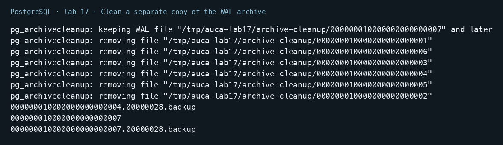

## 25. Close the temporary replication and recovery instances

```text
-- Subscriber: port 55418
DROP SUBSCRIPTION migration_sub;
-- Publisher: port 55417
DROP PUBLICATION migration_pub;
-- Terminal
pg_ctl -D /tmp/auca-lab17/standby stop
pg_ctl -D /tmp/auca-lab17/subscriber stop
pg_ctl -D /tmp/auca-lab17/recovered stop
pg_ctl -D /tmp/auca-lab17/primary stop
pg_isready
```

The subscription and publication were removed, then the four temporary servers were stopped. Their files remain under /tmp/auca-lab17 for inspection. The existing PostgreSQL service on port 5432 still accepts connections. CSV files and small logical backups are included in this lab folder; physical data directories and WAL are kept outside Git.

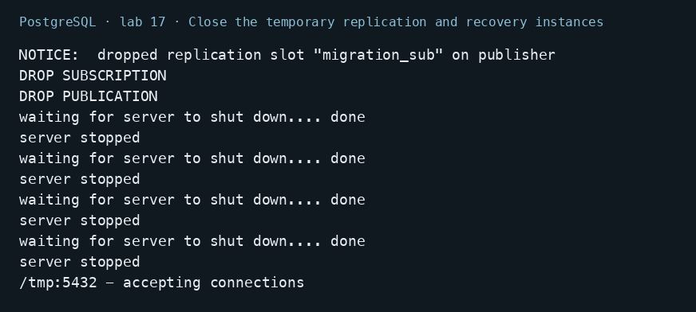

## Conclusion

CSV round trips preserved values, quoting, and UTF-8 text. Complete logical restores preserved rows and constraints. A physical base backup plus WAL recovered a named point between two committed changes. Dump/restore, logical replication, physical streaming, staging-table ETL, and partition transfer were executed against dedicated local databases.

References: [COPY](https://www.postgresql.org/docs/18/sql-copy.html), [pg_dump](https://www.postgresql.org/docs/18/app-pgdump.html), [PITR](https://www.postgresql.org/docs/18/continuous-archiving.html), [logical subscriptions](https://www.postgresql.org/docs/18/logical-replication-subscription.html), and [streaming replication](https://www.postgresql.org/docs/18/warm-standby.html).
